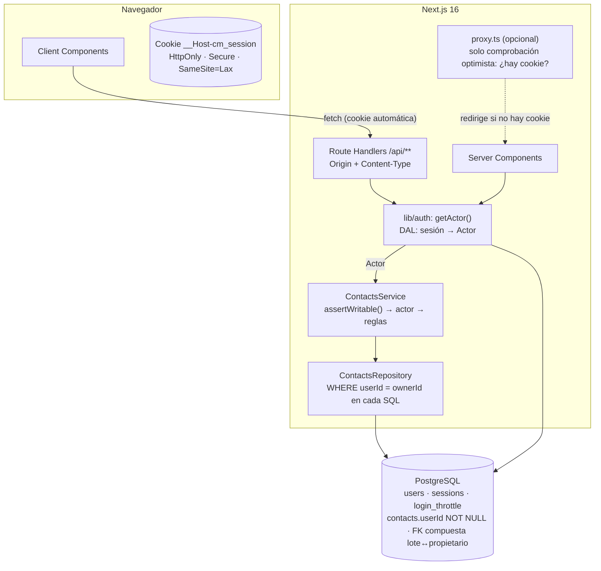

# Contact Manager — M3.5: Arquitectura de autenticación y multiusuario

> Fecha: 2026-11-06
> Estado: **diseño aprobado** (2026-11-06), salvo D-AUTH-12 (aprobada con condiciones) y D-AUTH-13 (pendiente); ver [`decisions.md`](decisions.md). Pendiente de autorizar la implementación (M4). Diseño exclusivamente; no hay código, esquema ni migraciones.
> Base: `main` en `2b90e06` (M3 integrado, PR #28).
> Documentos relacionados: [`data-model.md`](data-model.md), [`security.md`](security.md), [`api-contracts.md`](api-contracts.md), [`frontend-contracts.md`](frontend-contracts.md), [`decisions.md`](decisions.md).

---

## 1. Punto de partida (verificado en el repositorio)

| Elemento | Estado real en `2b90e06` |
|---|---|
| Usuarios, sesiones, autenticación | No existen. Ni en código, ni en `schema.prisma`, ni en dependencias. |
| `ContactsService` (`src/lib/contacts/service.ts`) | `list`, `get`, `getDetail`, `create`, `replace`, `patch`, `setFavorite`, `deleteOne`, `deleteAll`, `restore`, `purge`. Ninguno recibe identidad: operan sobre **un dataset único**. |
| `ContactsRepository` (`repository.ts`) | 10 métodos; 17 sentencias SQL directas (`$queryRaw`/`$executeRaw`) con el mutex estructural (R1), `SHARE` en `deleteAll` (R2) y purga con `try` (R4). Ninguna filtra por propietario. |
| Modo de acceso | `CONTACTS_ACCESS_MODE` (`src/lib/env.ts`): `read-only` / `read-write`, por defecto `read-only` en producción. El servicio rechaza toda escritura con `READ_ONLY` antes de validar. |
| Modelo | `contacts`, `undo_batches`, `system_state`. Ninguna tabla tiene propietario. FK `contacts.deletedBatchId → undo_batches.id` con `ON DELETE CASCADE`. |
| Migraciones | `0001`–`0004` (`0004_contactable_check`). |
| API y páginas | No hay Route Handlers (`src/app/api` no existe). Las páginas no usan el servicio. |
| Validación | `validateContactInput`/`validateContactPatch` devuelven solo las claves conocidas: un `userId` en el cuerpo se descarta ya hoy (prueba «descarta claves desconocidas y campos del servidor»). |
| Despliegue | Vercel + Neon con rol de solo lectura (`docs/despliegue-demo.md`). |

Consecuencia: añadir usuarios no es solo «poner login». Cambia **todas** las consultas del repositorio y la firma de **todos** los casos de uso. Este documento define cómo, para que M4 y M5 lo implementen sin improvisar.

---

## 2. Tres conceptos que no deben mezclarse

| Concepto | Pregunta que responde | Dónde se decide | Fuente de verdad |
|---|---|---|---|
| **Autenticación** | ¿Quién eres? | `lib/auth` (sesión en cookie → fila `sessions`) | PostgreSQL |
| **Autorización** | ¿Puedes hacer esto sobre este recurso? | Servicio (actor + reglas) **y** repositorio (predicado de propietario en cada SQL) | Código + restricciones de la base |
| **Modo de despliegue** | ¿Este despliegue admite escrituras? | `CONTACTS_ACCESS_MODE` (servidor) + rol de base de datos | Configuración del servidor |

El modo de despliegue es un **interruptor global** que se evalúa **primero** y que ninguna identidad puede saltarse: un usuario autenticado en un despliegue `read-only` no puede escribir. Los permisos individuales nunca amplían lo que el modo de despliegue prohíbe.

---

## 3. Arquitectura aprobada



### 3.1 Autenticación (D-AUTH-01 y D-AUTH-02, aprobadas)

**Sesiones propias en base de datos con cookie opaca** (no JWT, no Auth.js) y contraseñas con **Argon2id**. Argon2id se implementa con `@node-rs/argon2` (D-AUTH-02, aprobada). Comparación y justificación completas en [`decisions.md`](decisions.md) (D-AUTH-01, D-AUTH-02) y controles en [`security.md`](security.md) §2.

Resumen del flujo:

1. **Registro / alta**: email normalizado + contraseña → hash Argon2id asíncrono → fila en `users`.
2. **Login**: limitador por email e IP → verificación Argon2id en tiempo constante (también con email inexistente) → token aleatorio de 32 bytes → se guarda **solo su SHA-256** en `sessions` → cookie con el token.
3. **Cada petición**: `getActor()` lee la cookie, calcula el hash, busca la sesión vigente de un usuario `ACTIVE` y devuelve un `Actor`. La expiración la decide el reloj de PostgreSQL, como en M3.
4. **Renovación**: deslizante; si quedan menos de 15 días, se extiende a 30 (una escritura como máximo por petición).
5. **Logout**: borra la fila y la cookie. Desactivar la cuenta o cambiar la contraseña borra todas las sesiones del usuario.

### 3.2 El actor: identidad explícita en cada caso de uso

```ts
// lib/auth/actor.ts (M4)
export type Actor =
  | { kind: "user"; userId: string }   // usuario autenticado y ACTIVE
  | { kind: "demo" };                  // visitante anónimo del despliegue demo
```

- **Se pasa explícitamente** como primer parámetro a cada caso de uso: `service.list(actor, filters)`, `service.patch(actor, rawId, body)`, etc.
- **No** se usa un contexto implícito (`AsyncLocalStorage`) en el MVP: con un parámetro obligatorio, TypeScript impide llamar a un caso de uso sin identidad, y las pruebas lo construyen sin magia. Justificación en D-AUTH-05.
- El `Actor` solo lo construye `getActor()` a partir de la sesión del servidor. **Nunca** a partir de datos de la petición: los validadores ya descartan `userId` del cuerpo y ningún endpoint lo acepta en ruta, query ni cabecera.

### 3.3 Propietario efectivo

```ts
// El servicio traduce el actor a un propietario de datos.
function ownerOf(actor: Actor): string {
  return actor.kind === "user" ? actor.userId : DEMO_OWNER_ID;
}
```

- `DEMO_OWNER_ID` es un UUID fijo (constante + fila en `users` creada por la migración, ver [`data-model.md`](data-model.md) §5). Ese usuario **no puede iniciar sesión** (`passwordHash` nulo).
- El repositorio recibe siempre `ownerId: string` como **primer argumento obligatorio** y lo aplica en **cada** sentencia. No hay métodos «sin propietario» salvo `purge`, que es mantenimiento del sistema (ver §4).

### 3.4 Orden de las comprobaciones en el servicio

```text
1. assertWritable()        → READ_ONLY si CONTACTS_ACCESS_MODE=read-only (M3, sin cambios)
2. requireWriter(actor)    → READ_ONLY si actor.kind = "demo" (escrituras)
3. requireId(rawId)        → INVALID_ID
4. validación del cuerpo   → VALIDATION_ERROR
5. repositorio(ownerId, …) → NOT_FOUND si el recurso no existe o es de otro usuario
```

Los pasos 1 y 2 van antes de cualquier validación: un visitante no obtiene información del formato de los datos ni de la existencia de recursos.

---

## 4. Impacto en cada operación de M3

| Operación | Cambio en el servicio | Cambio en el SQL / repositorio |
|---|---|---|
| `list` | `list(actor, filters)` | `WHERE "userId" = $owner AND "deletedAt" IS NULL` |
| `get` / `getDetail` | Recurso ajeno → `NOT_FOUND` (nunca `FORBIDDEN`) | `WHERE "id" = $id AND "userId" = $owner` |
| Anterior/Siguiente | Sin cambios de lógica: se calcula sobre la lista **del propietario** | Consecuencia de `list` |
| `create` | `userId` = `ownerOf(actor)`; nunca del cuerpo | `INSERT … ("userId", …)` |
| `replace` / `patch` | `NOT_FOUND` si no es del actor | `UPDATE … WHERE "id" AND "userId" AND "deletedAt" IS NULL`; el `FOR UPDATE` del PATCH también filtra por `userId` |
| `setFavorite` | Igual | Igual |
| `deleteOne` | El lote se crea con el `userId` del actor | `INSERT undo_batches (…, "userId")` + `UPDATE contacts … WHERE "id" AND "userId"`; 0 filas → rollback → `NOT_FOUND` |
| `deleteAll` | Solo los contactos del actor | `SELECT … WHERE "userId" = $owner AND "deletedAt" IS NULL FOR UPDATE`; lote con `userId`. Se mantienen mutex y `SHARE` |
| `restore` | Lote ajeno → `UNDO_NOT_FOUND` (indistinguible de inexistente) | Claim `WHERE "id" AND "userId" AND …`; la clasificación del claim fallido también filtra por `userId`; el `UPDATE contacts` filtra por `deletedBatchId` **y** `userId` |
| `purge` | Mantenimiento global del sistema; no depende del actor | Sin filtro de propietario (borra lotes caducados de todos). Solo en despliegues `read-write` |

### 4.1 Mutex y bloqueos

- Se **mantiene** el mutex estructural global (`WRITE_MUTEX_KEY`) y el `SHARE` de `deleteAll`: su corrección está demostrada por las pruebas de M3 (C4, serialización, doble restauración, `lock_timeout`).
- Coste: un `deleteAll` de un usuario bloquea unos milisegundos las escrituras de los demás. Aceptable en el MVP.
- Evolución posible (no MVP): mutex por usuario con `pg_advisory_xact_lock(WRITE_MUTEX_KEY, hashtext(userId))` y bloqueos de fila en lugar de `SHARE`. Requiere rehacer C4 por usuario. Registrado como decisión pendiente D-AUTH-11.

### 4.2 Garantías en la capa de persistencia

La propiedad no se confía solo al código del servicio:

1. `contacts."userId"` y `undo_batches."userId"` son `NOT NULL` con FK a `users`.
2. **FK compuesta** `contacts("deletedBatchId", "userId") → undo_batches("id", "userId")`: PostgreSQL impide que un contacto quede vinculado al lote de otro usuario, aunque el código tuviera un error.
3. Cada método del repositorio exige `ownerId`; las pruebas de M4 incluyen una batería de aislamiento con dos usuarios para **cada** operación (ver [`security.md`](security.md) §3).
4. Row Level Security de PostgreSQL queda como endurecimiento posterior (D-AUTH-10): es la defensa más fuerte, pero obliga a fijar `app.user_id` en cada transacción y complica Prisma y las pruebas.

---

## 5. Convivencia con el modo demo de M3

### 5.1 Modalidades evaluadas

| Modalidad | Qué ve el visitante | Escrituras | Viabilidad |
|---|---|---|---|
| A. Demo pública de solo lectura, sin registro | Contactos del propietario demo | Ninguna | **Aprobada** (D-AUTH-06) para el despliegue público actual |
| B. Usuarios registrados con sus contactos | Solo los suyos | Sobre los suyos | **Aprobada** (D-AUTH-06) en un despliegue `read-write` aparte |
| C. Cuenta demo compartida con login | Los de la cuenta compartida | Cualquiera podría vaciarla o llenarla | **Descartada**: datos compartidos y vandalizables; credenciales públicas |
| D. Acceso de demostración independiente (por ejemplo, sesión demo efímera por visitante) | Copia propia temporal | Sobre la copia | **Descartada para el MVP**: requiere aprovisionar y limpiar datos por visitante |

### 5.2 Topología aprobada (D-AUTH-06): un código, dos despliegues

| | Despliegue **demo** (el actual) | Despliegue **app** (nuevo, multiusuario) |
|---|---|---|
| `CONTACTS_ACCESS_MODE` | `read-only` | `read-write` |
| Rol de base de datos | Solo lectura (capa 2 de M3, intacta) | Lectura y escritura |
| Proyecto Vercel | El actual | Uno nuevo (variables y Preview propios) |
| Base | Proyecto Neon demo (datos semilla) | **Otro proyecto de Neon** (host y credenciales distintos) |
| Visitante anónimo | `Actor { kind: "demo" }`: lee los contactos de `DEMO_OWNER_ID` | `401 UNAUTHENTICATED` en la API; redirección a `/login` en páginas |
| Login / registro | No disponibles (`READ_ONLY`): una sesión exige escribir | Disponibles según la política de registro (D-AUTH-07) |
| Usuario autenticado | No aplica | `Actor { kind: "user" }`: CRUD sobre sus contactos |

Por qué así:

- **No debilita M3**: el despliegue demo conserva las dos capas (modo global + rol de solo lectura). La autenticación no necesita escribir allí porque no hay login.
- **No necesita una variable nueva** para el MVP: el modo `read-only` implica «solo demo anónima»; el modo `read-write` implica «autenticación obligatoria».
- **Datos separados**: los datos semilla de la demo nunca conviven con datos reales de usuarios.

La alternativa de **un único despliegue** con demo anónima y usuarios a la vez obliga a un rol de base de datos con escritura; la protección de los datos demo pasaría a depender de la autorización por propietario y de un trigger que haga inmutables las filas de `DEMO_OWNER_ID`. Es viable pero más compleja; quedó descartada al aprobarse D-AUTH-06.

### 5.3 Separación de los despliegues (D-AUTH-06)

**Bases independientes.** La demo y la app usan **proyectos de Neon distintos**, no solo bases o esquemas distintos del mismo servidor: endpoint, roles y credenciales diferentes. Así no existe ningún rol que pueda conectarse a las dos, y un error de configuración no puede dirigir la demo a los datos de la app.

**Variables y credenciales por proyecto de Vercel.**

| Variable | Proyecto demo | Proyecto app |
|---|---|---|
| `DATABASE_URL` | Neon demo, rol `contact_manager_demo_ro` | Neon app, rol de ejecución `contact_manager_app` |
| `CONTACTS_ACCESS_MODE` | `read-only` | `read-write`, **explícito** |
| Variables de autenticación futuras (por ejemplo `AUTH_REGISTRATION`, D-AUTH-07) | No se definen | Según se apruebe |
| Cadena del rol propietario de cualquier base | **Nunca** | **Nunca** |
| `TEST_DATABASE_URL` | Nunca | Nunca |

Los Preview de cada proyecto usan las variables de Preview de **su** proyecto:

- Demo: la misma base demo con el rol de solo lectura; no hay riesgo, porque solo puede leer.
- App: una base o rama de Neon de Preview, nunca la de producción, y con Deployment Protection.

**Roles de base de datos.**

| Rol | Base | Permisos |
|---|---|---|
| Propietario de la demo | Neon demo | Dueño de las tablas. Solo para migraciones y seed, desde una máquina de confianza |
| `contact_manager_demo_ro` | Neon demo | `CONNECT`, `USAGE` sobre `public` y **`SELECT` solo sobre `contacts`**, con `default_transaction_read_only = on`. Sin acceso a `users`, `sessions`, `login_throttle`, `undo_batches`, `system_state` ni `_prisma_migrations` |
| Propietario de la app | Neon app | Dueño de las tablas. Solo para migraciones |
| `contact_manager_app` | Neon app | `SELECT`, `INSERT`, `UPDATE`, `DELETE` sobre las tablas de la aplicación. No es dueño de las tablas ni puede crear objetos. `LOCK TABLE … IN SHARE MODE` (`deleteAll`) solo exige `UPDATE`, `DELETE` o `TRUNCATE` sobre la tabla, ya incluidos |

**Cómo se impide que la demo lea las tablas de autenticación.** Tres barreras independientes:

1. Sus credenciales solo abren la base demo, que no contiene usuarios reales: en ella solo existe la fila del propietario demo.
2. Su rol solo tiene `SELECT` sobre `contacts`. Hay que sustituir el `GRANT SELECT ON ALL TABLES` y el `ALTER DEFAULT PRIVILEGES` del procedimiento actual (`docs/despliegue-demo.md` §5.1) por concesiones explícitas por tabla (D-AUTH-12).
3. En modo `read-only`, el código no consulta `users`, `sessions` ni `login_throttle`: `getActor()` devuelve `{ kind: "demo" }` sin leer cookies, y el propietario se filtra con una constante.

**Cómo se evita que la app dependa de la configuración de la demo.**

- Cada proyecto de Vercel tiene su propio conjunto de variables; no hay variables compartidas entre proyectos.
- La app fija `CONTACTS_ACCESS_MODE=read-write` de forma explícita. Si faltara, el valor por defecto en producción es `read-only` (fail-closed): la app quedaría sin login, pero **sin abrir nada**.
- `GET /api/auth/session` informa de `accessMode`, así que una configuración equivocada se detecta en la prueba de humo de cada despliegue.
- El mismo código funciona en los dos proyectos; solo cambian las variables.

**Migraciones.**

- Los mismos archivos (`0001`…`0005` y siguientes) se aplican a las dos bases, cada una con **su** rol propietario, desde una máquina de confianza (o un pipeline de CI en M8). Nunca desde el build de Vercel, que solo ejecuta `prisma generate`.
- Orden en cada cambio de esquema:
  1. respaldo (rama de Neon y/o `pg_dump`);
  2. comprobaciones previas;
  3. `pnpm db:deploy` con la cadena del propietario;
  4. comprobaciones posteriores;
  5. permisos de los roles de ejecución;
  6. despliegue del código nuevo.
- La migración va **antes** que el código: `0005` es compatible con el código de M3 en modo lectura (solo añade columnas y tablas), y el código de M4 necesita la columna `userId`.
- Procedimiento detallado para `0005` en [`data-model.md`](data-model.md) §7.

### 5.4 Matriz de operaciones

| Operación | Demo anónimo (despliegue demo) | Anónimo (despliegue app) | Usuario autenticado (despliegue app) | Cualquiera en `read-only` |
|---|---|---|---|---|
| Listar / detalle / búsqueda | Sí (datos demo) | `401` | Sí (propios) | Según actor |
| Crear / editar / favorito | `READ_ONLY` | `401` | Sí (propios) | `READ_ONLY` |
| Borrar uno / todos | `READ_ONLY` | `401` | Sí (propios) | `READ_ONLY` |
| Restaurar | `READ_ONLY` | `401` | Sí (lotes propios) | `READ_ONLY` |
| Login / registro | `READ_ONLY` | Sí | No aplica | `READ_ONLY` |
| Logout | `204` (idempotente) | `204` | `204` | `204` (no escribe si no hay sesión válida) |

---

## 6. Módulos nuevos previstos (M4)

| Módulo | Responsabilidad | Restricciones |
|---|---|---|
| `lib/auth/password.ts` | Hash y verificación Argon2id con `@node-rs/argon2` (D-AUTH-02), API asíncrona, parámetros centralizados y máximo 2 hashes simultáneos por instancia | Solo servidor |
| `lib/auth/tokens.ts` | Token aleatorio (`crypto.randomBytes(32)`), SHA-256, comparación | Solo servidor |
| `lib/auth/repository.ts` | `users`, `sessions`, `login_throttle` | Reloj de PostgreSQL |
| `lib/auth/service.ts` | Registro, login, logout, sesión actual, desactivación | Reutiliza la validación de email de M2 |
| `lib/auth/session.ts` (DAL) | `getActor()`, cookie, renovación | Única puerta para obtener un `Actor` |
| `lib/http/origin.ts` | Verificación de `Origin` en peticiones no `GET` | Ver [`security.md`](security.md) §5 |
| `proxy.ts` (opcional, M5) | Redirección optimista si no hay cookie | Nunca consulta la base; nunca es la única defensa |

Next 16 renombró `middleware.ts` a `proxy.ts` y lo ejecuta en el runtime de Node (`node_modules/next/dist/docs/.../proxy.md`). Su propia guía de autenticación indica que `proxy` solo debe hacer comprobaciones optimistas y que las comprobaciones reales deben estar «lo más cerca posible de los datos» (Data Access Layer). Este diseño sigue esa pauta: la autorización real está en servicio y repositorio.

---

## 7. Qué no cambia

- Contratos de dominio de M2 (validación, búsqueda, selectores, `normalizeId`).
- Semántica de deshacer, purga, timestamps, mutex y códigos de error de M3. Se **añaden** códigos de autenticación (ver [`api-contracts.md`](api-contracts.md)).
- Las dos capas de solo lectura del despliegue demo.
- `docs/fase-3-arquitectura.md` §1 y V-8 siguen siendo válidos: este diseño es la respuesta a V-8 y se incorporará a la arquitectura tras su aprobación.
