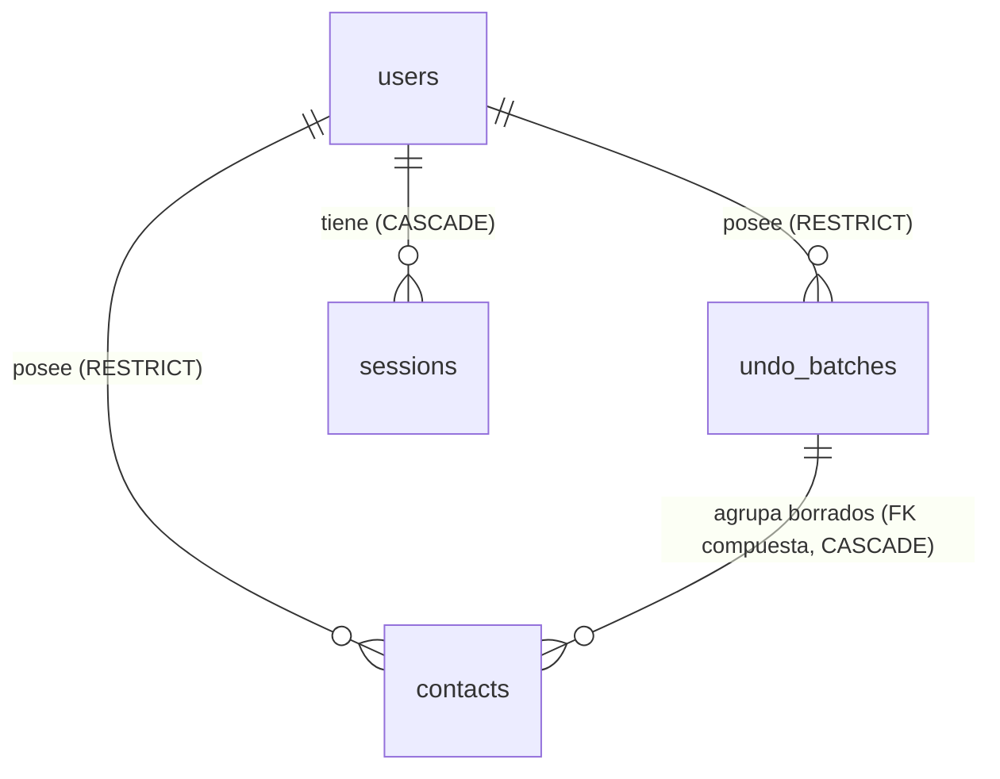

# Contact Manager — M3.5: Modelo de datos multiusuario y migración

> Estado: **diseño aprobado** (2026-11-06), salvo D-AUTH-12 (aprobada con condiciones) y D-AUTH-13 (pendiente); ver [`decisions.md`](decisions.md). Pendiente de autorizar la implementación (M4). Los fragmentos Prisma y SQL son de diseño: **no** se ha modificado `schema.prisma` ni creado migraciones.
> Base verificada: `prisma/schema.prisma` y migraciones `0001`–`0004` en `2b90e06`.

---

## 1. Principios

1. Solo se añaden campos con una función concreta en el MVP. Cada uno tiene su justificación en §2.
2. Los ids los genera el servicio con `crypto.randomUUID()` (D5); los timestamps, PostgreSQL (P2).
3. La propiedad se garantiza también con restricciones de la base, no solo con código.
4. Las migraciones de M3 (`0001`–`0004`) no se modifican: todo cambio entra en migraciones nuevas.

---

## 2. Entidades

### 2.1 `User` (`users`)

| Campo | Tipo | Restricciones | Justificación |
|---|---|---|---|
| `id` | `uuid` | PK | Identidad; generado por el servicio (D5) |
| `email` | `varchar(254)` | `UNIQUE`; `CHECK ("email" = lower(btrim("email")))` | Identificador de login. Se guarda normalizado (§3) |
| `name` | `varchar(80)` | `NOT NULL`, 1–80 tras `trim` (validación) | Mostrar «Hola, Ana» y en la cabecera. Mismos límites que `contacts.name` |
| `passwordHash` | `text` | Nullable | Cadena PHC de Argon2id. `NULL` = la cuenta **no puede iniciar sesión** (propietario demo, cuentas futuras por invitación) |
| `status` | enum `UserStatus` (`ACTIVE`, `DISABLED`) | `NOT NULL DEFAULT 'ACTIVE'` | Desactivar sin borrar datos (§6) |
| `createdAt` | `timestamptz(3)` | `DEFAULT now()` | Auditoría mínima |
| `updatedAt` | `timestamptz(3)` | `DEFAULT now()`; lo actualiza el SQL de escritura con `clock_timestamp()` | Saber cuándo cambió email, nombre, contraseña o estado |

Descartados para el MVP (sin uso todavía): `emailVerifiedAt`, `lastLoginAt`, `role`/`isAdmin`, `avatar`, `failedLoginCount` (el limitador vive en su propia tabla, §2.4). Se añadirán con la funcionalidad que los use.

### 2.2 `Session` (`sessions`)

Necesaria porque la estrategia elegida usa **sesiones en base de datos** (D-AUTH-01): permite revocar sesiones al instante (logout, desactivación, cambio de contraseña).

| Campo | Tipo | Restricciones | Justificación |
|---|---|---|---|
| `id` | `char(64)` | PK | **SHA-256 en hexadecimal del token** de la cookie. El token nunca se guarda: una copia de la base no permite suplantar sesiones |
| `userId` | `uuid` | FK → `users.id` `ON DELETE CASCADE` | Las sesiones no tienen sentido sin su usuario |
| `createdAt` | `timestamptz(3)` | `DEFAULT now()` | Caducidad absoluta (90 días, ver [`security.md`](security.md) §2.3) |
| `expiresAt` | `timestamptz(3)` | `NOT NULL`; `CHECK ("expiresAt" > "createdAt")` | Caducidad deslizante (30 días) |

Índices: `userId` (revocar todas las de un usuario) y `expiresAt` (purga de sesiones caducadas).
Descartados: `ipAddress`, `userAgent` (datos personales sin uso en el MVP; se añadirían con una pantalla de «dispositivos»).

### 2.3 Cambios en `Contact` y `UndoBatch`

| Tabla | Campo nuevo | Restricciones |
|---|---|---|
| `contacts` | `userId uuid` | `NOT NULL`; FK → `users.id` `ON DELETE RESTRICT` |
| `undo_batches` | `userId uuid` | `NOT NULL`; FK → `users.id` `ON DELETE RESTRICT`; `UNIQUE ("id", "userId")` |

**FK compuesta lote ↔ propietario.** La FK actual `contacts."deletedBatchId" → undo_batches."id"` (`ON DELETE CASCADE`) se sustituye por:

```sql
ALTER TABLE "contacts"
  ADD CONSTRAINT "contacts_deletedBatch_owner_fkey"
  FOREIGN KEY ("deletedBatchId", "userId")
  REFERENCES "undo_batches" ("id", "userId")
  ON DELETE CASCADE;
```

- Con `MATCH SIMPLE` (por defecto), un contacto activo (`deletedBatchId IS NULL`) no se comprueba.
- Un contacto borrado **solo** puede pertenecer a un lote de su mismo propietario. Un error en el código que mezclara propietarios falla en PostgreSQL.
- `ON DELETE CASCADE` conserva la semántica de purga de M3: borrar un lote elimina sus contactos borrados.
- `CHECK` de M1–M3 (`contacts_deleted_pair_check`, `undo_batches_count_check`, `undo_batches_window_check`, `contacts_timestamps_check`, `contacts_contactable_check`) se mantienen sin cambios.

Índices nuevos:

| Índice | Uso |
|---|---|
| `contacts ("userId", "deletedAt", "createdAt", "id")` | `list` del propietario en orden de creación (§10.3 y orden de M3) |
| `undo_batches ("userId")` | Restaurar y borrar en cascada por usuario |

Los índices de M1 (`deletedAt`, `createdAt`, `isFavorite`, `deletedBatchId`, `expiresAt`, `restoredAt`) se conservan; la purga sigue usando `expiresAt`/`restoredAt`. Revisar los que queden sin uso se deja para después de medir (no MVP).

### 2.4 `LoginThrottle` (`login_throttle`)

Limitador de intentos de login persistente. Hace falta una tabla porque en Vercel cada instancia tiene su propia memoria: un contador en memoria no limita nada.

| Campo | Tipo | Restricciones | Justificación |
|---|---|---|---|
| `key` | `char(64)` | PK | SHA-256 de `email:<normalizado>` o `ip:<dirección>`. Se guarda el hash para no almacenar emails ni IP en claro |
| `failures` | `integer` | `NOT NULL DEFAULT 0`, `CHECK (failures >= 0)` | Fallos dentro de la ventana |
| `windowStartedAt` | `timestamptz(3)` | `NOT NULL` | Inicio de la ventana (reloj de PostgreSQL) |
| `blockedUntil` | `timestamptz(3)` | Nullable | Bloqueo temporal activo |

Umbrales en [`security.md`](security.md) §2.4. Las filas antiguas se purgan junto con las sesiones caducadas.

### 2.5 `SystemState`

Sin cambios: sigue siendo global (marca de seed `seed:v1`, M7).

### 2.6 Cardinalidades



- Un usuario: 0..n contactos, 0..n lotes, 0..n sesiones.
- Un contacto: exactamente 1 propietario; 0..1 lote (solo si está borrado), del **mismo** propietario.
- Un lote: exactamente 1 propietario; 1..n contactos mientras no se restaure (invariante 6 de §5.5).

### 2.7 Esbozo Prisma (diseño, no aplicado)

```prisma
enum UserStatus {
  ACTIVE
  DISABLED
}

model User {
  id           String     @id @db.Uuid
  email        String     @unique @db.VarChar(254)
  name         String     @db.VarChar(80)
  passwordHash String?
  status       UserStatus @default(ACTIVE)
  createdAt    DateTime   @default(now()) @db.Timestamptz(3)
  updatedAt    DateTime   @default(now()) @db.Timestamptz(3)
  contacts     Contact[]
  undoBatches  UndoBatch[]
  sessions     Session[]

  @@map("users")
}

model Session {
  id        String   @id @db.Char(64)
  userId    String   @db.Uuid
  user      User     @relation(fields: [userId], references: [id], onDelete: Cascade)
  createdAt DateTime @default(now()) @db.Timestamptz(3)
  expiresAt DateTime @db.Timestamptz(3)

  @@index([userId])
  @@index([expiresAt])
  @@map("sessions")
}

// En Contact:
//   userId       String     @db.Uuid
//   user         User       @relation(fields: [userId], references: [id], onDelete: Restrict)
//   deletedBatch UndoBatch? @relation(fields: [deletedBatchId, userId], references: [id, userId], onDelete: Cascade)
//   @@index([userId, deletedAt, createdAt, id])
//
// En UndoBatch:
//   userId   String @db.Uuid
//   user     User   @relation(fields: [userId], references: [id], onDelete: Restrict)
//   @@unique([id, userId])
//   @@index([userId])
```

Comprobar en M4 (con `prisma migrate diff`) que Prisma 7 genera la FK compuesta tal cual; si no, se escribe en SQL como en M1–M3. Los `CHECK` de `users`, `sessions` y `login_throttle` van en SQL, igual que en `0002`–`0004`.

---

## 3. Unicidad y normalización del email

- Se normaliza con la misma regla que los contactos (M2, `validation.ts`): `trim()` + minúsculas + formato básico + ≤ 254. M4 extrae esa función a un módulo compartido; no se duplica.
- **No** se eliminan puntos ni sufijos `+etiqueta`: son direcciones distintas para muchos proveedores.
- Unicidad: `UNIQUE ("email")` sobre el valor normalizado. El `CHECK ("email" = lower(btrim("email")))` impide que una escritura que no pase por el servicio rompa la normalización.
- El email de un **contacto** sigue sin ser único (F2-07): son entidades distintas.

---

## 4. Estados de cuenta

| Estado | Login | Sesiones | Datos |
|---|---|---|---|
| `ACTIVE` | Sí (si tiene `passwordHash`) | Válidas | Accesibles para su propietario |
| `DISABLED` | No: responde el mismo `INVALID_CREDENTIALS` que una contraseña errónea | Todas borradas al desactivar; `getActor()` ignora cualquier sesión de un usuario `DISABLED` | Conservados; nadie puede verlos desde la app |

Reactivar = volver a `ACTIVE`; el usuario inicia sesión de nuevo. Sin panel de administración en el MVP: cambio de estado mediante un script de servidor (`tsx`), igual que seed y purga.

---

## 5. Propietario demo

- Constante `DEMO_OWNER_ID` (UUID fijo, por ejemplo `00000000-0000-4000-8000-000000000001`) y fila en `users` creada por la migración `0005`:
  - `email` = `demo@contact-manager.invalid` (dominio reservado `.invalid`: nunca entrega correo).
  - `passwordHash` = `NULL`: no puede iniciar sesión.
  - `status` = `ACTIVE`: sus datos se leen en la demo.
- El visitante anónimo del despliegue demo es `Actor { kind: "demo" }` → lee los datos de `DEMO_OWNER_ID` y no puede escribir (ver [`architecture.md`](architecture.md) §5).

---

## 6. Eliminación de usuarios

| Acción | Cómo | Efecto |
|---|---|---|
| **Desactivar** (operación normal del MVP) | Script: `status = 'DISABLED'` + `DELETE FROM sessions WHERE "userId" = …` en una transacción | Login y sesiones bloqueados; datos intactos |
| **Borrar definitivamente** (solicitud explícita del titular) | Script, en una transacción con el mutex estructural: `DELETE undo_batches WHERE "userId"` (la cascada borra sus contactos borrados) → `DELETE contacts WHERE "userId"` → `DELETE users WHERE "id"` (la cascada borra las sesiones) | Datos eliminados sin huérfanos |

`ON DELETE RESTRICT` en `contacts` y `undo_batches` es deliberado: un `DELETE` accidental de un usuario **falla** en lugar de borrar en cascada todos sus contactos. El borrado definitivo tiene que ser explícito.

---

## 7. Migración de los datos existentes

### 7.1 Dónde están hoy los contactos y dónde se ejecuta `0005`

Desde el repositorio no se puede ver qué hay en Neon: el estado de esa base debe confirmarlo el propietario antes de migrar (§7.7, paso 1). Según lo documentado hasta M3:

| Base | Contactos que contiene hoy | ¿Se ejecuta `0005`? | Propietario asignado |
|---|---|---|---|
| **Neon demo** (proyecto actual, conectado al Vercel actual) | Los datos semilla de la demostración, si ya se cargaron. Ningún dato real de usuarios | **Sí**, con el rol propietario de la demo | `DEMO_OWNER_ID` |
| **Neon app** (proyecto nuevo, D-AUTH-06) | No existe todavía | Sí, `0001`–`0005` desde cero al crearla | No hay contactos que asignar; solo se crea la fila del propietario demo, que no puede iniciar sesión |
| Desarrollo local (`contact_manager`) | Los que haya creado el desarrollador | Sí (`pnpm db:deploy`) | `DEMO_OWNER_ID`; el desarrollador puede reasignarlos después con un script |
| Pruebas (`contact_manager_test`) | Ninguno persistente: `globalSetup` recrea el esquema | Sí, en cada ejecución | No aplica |

Ninguna base contiene hoy datos de usuarios reales: no existen usuarios. Por eso la migración no puede mezclar datos de personas distintas.

### 7.2 Alternativas

| Alternativa | Veredicto |
|---|---|
| **Asignar todo al propietario demo** (`DEMO_OWNER_ID`) | **Recomendada**: no pierde nada, encaja con la demo pública y no inventa un usuario real |
| Asignar a un usuario inicial real (el propietario del proyecto) | Descartada por defecto: mezclaría datos de demostración con una cuenta personal y exigiría crear credenciales dentro de una migración |
| Mantener los datos en una instancia de demostración independiente | Compatible con la recomendada: es exactamente el despliegue demo; la base de la app multiusuario empieza vacía |
| Borrar los datos sin propietario | Descartada: pérdida de información |
| Dejar `userId` nullable de forma permanente | Descartada: rompe el aislamiento (un `NULL` no pertenece a nadie y es fácil olvidarlo en un `WHERE`) |

### 7.3 Migración `0005_users_and_ownership` (diseño)

Expand → backfill → contract en **una sola migración transaccional** (los volúmenes son pequeños). M4 debe verificar si Prisma Migrate envuelve el archivo en una transacción en PostgreSQL; si no, el SQL incluye `BEGIN`/`COMMIT` explícitos.

```text
1. CREATE TYPE "UserStatus"; CREATE TABLE "users", "sessions", "login_throttle" (+ CHECK e índices).
2. INSERT del propietario demo con DEMO_OWNER_ID (ON CONFLICT DO NOTHING).
3. ALTER TABLE "contacts"     ADD COLUMN "userId" uuid NULL;
   ALTER TABLE "undo_batches" ADD COLUMN "userId" uuid NULL;
4. UPDATE "undo_batches" SET "userId" = DEMO_OWNER_ID;   -- primero los lotes
   UPDATE "contacts"     SET "userId" = DEMO_OWNER_ID;   -- el trigger de M3 no toca updatedAt (no cambia contenido)
5. ALTER COLUMN "userId" SET NOT NULL (ambas tablas); FK a "users" (RESTRICT).
6. UNIQUE ("id","userId") en "undo_batches";
   DROP de la FK simple "contacts_deletedBatchId_fkey"; ADD de la FK compuesta (CASCADE).
7. Índices nuevos.
```

El paso 4 no altera `updatedAt`: el trigger `contacts_before_update` de M3 solo lo cambia cuando cambia `name`, `phone`, `email`, `role` o `company` (§6.4). Verificarlo en la prueba de la migración.

### 7.4 Comprobaciones

**Antes** (solo lectura, con el rol propietario):

```sql
SELECT (SELECT count(*) FROM "contacts")     AS "contactos",
       (SELECT count(*) FROM "undo_batches") AS "lotes",
       (SELECT count(*) FROM "contacts" WHERE "deletedAt" IS NOT NULL) AS "borrados";
```

En la demo de solo lectura no debería haber lotes (la app nunca pudo crearlos allí). Si los hubiera, se migran igual, asignados al propietario demo.

**Después**:

```sql
SELECT (SELECT count(*) FROM "contacts")                              AS "contactos",              -- igual que antes
       (SELECT count(*) FROM "undo_batches")                          AS "lotes",                  -- igual que antes
       (SELECT count(*) FROM "contacts" WHERE "userId" IS NULL)       AS "contactos_sin_propietario", -- 0
       (SELECT count(*) FROM "undo_batches" WHERE "userId" IS NULL)   AS "lotes_sin_propietario",  -- 0
       (SELECT count(*) FROM "contacts" WHERE "userId" <> '00000000-0000-4000-8000-000000000001')
                                                                      AS "contactos_de_otro",      -- 0 en la demo
       (SELECT count(*) FROM "contacts" c
          JOIN "undo_batches" b ON b."id" = c."deletedBatchId"
         WHERE b."userId" <> c."userId")                              AS "cruzados";               -- 0
```

**Integridad estructural.** Las restricciones deben existir y estar validadas:

```sql
-- userId NOT NULL en ambas tablas. Esperado: 2 filas con is_nullable = 'NO'.
SELECT table_name, is_nullable
  FROM information_schema.columns
 WHERE table_schema = 'public' AND column_name = 'userId'
   AND table_name IN ('contacts', 'undo_batches');

-- FK hacia users, FK compuesta lote↔propietario y UNIQUE ("id","userId").
-- Esperado: todas presentes y con convalidated = true.
SELECT conrelid::regclass AS "tabla", conname, contype, convalidated,
       pg_get_constraintdef(oid) AS "definicion"
  FROM pg_constraint
 WHERE connamespace = 'public'::regnamespace
   AND conrelid IN ('"contacts"'::regclass, '"undo_batches"'::regclass)
   AND contype IN ('f', 'u')
 ORDER BY 1, 2;

-- Los CHECK de M1–M4 siguen presentes (misma lista que migrations.int.test.ts).
SELECT conname FROM pg_constraint
 WHERE contype = 'c' AND connamespace = 'public'::regnamespace
 ORDER BY conname;
```

M4 añade estas comprobaciones a `migrations.int.test.ts`, igual que M1 hizo con los `CHECK`. Con `NOT NULL` aplicado, los valores nulos son imposibles a partir de entonces; las consultas confirman que la migración terminó y que no quedó ninguna restricción sin validar.

Más la huella md5 de `docs/despliegue-demo.md` §8.1, comparando solo las columnas que existían antes (la nueva `userId` cambia la huella completa por diseño).

### 7.5 Reversión

La migración es reversible sin pérdida de contactos ni lotes. El script de vuelta (documentado, no automático) es:

```text
DROP FK compuesta → ADD de nuevo la FK simple deletedBatchId → undo_batches(id) ON DELETE CASCADE
DROP UNIQUE ("id","userId"); DROP COLUMN "userId" (contacts, undo_batches)
DROP TABLE "login_throttle", "sessions", "users"; DROP TYPE "UserStatus"
```

Se pierde únicamente la información de propiedad, que antes no existía. Prisma no ejecuta migraciones «hacia atrás»: la vuelta se aplicaría como una migración nueva si alguna vez fuera necesaria.

### 7.6 Permisos del rol demo y su relación con la migración (D-AUTH-12 y D-AUTH-13)

Las dos decisiones dependen una de otra:

- **D-AUTH-13** asigna los contactos existentes a `DEMO_OWNER_ID`. Es lo que permite que la demo siga funcionando con el código de M4, que siempre filtra por propietario: el visitante anónimo lee `WHERE "userId" = DEMO_OWNER_ID`.
- **D-AUTH-12** fija qué puede leer el rol demo **después** de `0005`. La migración crea `users`, `sessions` y `login_throttle` en la base demo. El procedimiento actual (`docs/despliegue-demo.md` §5.1) concede `SELECT ON ALL TABLES` y además `ALTER DEFAULT PRIVILEGES`, así que el rol demo **obtendría lectura automática de esas tablas nuevas**.

#### 7.6.1 Permisos aprobados (D-AUTH-12, con condiciones)

El rol demo solo puede leer la tabla `contacts`. No puede consultar `users`, `sessions`, `login_throttle`, `undo_batches`, `system_state` ni `_prisma_migrations`, ni crear objetos de ningún tipo.

| Nivel | Permiso del rol `contact_manager_demo_ro` |
|---|---|
| Rol | `LOGIN`; `default_transaction_read_only = on`; sin `SUPERUSER`, `CREATEROLE`, `CREATEDB` ni `BYPASSRLS`; sin pertenencia a ningún otro rol (`neon_superuser`, `pg_read_all_data`, `pg_write_all_data`…) |
| Base de datos | Solo `CONNECT`. Sin `CREATE` ni `TEMPORARY` |
| Esquema `public` | Solo `USAGE`. Sin `CREATE` |
| Tablas | Solo `SELECT` sobre `contacts`. Ningún privilegio sobre las demás |
| Secuencias | Ninguno (el modelo usa UUID; no hay secuencias propias) |
| Privilegios por defecto | Ninguno: las tablas que creen migraciones futuras **no** le dan acceso automático |

#### 7.6.2 SQL (manual, con el rol propietario de la demo, después de aplicar `0005`)

Sustituir `<base>` y `<rol_propietario>`. Las sentencias son idempotentes: se pueden repetir.

```sql
BEGIN;

-- 1. Quitar las concesiones genéricas del procedimiento anterior (despliegue-demo.md §5.1).
ALTER DEFAULT PRIVILEGES FOR ROLE <rol_propietario> IN SCHEMA public
  REVOKE ALL ON TABLES FROM contact_manager_demo_ro;
ALTER DEFAULT PRIVILEGES FOR ROLE <rol_propietario> IN SCHEMA public
  REVOKE ALL ON SEQUENCES FROM contact_manager_demo_ro;
REVOKE ALL ON ALL TABLES    IN SCHEMA public FROM contact_manager_demo_ro;
REVOKE ALL ON ALL SEQUENCES IN SCHEMA public FROM contact_manager_demo_ro;

-- 2. Base de datos: conectar y nada más.
REVOKE ALL       ON DATABASE <base> FROM contact_manager_demo_ro;
GRANT  CONNECT   ON DATABASE <base> TO   contact_manager_demo_ro;
-- TEMPORARY se concede por defecto a PUBLIC; se retira para todos (el propietario conserva el suyo).
REVOKE TEMPORARY ON DATABASE <base> FROM PUBLIC;

-- 3. Esquema: usar, nunca crear (PostgreSQL 15+ ya no da CREATE a PUBLIC; se fija de forma explícita).
REVOKE CREATE ON SCHEMA public FROM PUBLIC;
REVOKE ALL    ON SCHEMA public FROM contact_manager_demo_ro;
GRANT  USAGE  ON SCHEMA public TO   contact_manager_demo_ro;

-- 4. Única tabla legible.
GRANT SELECT ON "contacts" TO contact_manager_demo_ro;

-- 5. Toda transacción del rol es de solo lectura (ya existente; se reafirma).
ALTER ROLE contact_manager_demo_ro SET default_transaction_read_only = on;

COMMIT;
```

#### 7.6.3 Verificación

**Como `contact_manager_demo_ro`.** Solo lectura.

```sql
-- Privilegios efectivos sobre cada tabla, vista y secuencia de public.
-- Esperado: solo "contacts" con lectura = true; escritura = false en todas.
SELECT c.relname                                                             AS "objeto",
       has_table_privilege(c.oid, 'SELECT')                                  AS "lectura",
       has_table_privilege(c.oid, 'INSERT, UPDATE, DELETE, TRUNCATE, REFERENCES, TRIGGER')
                                                                             AS "escritura"
  FROM pg_class c
  JOIN pg_namespace n ON n.oid = c.relnamespace
 WHERE n.nspname = 'public' AND c.relkind IN ('r', 'p', 'v', 'm', 'S')
 ORDER BY c.relname;

-- Esquema y base de datos. Esperado: true, false, true, false, false, on.
SELECT has_schema_privilege('public', 'USAGE')                  AS "usage_esquema",
       has_schema_privilege('public', 'CREATE')                 AS "create_esquema",
       has_database_privilege(current_database(), 'CONNECT')    AS "connect_base",
       has_database_privilege(current_database(), 'CREATE')     AS "create_base",
       has_database_privilege(current_database(), 'TEMPORARY')  AS "temporary_base",
       current_setting('default_transaction_read_only')         AS "ro_por_defecto";

-- Intentos que deben fallar con 42501 (permission denied), cada uno revertido.
BEGIN; SELECT count(*) FROM "users";          ROLLBACK;
BEGIN; SELECT count(*) FROM "sessions";       ROLLBACK;
BEGIN; SELECT count(*) FROM "login_throttle"; ROLLBACK;
```

**Como el rol propietario.** No debe quedar ningún privilegio por defecto a favor del rol demo:

```sql
SELECT defaclobjtype, defaclacl
  FROM pg_default_acl
 WHERE defaclacl::text LIKE '%contact_manager_demo_ro%';   -- 0 filas
```

Además, la comprobación de pertenencias de `docs/despliegue-demo.md` §5.3 debe seguir devolviendo 0 filas.

**Condiciones de la aprobación:**
1. El SQL de §7.6.2 se aplica **después** de `0005`.
2. Las consultas de §7.6.3 dan exactamente el resultado esperado con la cadena de conexión de Production y con la de Preview del proyecto demo.
3. `docs/despliegue-demo.md` §5.1 y §5.2 se actualizan para reflejar estos permisos (fuera de M3.5).

### 7.7 Procedimiento en la base demo (manual, con el rol propietario)

**D-AUTH-13 sigue pendiente.** La asignación a `DEMO_OWNER_ID` es la estrategia propuesta, pero **ni la migración en Neon ni la decisión se dan por aprobadas** hasta que el responsable confirme, en este orden:

1. **Inventario real** de la base demo de Neon (paso 1).
2. **Que los datos son de la demo**: solo datos semilla, sin información real de personas.
3. **Respaldo recuperable** (paso 2), comprobado restaurando o listando su contenido.
4. **Ensayo satisfactorio** sobre una copia (paso 3).

Si alguna condición no se cumple, el procedimiento se detiene antes del paso 4 y se replantea la estrategia (por ejemplo, otra asignación o un borrado autorizado de datos que no sean de la demo).

| Paso | Acción | Criterio para continuar |
|---|---|---|
| 1 | **Inventario** (solo lectura): consulta «Antes» de §7.4 y huella de `docs/despliegue-demo.md` §8.1 | Guardar los resultados |
| 2 | **Respaldo**: crear una rama de Neon a partir del estado actual (copia instantánea) **y** un `pg_dump` lógico guardado fuera del repositorio | La rama existe y el archivo de volcado se puede leer (`pg_restore --list`) |
| 3 | **Ensayo**: aplicar `0005` sobre esa rama de respaldo o sobre una copia, nunca primero en la base real | Las comprobaciones «Después» pasan en la copia |
| 4 | **Migración**: `pnpm db:deploy` con la cadena del propietario de la demo | `prisma migrate status` sin migraciones pendientes |
| 5 | **Comprobaciones «Después»** de §7.4 y huella de las columnas anteriores | Los conteos coinciden; los sin propietario, los de otro propietario y los cruzados son 0 |
| 6 | **Permisos**: SQL de §7.6.2 y verificación de §7.6.3 | El rol demo solo puede leer `contacts`; sin privilegios por defecto ni pertenencias |
| 7 | **Código**: desplegar M4 en el proyecto demo | `GET /api/contacts` devuelve los datos semilla; las escrituras responden `403 READ_ONLY` (§8.2 de ese documento) |

El orden «migración → permisos → código» mantiene la demo funcionando en todo momento:

- El código de M3 sigue funcionando con la columna `userId` añadida: la demo solo lee, y las columnas nuevas no le afectan.
- El código de M4 necesita esa columna, así que no se despliega hasta que exista.

**Recuperación.**

| Fallo | Qué hacer |
|---|---|
| La migración falla a mitad | Si se ejecuta en una sola transacción (requisito de §7.3, que M4 debe garantizar), PostgreSQL la revierte entera. Revisar el error y corregir la migración antes de reintentar. Si no fuera transaccional, restaurar desde el respaldo del paso 2 |
| La migración termina, pero las comprobaciones fallan | No desplegar el código. Restaurar desde la rama de respaldo de Neon o desde el `pg_dump`, o aplicar la vuelta atrás de §7.5 |
| Ya desplegado, la demo no muestra datos | Volver a desplegar la versión anterior del código: con la columna nueva sigue funcionando. Investigar después los permisos (paso 6) |

### 7.8 Base de la app

La base de la app multiusuario está en otro proyecto de Neon (D-AUTH-06). Se crea vacía y recibe `0001`–`0005` desde cero; solo contiene la fila del propietario demo, que no puede iniciar sesión. Sus usuarios reales se crean después con el script de altas (D-AUTH-07). La demo no tiene credenciales para esta base.
