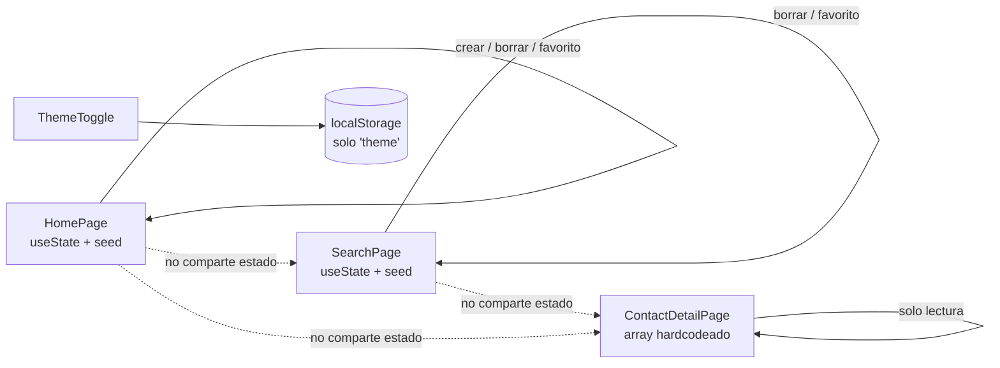
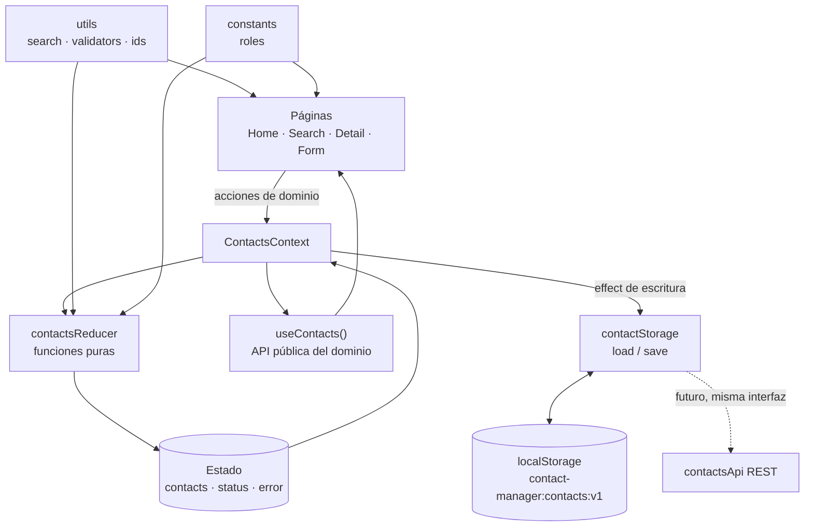

# Contact Manager — Fase 1: Análisis y diagnóstico

> Documento generado a partir de la inspección del proyecto en modo solo lectura.
> Fecha: 2026-11-02
> Alcance: análisis, diagnóstico, requisitos y planificación. Sin cambios de código, sin instalación de dependencias y sin ejecución del build.

---

## 1. Diagnóstico del proyecto actual

### 1.1 Resumen ejecutivo

| Aspecto | Estado |
|---|---|
| UI y estilos | Base sólida: CSS Modules, variables de tema claro/oscuro, tarjetas y detalle con identidad visual coherente. |
| Arquitectura de estado | **Crítica**: cada página mantiene su propia copia de los contactos y de los datos. |
| Datos | Semilla hardcodeada **tres veces** (Home, Search, Detail). Sin persistencia de contactos. |
| CRUD | Incompleto: "crear" inserta un placeholder sin formulario; no hay edición; el detalle no permite borrar ni marcar favorito. |
| Rutas | Correctas en lo básico (`/`, `/search`, `/contact/:id`, `/about`, `*`), pero la navegación del detalle depende de la aritmética de IDs. |
| Accesibilidad | Básica: hay `aria-label` en botones de icono, pero la tarjeta no es navegable por teclado, falta label en el buscador, hay landmarks anidados y varios fallos de contraste. |
| Responsive | "Básico" real: `#root` limitado a 600 px y sin breakpoints para navbar ni acciones. |
| Calidad | ESLint en verde; sin tests, sin CI, sin `.prettierrc`; README desactualizado. |
| Dependencias | Mínimas y justificadas: React, React DOM, React Router. Nada que retirar del runtime. |

### 1.2 Inventario técnico

| Capa | Archivos | Observación |
|---|---|---|
| Entrada | `index.html`, `src/main.jsx`, `src/App.jsx` | `BrowserRouter` + `StrictMode`; rutas anidadas dentro de `Layout`. |
| Layout | `src/layout/Layout.jsx`, `Header`, `Navbar`, `Footer`, `Copyright` | `Layout` renderiza `<main>` y varias páginas renderizan otro `<main>` dentro. |
| Páginas | `HomePage`, `SearchPage`, `ContactDetailPage`, `AboutPage`, `NotFoundPage` | 5 páginas; las 3 primeras gestionan contactos por separado. |
| Componentes de dominio | `ContactList`, `ContactCard`, `Badge`, `Breadcrumbs` | `ContactList` mezcla presentación y acción destructiva. |
| Tema | `ThemeToggle`, `index.css` | Tema persistido en `localStorage` bajo la clave `"theme"`. |
| Estilos | 11 CSS Modules + `index.css` + `App.css` | `App.css` está vacío y no se importa. |
| Datos | Arrays inline en 3 archivos + `contact.json` (sin trackear) | `contact.json` no lo usa ningún archivo. |
| Config | `vite.config.js`, `eslint.config.js`, `package.json` | Sin alias, sin setup de tests, sin `engines`. |
| Assets | `hero.png`, `react.svg`, `vite.svg`, `public/icons.svg` | Todos sin referencias. |

**Volumen aproximado:** ~970 líneas JS/JSX + ~660 líneas CSS. Proyecto pequeño: **no justifica Redux ni una capa de datos compleja**.

### 1.3 Flujo actual del estado



La consecuencia es directa: **los cambios no viajan entre páginas**. Borrar un contacto en Home no lo borra en Search; el detalle sigue mostrando contactos eliminados; un contacto creado en Home nunca aparece en Search.

### 1.4 Qué funciona y qué no

| Funciona | No funciona / incompleto |
|---|---|
| Listado y tarjetas con rol, teléfono y email. | Crear contacto real (inserta `"Nuevo Contacto N"` con datos falsos). |
| Detalle por `:id` con estado "no encontrado". | Editar contacto (no existe). |
| Búsqueda por nombre, email y rol vía `?q=`. | Búsqueda por teléfono, insensible a acentos, contador de resultados. |
| Favoritos en listado y búsqueda. | Favorito desde el detalle; filtro "solo favoritos". |
| Borrado individual y borrado total. | Confirmación, deshacer, estado deshabilitado, borrado selectivo. |
| Tema claro/oscuro persistido. | Respeto de `prefers-color-scheme` y ausencia de parpadeo inicial. |
| Rutas y 404. | 404 **sin estilos** (ver P-06); breadcrumb semánticamente incorrecto. |
| Responsive mínimo. | Navbar y acciones en pantallas de 320–360 px. |
| Lint limpio. | Tests, CI y documentación actualizada. |

### 1.5 Línea base técnica

- `npm run lint` → **OK, 0 errores**.
- `npm run build` → **no ejecutado** para respetar la restricción de no generar archivos.
- Tests → **no existen** (ni script ni dependencias).
- Lockfile: `pnpm-lock.yaml`, pero el README indica `npm install` (inconsistencia de gestor).
- `contact.json` está **sin trackear** y no se importa; parece un contrato de API de un módulo posterior (el detalle ya comenta "en M2 vendrán de API").

---

## 2. Problemas encontrados y prioridades

**Criterio de criticidad:** Alta = rompe funcionalidad, integridad de datos o accesibilidad básica · Media = afecta UX, mantenibilidad o coherencia visual de forma relevante · Baja = deuda menor o cosmética.

### 2.1 Criticidad alta

| ID | Hallazgo y evidencia | Impacto | Recomendación |
|---|---|---|---|
| **P-01** | **Estado y datos duplicados en 3 páginas** (`HomePage.jsx:6-31`, `SearchPage.jsx:7-32`, `ContactDetailPage.jsx:16-41`). | Datos contradictorios entre vistas; el detalle muestra contactos ya eliminados; las acciones no se reflejan en otras páginas. Es el problema raíz del proyecto. | Fuente única de verdad (`ContactsContext` + `useReducer`) consumida por todas las páginas. |
| **P-02** | **IDs generados con `contacts.length + 1`** (`HomePage.jsx:39`). | Tras borrar, el nuevo ID colisiona (ej.: 3 contactos, borras el 2, creas uno → ID 3 duplicado). Rompe `key`, favoritos y la ruta `/contact/:id`. | `crypto.randomUUID()` (nativo, sin dependencias) o un contador persistido. Recomiendo UUID. |
| **P-03** | **Sin persistencia de contactos** (solo `"theme"` en `ThemeToggle.jsx:5-16`). | Recargar la página pierde todos los cambios; el proyecto no se siente como una app real. | Servicio `contactStorage` sobre `localStorage` con versión de esquema y lectura tolerante a errores. |
| **P-04** | **Navegación del detalle por aritmética de ID** (`ContactDetailPage.jsx:11-13, 43-49, 95-107`). | Tras eliminar contactos, "Anterior/Siguiente" se deshabilita o lleva a IDs inexistentes; no respeta el orden de la lista filtrada desde Search. | Calcular vecinos por índice dentro de la colección actual (o del resultado filtrado). |
| **P-05** | **Acciones destructivas sin confirmación ni deshacer** (`HomePage.jsx:58-60`, `ContactList.jsx:30-36`). | Pérdida accidental de datos; "Eliminar Todos" se ejecuta con un clic. | Diálogo de confirmación + snackbar con "Deshacer" (temporal, en memoria). |
| **P-06** | **Los estilos del 404 nunca se aplican**: se importa un CSS Module sin binding y se usan clases globales (`NotFoundPage.jsx:2, 6-19`). | La página 404 se ve sin tarjeta ni estilos; regresión visual evidente. | Usar `styles["not-found-page"]` o convertir el archivo en CSS global. |
| **P-07** | **Los estilos de Copyright no se aplican**: clase global `"copyright"` (`Copyright.jsx:5`) frente a `.copyright` dentro de un CSS Module (`Footer.module.css:12`). | El texto del pie no recibe tamaño ni color previstos. | Importar `styles` en `Copyright` o mover la regla a un CSS global. |
| **P-08** | **"Agregar Contacto" inserta datos placeholder sin formulario ni validación** (`HomePage.jsx:37-48`). | Funcionalidad aparentemente terminada que en realidad no permite crear un contacto real. | Formulario real con validación (MVP). Si no entra en el alcance, etiquetarlo explícitamente como demo. **Requiere decisión.** |

### 2.2 Criticidad media

| ID | Hallazgo y evidencia | Impacto | Recomendación |
|---|---|---|---|
| **P-09** | **Tarjeta clickeable no accesible**: `<div onClick>` sin `role`, `tabIndex` ni teclado (`ContactCard.jsx:21-24`). | Usuarios de teclado o lectores de pantalla no pueden abrir el detalle. | Convertir el contenedor en `Link` (o `button`) y mantener los botones internos fuera del enlace. |
| **P-10** | **Landmarks y encabezados duplicados**: `<main>` en `Layout.jsx:11`, `HomePage.jsx:83` y `ContactDetailPage.jsx:110`; `<h1>` en `Header.jsx:6` y en `ContactDetailPage.jsx:119`. | Navegación por regiones confusa; estructura semántica inválida. | Un solo `<main>` en Layout; un `<h1>` por página (el Header pasa a `<p>`/`<div>` o el título de página manda). |
| **P-11** | **Buscador sin etiqueta**: solo `placeholder` (`SearchPage.jsx:92-98`). | El placeholder no es una etiqueta accesible y desaparece al escribir. | `<label>` visualmente oculto o `aria-label`. |
| **P-12** | **El input no se sincroniza con la URL** (`SearchPage.jsx:37`). | Atrás/adelante y enlaces con `?q=` dejan el campo con texto obsoleto. | Derivar el valor del query param o sincronizarlo con `useEffect`. |
| **P-13** | **Búsqueda limitada**: no incluye teléfono, no ignora acentos/mayúsculas de forma robusta y no muestra contador ni `aria-live` (`SearchPage.jsx:53-60, 132-140`). | "maria" no encuentra "María"; no se puede buscar por teléfono; sin feedback del número de resultados. | Utilidad `normalizeText` + incluir `phone`; contador con `aria-live="polite"`. |
| **P-14** | **Sin filtros por rol ni "solo favoritos"**. | El usuario no puede acotar la lista; funcionalidad esperable en un Contact Manager. | Filtros con estado en la URL (`?role=&fav=1`). |
| **P-15** | **Favorito no se puede alternar desde el detalle** (`ContactDetailPage.jsx:121-129`, solo lectura). | Inconsistencia entre listado y detalle. | Botón de favorito reutilizable en ambos. |
| **P-16** | **Tema incompleto**: parpadeo inicial, ignora `prefers-color-scheme`, solo reconoce el valor `"dark"` (`ThemeToggle.jsx:5-16`). | Flash claro en cada carga; no respeta la preferencia del sistema. | Hook `useTheme` + `matchMedia` + script inline mínimo en `index.html` (o atributo inicial). |
| **P-17** | **Contraste insuficiente**: badge `#d97706` sobre `#fffbeb` (~3:1), `--empty-text: #999` sobre blanco (~2.8:1), blanco sobre `#06b6d4` (~2.4:1) (`index.css:26-39, 60-100`). | No cumple WCAG AA para texto normal; afecta legibilidad real. | Ajustar tokens de color y verificar con contraste ≥ 4.5:1. |
| **P-18** | **Responsive frágil**: `#root` con `max-width: 600px` (`index.css:115-125`), navbar de 3 enlaces + iconos + toggle sin breakpoint (`Navbar.module.css`), botón de borrar absoluto sobre la tarjeta (`ContactList.module.css:14-38`), emails largos sin `overflow-wrap`. | Desbordes y solapamientos en móvil; desaprovecha pantallas grandes. | Breakpoints reales, navbar compacta, acciones dentro de la tarjeta y `min-width: 0`/`overflow-wrap`. |
| **P-19** | **IDs SVG duplicados por tarjeta**: `phone-gradient` y `mail-gradient` se definen en cada instancia (`ContactCard.jsx:89, 121`). | IDs repetidos en el DOM; gradientes potencialmente incorrectos. | `useId()` o gradiente definido una sola vez en CSS/defs global. |
| **P-20** | **Namespace SVG inválido**: `xmlns="http://w3.org"` (`SearchPage.jsx:110`). | El icono "X" puede no renderizarse en algunos motores. | Corregir a `http://www.w3.org/2000/svg`. |
| **P-21** | **Estados vacíos inconsistentes y sin CTA**: "No hay contactos" (`ContactList.jsx:9-11`) vs "No se encontraron contactos…" incluso con lista vacía (`SearchPage.jsx:138-140`). | Mensajes contradictorios; el usuario no sabe qué hacer. | Componente `EmptyState` con variantes (sin datos / sin resultados / sin favoritos) y acción sugerida. |
| **P-22** | **Sin manejo de errores ni `ErrorBoundary`**; acceso a `localStorage` sin `try/catch`. | Un JSON corrupto o cuota llena puede romper la app al añadir persistencia. | Boundary + lectura con validación y fallback a datos semilla. |
| **P-23** | **`<html lang="en">` con UI en español** (`index.html:2`); título `contact-manager`, sin meta description. | Lectores de pantalla pronuncian mal; SEO/UX deficiente. | `lang="es"`, título "Contact Manager" y meta description. |
| **P-24** | **Foco visible inconsistente** en botones y tarjetas. | Navegación por teclado poco clara. | Tokens de `:focus-visible` globales. |
| **P-25** | **IDs numéricos y `Number(id)`** (`ContactDetailPage.jsx:11`). | Bloquea migrar a UUID o a IDs de API sin tocar rutas. | Decidir estrategia de ID ahora (ver decisión D5). |

### 2.3 Criticidad baja

| ID | Hallazgo | Recomendación |
|---|---|---|
| **P-26** | `src/App.css` vacío y no importado. | Eliminar. |
| **P-27** | Assets sin uso: `hero.png`, `react.svg`, `vite.svg`, `public/icons.svg`. | Eliminar tras confirmación. |
| **P-28** | CSS muerto: `.contact-detail__back`, `.contact-detail__back-link`, `.contact-card__info-icon-path`. | Eliminar en la fase de estilos. |
| **P-29** | Formato inconsistente (comillas simples/dobles, punto y coma opcional) y sin `.prettierrc`, pese a existir `format`. | Añadir `.prettierrc` y aplicarlo una sola vez. |
| **P-30** | README desactualizado: estructura obsoleta, funcionalidades listadas como "próximas" ya implementadas (`README.md:211-223`), colores y ejemplo de `Badge` ya no coinciden, `npm` frente a `pnpm-lock.yaml`. | Reescribir README en la fase de documentación. |
| **P-31** | `package.json`: versión `0.0.0`, sin script de test, sin `engines`; `@types/react` en proyecto JS. | Ajustar metadatos; `@types` es inocuo, se puede mantener para el editor. |
| **P-32** | Colores y gradientes hardcodeados en módulos (`#2563eb`, `#7c3aed`, etc.) y botón azul duplicado en 3 archivos. | Tokens semánticos y primitivas de botón. |
| **P-33** | Doble margen entre tarjetas (10 px en `ContactCard` + 10 px en `ContactList`). | Unificar espaciado en el contenedor. |
| **P-34** | El borde pasa de 1 px a 2 px al marcar favorito → salto de layout (sin `box-sizing` global). | `box-sizing: border-box` global o borde constante. |
| **P-35** | Pluralización incorrecta: "1 contactos". | Helper de pluralización. |
| **P-36** | `contact.json` sin trackear, sin uso y con campos distintos al código. | Decidir si es el contrato objetivo (decisión D1). |
| **P-37** | Sin tests ni CI. | Ver sección 9. |
| **P-38** | Breadcrumb: "Contacto" enlaza a `/search` y el ítem actual es un enlace a sí mismo; falta `aria-current` (`Breadcrumbs.jsx:16-30`). | Corregir jerarquía y marcar el ítem actual como texto con `aria-current="page"`. |
| **P-39** | `aria-label` sobre un `<span>` sin rol en el detalle (`ContactDetailPage.jsx:121-128`). | `role="img"` o texto visible. |
| **P-40** | Sin feedback tras acciones (crear, borrar, favorito). | Toasts o mensajes `aria-live`. |

**Prioridad global recomendada:** P-01 → P-02 → P-03 → P-04/P-05 → P-06/P-07/P-08 → P-09…P-18. Los problemas de estilo y limpieza (P-26…P-35) se resuelven de forma oportunista al tocar cada archivo.

---

## 3. Requisitos funcionales y no funcionales

### 3.1 Requisitos funcionales

| ID | Requisito | Prioridad |
|---|---|---|
| **FR-01** | Listar contactos desde una fuente única de verdad. | MVP |
| **FR-02** | Ver el detalle de un contacto por ID, con estado "no encontrado". | MVP |
| **FR-03** | Crear contacto mediante formulario con validación. | MVP |
| **FR-04** | Editar contacto existente. | MVP |
| **FR-05** | Eliminar un contacto con confirmación y opción de deshacer. | MVP |
| **FR-06** | Eliminar todos los contactos con confirmación y opción de deshacer. | MVP |
| **FR-07** | Marcar/desmarcar favorito desde listado y detalle. | MVP |
| **FR-08** | Buscar por nombre, email, teléfono y rol, sin distinguir mayúsculas ni acentos. | MVP |
| **FR-09** | Filtrar por rol y por "solo favoritos". | Mejora |
| **FR-10** | Persistir contactos entre recargas. | MVP |
| **FR-11** | Persistir el tema y respetar la preferencia del sistema. | MVP |
| **FR-12** | Navegar con URLs compartibles (`?q=`, `?role=`, `?fav=1`). | Mejora |
| **FR-13** | Mostrar estados vacíos diferenciados y con acción sugerida. | MVP |
| **FR-14** | Navegar y operar toda la app con teclado y lector de pantalla. | MVP |
| **FR-15** | Mantener el contexto de búsqueda al entrar y volver del detalle. | Mejora |
| **FR-16** | Mostrar confirmación visual de las acciones realizadas. | Mejora |

### 3.2 Requisitos no funcionales

| ID | Requisito | Criterio verificable |
|---|---|---|
| **NFR-01** | Mantenibilidad | Sin datos duplicados; cada capa con una responsabilidad; componentes < 150 líneas. |
| **NFR-02** | Accesibilidad | WCAG 2.1 AA en contraste, foco, teclado y nombres accesibles. |
| **NFR-03** | Rendimiento | Bundle inicial sin crecimiento significativo; listas sin re-renders innecesarios; sin dependencias de runtime nuevas. |
| **NFR-04** | Compatibilidad | Últimas 2 versiones de Chrome, Edge, Firefox y Safari; móvil 320 px+. |
| **NFR-05** | Responsive | Sin desbordes horizontales entre 320 px y 1440 px. |
| **NFR-06** | Robustez de persistencia | JSON corrupto o cuota llena no rompen la app; fallback controlado. |
| **NFR-07** | Calidad de código | `lint` y `format` limpios; estilo homogéneo. |
| **NFR-08** | Testabilidad | Lógica pura separada (reducer, búsqueda, validación) y testeable sin DOM. |
| **NFR-09** | Dependencias | Ninguna librería de estado, UI o formularios; justificar cualquier adición. |
| **NFR-10** | Documentación | README, arquitectura, modelo de datos y pruebas actualizados. |
| **NFR-11** | Privacidad | Datos solo en el navegador; nada sensible; sin telemetría. |
| **NFR-12** | Idioma | UI en español, `lang="es"`, textos centralizados donde aporte valor. |

### 3.3 Modelo de contacto recomendado

**Campos actuales:** `id`, `name`, `phone`, `email`, `role`, `isFavorite`.
**`contact.json` encontrado (sin usar):** `id`, `fullname`, `phonenumber`, `email`, `type`, `company`, `birthday`, `createdAt`, `updatedAt`.

Propuesta para el MVP (sin campos innecesarios):

| Campo | Tipo | Obligatorio | Origen | Nota |
|---|---|---|---|---|
| `id` | `string` (UUID) | Sí | Generado | Estable ante borrados; compatible con API. |
| `fullname` | `string` | Sí | Formulario | 2–80 caracteres. |
| `email` | `string` | Sí | Formulario | Validación de formato; unicidad recomendada. |
| `phonenumber` | `string` | No | Formulario | Validación laxa (formatos internacionales). |
| `type` | `string` (enum) | Sí | Formulario | `Amigo`, `Trabajo`, `Familia`, `Otro`. |
| `company` | `string` | No | Formulario | Opcional; se muestra solo si existe. |
| `birthday` | `string` (ISO date) | No | Formulario | Opcional; valor para "Mejoras". |
| `isFavorite` | `boolean` | Sí | Acción de usuario | **No existe en `contact.json`** (ver más abajo). |
| `createdAt` | `string` (ISO) | Sí | Generado | Para orden y futura API. |
| `updatedAt` | `string` (ISO) | Sí | Generado | Para orden y futura API. |

**Sobre la nomenclatura:** `contact.json` usa `fullname`/`phonenumber`/`type`, mientras el código usa `name`/`phone`/`role`. Hay dos alternativas:

| Alternativa | Ventajas | Desventajas |
|---|---|---|
| **A. Alinear el código a `contact.json`** (recomendada) | Un solo vocabulario; migración a API sin traducción; evita una segunda migración. | Renombrar en ~6 archivos (cambio mecánico y verificable). |
| **B. Mantener nombres actuales y mapear en el servicio** | Menos cambios inmediatos. | Doble vocabulario permanente; deuda en cada integración. |

**Recomendación:** A, siempre que se confirme que `contact.json` es el contrato objetivo.

**Sobre `company` y `birthday`:** son razonables para un Contact Manager y ya vienen en el contrato, pero añaden complejidad al formulario. Recomiendo incluirlos como **opcionales** en el modelo y mostrarlos solo si existen; el formulario del MVP puede cubrir los cinco campos esenciales y dejar estos dos para "Mejoras". **Requiere decisión (D4).**

**Sobre `isFavorite`:** el contrato de API no lo incluye. Opciones:

1. Añadirlo al backend/API (lo ideal si se controla).
2. Guardarlo localmente como "overlay" (`{ [id]: boolean }`) y combinarlo al leer.
3. Campo local dentro del contacto, aceptando que la API lo ignore.

Recomendación para el MVP: **opción 3** (simple, con una sola fuente de verdad). Documentar que, al migrar a API, se resolverá con la opción 1 o 2. **Requiere decisión (D9).**

### 3.4 Persistencia

| Alternativa | Ventajas | Desventajas | Veredicto |
|---|---|---|---|
| **`localStorage`** | Síncrono, nativo, cero dependencias, suficiente para decenas/cientos de contactos. | Límite ~5 MB, solo strings, bloquea el hilo principal, sin consultas. | **Recomendada para el MVP.** |
| IndexedDB | Más capacidad y asíncrono. | Complejidad innecesaria para este volumen. | Futuro, solo si crece el dataset. |
| API REST | Multiusuario, fuente compartida, datos reales. | Requiere backend, estados de carga/error, auth. | **Futuro**, no implementar ahora. |

**Diseño recomendado:** una sola puerta de acceso (`services/contactStorage.js`) con `loadContacts()` y `saveContacts()`, clave versionada `contact-manager:contacts:v1` y payload `{ version: 1, contacts: [...] }`. Así, migrar a REST consiste en sustituir la implementación por un adaptador con la misma interfaz (`list`, `create`, `update`, `remove`), añadiendo estados de carga y error. No implementar la API en esta fase.

**Riesgos a cubrir desde el inicio:** JSON corrupto (validar y caer a semilla), cuota llena (capturar y avisar), `StrictMode` (efectos dobles: la escritura debe ser idempotente) y datos antiguos (migración por `version`).

### 3.5 Favoritos y eliminación masiva: comportamiento propuesto

**Favoritos (actual):** se alternan solo desde la tarjeta; el detalle los muestra en modo lectura; no hay filtro; no se persisten.

Reglas propuestas:
1. El favorito es un atributo del contacto, editable desde tarjeta **y** detalle.
2. El cambio es inmediato (optimista) y se persiste.
3. El estado se comunica con icono **y** texto accesible (`aria-pressed`), no solo con color.
4. Filtro "Solo favoritos" combinable con búsqueda y rol.
5. Contador de favoritos en el resumen, actualizado con `aria-live="polite"`.

**Eliminación masiva (actual):** un botón "Eliminar Todos" que vacía el estado de Home, sin confirmación, sin deshacer y sin relación con Search/Detail.

Hay dos interpretaciones y **requieren decisión (D3)**:

| Interpretación | Descripción | Ventajas | Desventajas |
|---|---|---|---|
| **A. Borrar todo** (lo actual, mejorado) | Vaciar la lista completa con confirmación + deshacer. | Simple, coherente con el botón existente. | Poco control; riesgo alto. |
| **B. Selección múltiple** | Checkboxes + "seleccionar todo" + borrar seleccionados. | Control real, patrón estándar. | Más UI, más estado, más tests. |

**Recomendación:** MVP con **A** (confirmación + deshacer + botón deshabilitado si no hay contactos) y **B** en "Mejoras". Reglas comunes: la acción afecta a la fuente única, redirige si el detalle abierto desaparece, y ofrece deshacer durante ~5 segundos.

### 3.6 Autenticación y multiusuario

**Fuera del alcance del MVP.** No hay dependencia actual que lo exija: no existen login, tokens, rutas protegidas, roles de usuario ni campo de propietario. Única previsión: si en el futuro se integra una API con auth, la clave de `localStorage` debería incluir el identificador de usuario y las peticiones llevar credenciales. No se implementa nada de esto ahora.

---

## 4. Propuesta de arquitectura

### 4.1 Alternativas evaluadas

| Opción | Ventajas | Desventajas | Veredicto |
|---|---|---|---|
| **A. Levantar estado a `App` y pasar props** | Cero abstracciones; fácil de entender. | `App` se convierte en contenedor de todo; prop drilling por rutas y layout; difícil de testear. | No recomendada al crecer. |
| **B. Context API + `useReducer`** (recomendada) | Estado compartido entre rutas sin dependencias; reducer puro y testeable; acciones explícitas. | Context re-renderiza consumidores; requiere separar estado/acciones si se optimiza. | **Recomendada.** |
| **C. Zustand / Redux / Jotai** | Potentes y escalables. | Dependencia nueva injustificada para una entidad y un usuario; viola las reglas 4 y 7. | Descartada. |
| **D. `useState` en un hook + Context** | Menos código que el reducer. | Acciones relacionadas dispersas; transiciones complejas (borrar + deshacer + persistir) menos claras. | Válida, pero el reducer gana en claridad. |

**Justificación de B:** el proyecto tiene una sola entidad, pero **cuatro superficies que la comparten** (Home, Search, Detail, formulario). El reducer concentra las transiciones (`add`, `update`, `remove`, `removeAll`, `toggleFavorite`, `restore`), es puro y se testea sin React. No es sobreingeniería: son ~60 líneas y evita el problema P-01 de raíz.

### 4.2 Arquitectura propuesta



**Capas y responsabilidades:**

| Capa | Responsabilidad | No debe hacer |
|---|---|---|
| `pages/` | Composición, lectura de URL, layout de la vista. | Guardar datos duplicados ni lógica de negocio. |
| `components/` | Presentación y eventos hacia arriba. | Acceder a `localStorage` ni conocer rutas concretas. |
| `context/` | Proveer estado y despacho de acciones. | Renderizar UI de página. |
| `hooks/` | API de dominio (`useContacts`) y utilidades (`useTheme`). | Conocer detalles de presentación. |
| `services/` | Persistencia y futura API. | Conocer React. |
| `utils/` | Funciones puras (búsqueda, validación, IDs, fechas). | Tener estado. |
| `constants/` | Roles, claves, límites. | Lógica. |

**Forma del estado:**

```js
{
  contacts: [],        // Contact[]
  status: "idle",      // "idle" | "loading" | "error" (preparado para API)
  error: null,         // string | null
  lastAction: null     // para deshacer (snapshot o acción inversa)
}
```

**Estrategia de navegación propuesta:**

| Ruta | Página | Notas |
|---|---|---|
| `/` | Home | Listado + resumen + acciones + filtros. |
| `/search?q=&role=&fav=1` | Search | Estado en URL, compartible; conserva contexto. |
| `/contact/:id` | Detail | Vecinos por índice de la colección, no por aritmética. |
| `/contact/new` | Form | Crear. **Requiere decisión** sobre ruta vs modal (D8). |
| `/contact/:id/edit` | Form | Editar. |
| `/about` | About | Sin cambios funcionales. |
| `*` | NotFound | Con estilos corregidos. |

**Manejo de errores y estados vacíos:** `ErrorBoundary` a nivel de app; error de persistencia mostrado como aviso no bloqueante; `EmptyState` con tres variantes (sin contactos, sin resultados, sin favoritos); validación de formulario en campo + resumen; `aria-live` para resultados y confirmaciones.

**Estilos y temas:** mantener CSS Modules y variables; introducir **tokens semánticos** (`--color-bg`, `--color-text`, `--color-surface`, `--color-accent`, `--color-danger`, `--color-focus`) para eliminar colores hardcodeados; tema en `<html data-theme>` con `matchMedia` como valor inicial; primitivas `Button`, `IconButton`, `Card` para no repetir gradientes. Sin frameworks CSS.

**Dependencias de runtime:** **ninguna nueva**. Todo se resuelve con React 19, React Router 7 y APIs nativas (`crypto.randomUUID`, `localStorage`, `matchMedia`).

---

## 5. Estructura de carpetas propuesta

```text
src/
├── components/
│   ├── ui/                     # NUEVO - primitivas reutilizables
│   │   ├── Badge.jsx
│   │   ├── Button.jsx
│   │   ├── IconButton.jsx
│   │   ├── ConfirmDialog.jsx
│   │   ├── EmptyState.jsx
│   │   └── Toast.jsx
│   ├── contacts/               # NUEVO - dominio contactos
│   │   ├── ContactCard.jsx
│   │   ├── ContactList.jsx
│   │   ├── ContactForm.jsx
│   │   ├── ContactFilters.jsx
│   │   └── SearchBar.jsx
│   ├── layout/                 # MOVER (sin cambios de comportamiento)
│   │   ├── Header.jsx
│   │   ├── Navbar.jsx
│   │   ├── Footer.jsx
│   │   └── Copyright.jsx
│   └── Breadcrumbs.jsx
├── context/
│   ├── ContactsContext.jsx     # NUEVO
│   └── contactsReducer.js      # NUEVO
├── hooks/
│   ├── useContacts.js          # NUEVO
│   └── useTheme.js             # NUEVO
├── layout/
│   └── Layout.jsx              # se mantiene para minimizar cambios
├── pages/
│   ├── HomePage.jsx
│   ├── SearchPage.jsx
│   ├── ContactDetailPage.jsx
│   ├── ContactFormPage.jsx     # NUEVO (crear/editar)
│   ├── AboutPage.jsx
│   └── NotFoundPage.jsx
├── services/
│   └── contactStorage.js       # NUEVO
├── data/
│   └── seedContacts.js         # NUEVO - datos demo en un solo lugar
├── constants/
│   ├── roles.js                # NUEVO
│   └── storageKeys.js          # NUEVO
├── utils/
│   ├── validators.js           # NUEVO
│   ├── search.js               # NUEVO (normalización y filtrado)
│   └── ids.js                  # NUEVO
├── styles/
│   ├── tokens.css              # NUEVO - variables semánticas
│   └── base.css                # NUEVO - reset y foco
├── App.jsx
├── index.css
└── main.jsx
```

**Nota:** los movimientos de archivos son mecánicos y opcionales. Si se prefiere minimizar el diff, se puede mantener la estructura plana actual y crear solo las carpetas nuevas (`context`, `hooks`, `services`, `utils`, `constants`, `data`). Recomiendo hacer los movimientos en un commit separado, sin cambios de comportamiento, para que el historial sea revisable.

---

## 6. Alcance del MVP

### 6.1 Dentro del MVP

| # | Funcionalidad | Criterios de aceptación |
|---|---|---|
| 1 | **Fuente única de estado** | Crear, editar, borrar o marcar favorito en cualquier página se refleja de inmediato en todas las demás. |
| 2 | **Persistencia** | Recargar conserva contactos, favoritos y tema; datos corruptos no rompen la app. |
| 3 | **CRUD completo** | Formulario con validación; alta, edición y borrado con confirmación; redirección correcta tras borrar. |
| 4 | **Búsqueda** | Nombre, email, teléfono y rol; insensible a mayúsculas y acentos; estado en `?q=`; contador de resultados. |
| 5 | **Favoritos** | Alternables desde tarjeta y detalle; persistidos; filtro "solo favoritos" (si se aprueba FR-09 como MVP). |
| 6 | **Borrado total** | Confirmación + deshacer; deshabilitado si no hay contactos. |
| 7 | **Detalle** | Vecinos por índice; estado no encontrado; acciones de editar/borrar/favorito. |
| 8 | **Tema** | Claro/oscuro persistido, sin parpadeo, con preferencia del sistema como valor inicial. |
| 9 | **Accesibilidad base** | Tarjeta navegable, labels, un solo `main`, foco visible, contraste AA, `lang="es"`. |
| 10 | **Responsive** | 320 px–1440 px sin desbordes; navbar y acciones adaptadas. |
| 11 | **Estados vacíos y errores** | Mensajes diferenciados con CTA; `ErrorBoundary`. |

### 6.2 Fuera del MVP (explícito)

- Autenticación, multiusuario y permisos.
- Backend/API REST (solo se deja preparada la interfaz del servicio).
- Importación/exportación de contactos (CSV/vCard).
- Avatares e imágenes.
- Multi-selección para borrado (queda en Mejoras).
- Notificaciones, recordatorios de cumpleaños, integración con calendario.
- i18n multi-idioma (solo se deja `lang="es"` correcto).

---

## 7. Backlog priorizado

**Complejidad:** S ≈ ≤ 2 h · M ≈ 2–5 h · L ≈ > 5 h (estimación relativa para un frontend de portafolio).

### 7.1 MVP (P0)

| ID | Funcionalidad | Complejidad | Depende de |
|---|---|---|---|
| B-01 | Modelo de datos, `roles.js`, `seedContacts.js`, `utils/ids.js` | S | D1, D4, D5 |
| B-02 | `contactsReducer` + acciones + tests unitarios | M | B-01 |
| B-03 | `ContactsProvider` + `useContacts` | S | B-02 |
| B-04 | `contactStorage` con versión, validación y fallback | M | B-01 |
| B-05 | Refactor de Home/Search/Detail a la fuente única | M | B-03, B-04 |
| B-06 | Formulario crear/editar + validación + ruta | L | B-03 |
| B-07 | Confirmación + deshacer en borrados | M | B-03 |
| B-08 | Favoritos unificados (tarjeta + detalle) | S | B-03 |
| B-09 | Búsqueda normalizada (nombre, email, teléfono, rol) + contador | S | B-03 |
| B-10 | Detalle con vecinos por índice + acciones | M | B-03 |
| B-11 | Tema con `matchMedia` y sin parpadeo | S | — |
| B-12 | Corrección 404 + Copyright + clases CSS Module | S | — |
| B-13 | Accesibilidad base (tarjeta, labels, `main`, foco, contraste) | M | B-05 |
| B-14 | Responsive (navbar, acciones, overflow) | M | — |
| B-15 | `EmptyState` + `ErrorBoundary` | S | B-05 |

### 7.2 Mejoras (P1)

| ID | Funcionalidad | Complejidad | Depende de |
|---|---|---|---|
| B-16 | Filtros por rol y favoritos en URL | M | B-09 |
| B-17 | Conservar contexto de búsqueda al entrar/volver del detalle | S | B-16 |
| B-18 | Multi-selección para borrado masivo | L | B-07 |
| B-19 | Toasts de confirmación | S | B-07 |
| B-20 | Ordenación (nombre, reciente, favoritos) | M | B-03 |
| B-21 | Campos opcionales `company` y `birthday` | S | B-06 |
| B-22 | Ficha con iniciales/avatar generado | S | — |
| B-23 | Tests de integración de páginas y E2E básico | L | B-05 |
| B-24 | CI (lint + test + build) | S | B-23 |

### 7.3 Futuro (P2)

| ID | Funcionalidad | Complejidad | Depende de |
|---|---|---|---|
| B-25 | API REST con adaptador intercambiable | L | B-04 |
| B-26 | Importar/exportar CSV o vCard | M | B-06 |
| B-27 | Autenticación y datos por usuario | L | B-25 |
| B-28 | Recordatorios de cumpleaños | L | B-21 |
| B-29 | PWA / uso offline | M | B-04 |
| B-30 | i18n español/inglés | M | — |

---

## 8. Plan de implementación

> Esta fase **no implementa**. Es una propuesta de orden y alcance.

### 8.1 Módulos

| Módulo | Objetivo | Archivos nuevos | Archivos modificados | Riesgo |
|---|---|---|---|---|
| **M0. Preparación** | `.prettierrc`, scripts de test, baseline verde. | `.prettierrc`, `vitest.config.js` (fase de tests) | `package.json`, `eslint.config.js` | Bajo |
| **M1. Dominio** | Modelo, roles, semilla, utilidades puras. | `data/seedContacts.js`, `constants/roles.js`, `constants/storageKeys.js`, `utils/ids.js`, `utils/validators.js`, `utils/search.js` | — | Bajo |
| **M2. Estado** | Reducer + Provider + hook + persistencia. | `context/contactsReducer.js`, `context/ContactsContext.jsx`, `hooks/useContacts.js`, `services/contactStorage.js` | `main.jsx` (envolver con provider) | **Medio**: no romper Home mientras se migra |
| **M3. Migración de vistas** | Eliminar duplicación y conectar páginas. | — | `HomePage.jsx`, `SearchPage.jsx`, `ContactDetailPage.jsx`, `ContactList.jsx`, `ContactCard.jsx` | **Alto**: regresiones visuales/funcionales |
| **M4. CRUD** | Formulario crear/editar, confirmaciones, deshacer. | `pages/ContactFormPage.jsx`, `components/contacts/ContactForm.jsx`, `components/ui/ConfirmDialog.jsx`, `components/ui/Toast.jsx` | `App.jsx`, `HomePage.jsx`, `ContactDetailPage.jsx` | Medio |
| **M5. Búsqueda y filtros** | Normalización, teléfono, contador, filtros en URL. | `components/contacts/SearchBar.jsx`, `components/contacts/ContactFilters.jsx` | `SearchPage.jsx`, `HomePage.jsx` | Bajo |
| **M6. Detalle** | Vecinos por índice, acciones, breadcrumb correcto. | — | `ContactDetailPage.jsx`, `Breadcrumbs.jsx` | Medio |
| **M7. Tema y estilos** | Tokens, foco, contraste, primitivas, limpieza. | `styles/tokens.css`, `styles/base.css`, `hooks/useTheme.js`, `components/ui/Button.jsx`, `components/ui/IconButton.jsx`, `components/ui/Badge.jsx` | `index.css`, `index.html`, `ThemeToggle.jsx`, todos los `*.module.css` | Medio: cambios visuales amplios |
| **M8. Accesibilidad y responsive** | Teclado, labels, landmarks, breakpoints. | — | `Layout.jsx`, `Header.jsx`, `Navbar.module.css`, `ContactCard.jsx`, `ContactList.module.css` | Bajo |
| **M9. Pruebas** | Unitarias, integración, a11y. | `src/**/*.test.js(x)`, `src/test/setup.js` | `package.json` | Bajo |
| **M10. Documentación** | README, arquitectura, modelo, pruebas. | `docs/ARCHITECTURE.md`, `docs/DATA_MODEL.md`, `docs/TESTING.md` | `README.md`, `AboutPage.jsx` (versión) | Bajo |

### 8.2 Orden recomendado y dependencias

```text
M0 → M1 → M2 → M3 → M4 → M5 → M6 → M7 → M8 → M9 → M10
                 └──────────────┘
              (M5 y M6 pueden ir en paralelo tras M3)
```

**Justificación del orden:** primero se elimina la causa raíz (estado duplicado) y se garantiza persistencia; después se añaden funcionalidades sobre una base estable; estilos y accesibilidad se abordan cuando la estructura ya no cambia; los tests acompañan cada módulo, aunque la suite completa se consolide en M9.

### 8.3 Archivos que pueden eliminarse (previa confirmación)

| Archivo | Motivo |
|---|---|
| `src/App.css` | Vacío y sin importar. |
| `src/assets/hero.png`, `src/assets/react.svg`, `src/assets/vite.svg` | Sin referencias. |
| `public/icons.svg` | Sin referencias (verificar antes). |
| Reglas CSS muertas en `ContactDetailPage.module.css` y `ContactCard.module.css` | `.contact-detail__back`, `.contact-detail__back-link`, `.contact-card__info-icon-path`. |

**No se propone eliminar** `Copyright.jsx` (se corrige), ni ninguna página, ruta o funcionalidad existente.

### 8.4 Dependencias

| Tipo | Paquete | Justificación |
|---|---|---|
| Runtime | — | Ninguna nueva. |
| Dev (M9) | `vitest` | Runner nativo de Vite, sin configuración pesada. |
| Dev (M9) | `jsdom` | Entorno DOM para tests de componentes. |
| Dev (M9) | `@testing-library/react` | Pruebas centradas en comportamiento. |
| Dev (M9) | `@testing-library/user-event` | Simulación realista de interacción. |
| Dev (M9) | `@testing-library/jest-dom` | Matchers de accesibilidad y DOM. |
| Dev (opcional) | `eslint-plugin-jsx-a11y` | Detección temprana de errores de accesibilidad. |
| Dev (opcional, futuro) | `@playwright/test` | E2E real; no necesario para el MVP. |

### 8.5 Riesgos técnicos del plan

| Riesgo | Probabilidad | Impacto | Mitigación |
|---|---|---|---|
| Regresiones al migrar a contexto | Media | Alto | Migrar página por página; tests del reducer antes del refactor; revisar manualmente cada vista. |
| Renombrar campos (`name` → `fullname`) | Media | Medio | Hacerlo en M1 con un commit aislado y buscar referencias exhaustivamente. |
| `StrictMode` duplica efectos de persistencia | Alta | Bajo | Escritura idempotente; no usar el efecto para generar IDs ni timestamps. |
| `localStorage` con datos viejos o corruptos | Media | Medio | Validación + `version` + fallback a semilla. |
| Parpadeo de tema antes de montar React | Alta | Bajo | Script inline mínimo o atributo inicial en `index.html`. |
| Cambios visuales amplios en M7 | Media | Medio | Hacerlo en commits por componente; comparar capturas antes/después. |
| Alcance creciente (multi-selección, API, i18n) | Alta | Medio | Congelar MVP; todo lo demás al backlog P1/P2. |

---

## 9. Estrategia de pruebas

### 9.1 Herramientas

| Nivel | Herramienta | Alcance |
|---|---|---|
| Unitario | Vitest | Reducer, `search.js`, `validators.js`, `ids.js`, `contactStorage` (con `localStorage` mockeado). |
| Integración | Vitest + React Testing Library + `user-event` + `jsdom` | Páginas y flujos: crear, editar, borrar, buscar, favoritos, tema. |
| Accesibilidad | `jest-dom` + consultas por rol; opcional `axe-core` | Nombres accesibles, roles, foco, labels. |
| E2E (futuro) | Playwright | Flujo completo con persistencia real y recarga. |
| Manual | Checklist | Responsive, temas, navegación, persistencia entre pestañas. |

**Comandos previstos:** `npm run test`, `npm run test:watch`, `npm run test:coverage`, `npm run lint`.

### 9.2 Matriz de validación

| Área | Casos mínimos |
|---|---|
| **CRUD** | Crear con datos válidos; crear con campos vacíos/email inválido; editar y ver el cambio en Home, Search y Detail; borrar y comprobar redirección/estado; borrar el último contacto; borrar todos con confirmación y deshacer. |
| **Búsqueda** | Coincidencia por nombre, email, teléfono y rol; mayúsculas/minúsculas; acentos ("maria" → "María"); sin resultados; query vacía; URL compartida `?q=`. |
| **Filtros** | Rol + favoritos combinados; limpiar filtros; estado reflejado en la URL. |
| **Favoritos** | Alternar en tarjeta y detalle; persistencia tras recarga; filtro solo favoritos; `aria-pressed` correcto. |
| **Persistencia** | Recarga conserva datos; JSON corrupto cae a semilla; cuota llena muestra aviso; `version` antigua migra o se descarta de forma controlada. |
| **Navegación** | Home → Detail → Anterior/Siguiente; borrar contacto abierto; URL inválida → "no encontrado"; ruta desconocida → 404 con estilos; atrás/adelante conserva búsqueda. |
| **Formulario** | Validación en tiempo real y al enviar; errores asociados a campos (`aria-describedby`); foco en el primer error; cancelar no guarda. |
| **Temas** | Toggle claro/oscuro; persistencia; preferencia del sistema en primera visita; sin parpadeo; contraste AA. |
| **Responsive** | 320, 375, 768, 1024 y 1440 px; sin scroll horizontal; navbar usable; acciones visibles; textos largos no desbordan. |
| **Accesibilidad** | Recorrido completo solo con teclado; tarjeta abre con Enter/Espacio; un solo `main`; un `h1` por página; labels en buscador y formulario; foco visible. |

### 9.3 Criterios de cobertura

- **Reducer, búsqueda, validación y storage:** ~90 % (lógica pura y crítica).
- **Componentes y páginas:** flujos principales cubiertos; no perseguir 100 %.
- **Global:** objetivo razonable 70–80 %, sin bloquear el MVP por una cifra.
- **Regresión manual obligatoria** antes de cerrar el MVP: CRUD + búsqueda + favoritos + persistencia + tema + responsive.

### 9.4 Qué no se testea ahora

- Integración real con API (no existe).
- Rendimiento con miles de contactos.
- Multi-navegador automatizado (se valida manualmente; Playwright queda para P1).

---

## 10. Riesgos y recomendaciones

### 10.1 Riesgos del proyecto

| Riesgo | Prob. | Impacto | Mitigación |
|---|---|---|---|
| Mantener el estado duplicado y "parchear" vistas | Alta | Alto | Abordar P-01 antes de añadir funcionalidades. |
| Pérdida de datos por borrados sin confirmación | Media | Alto | Confirmación + deshacer (B-07). |
| Migración a API que obligue a rehacer el modelo | Media | Alto | Decidir el contrato ahora (D1) y aislar la persistencia tras un servicio. |
| `isFavorite` fuera del contrato de API | Alta | Medio | Documentar la estrategia (local vs API) antes de integrar. |
| Accesibilidad tratada al final | Media | Medio | Incluir criterios en cada componente, no como fase separada. |
| Contraste y temas inconsistentes | Media | Medio | Tokens semánticos + revisión con contraste. |
| Sobrealcance del MVP | Alta | Medio | Congelar alcance; P1/P2 explícitos. |
| Sin tests desde el inicio | Media | Medio | Empezar por reducer y utilidades puras en M2. |
| Documentación que vuelve a quedar obsoleta | Media | Bajo | Actualizar README en cada módulo que cambie comportamiento. |

### 10.2 Recomendaciones

1. **Priorizar la fuente única de verdad** antes que cualquier funcionalidad nueva. Es la causa raíz de la mayoría de los bugs.
2. **No añadir librerías de estado ni de formularios.** El tamaño del proyecto no lo justifica.
3. **Alinear el modelo con `contact.json`** si es el contrato objetivo; hacerlo una sola vez.
4. **Tratar `localStorage` como un detalle de infraestructura**, nunca desde componentes.
5. **Corregir los CSS Modules mal importados** (404 y Copyright) cuanto antes: son bugs visibles y de bajo coste.
6. **Convertir la tarjeta en un enlace real**: resuelve accesibilidad y semántica con menos código.
7. **Mantener el alcance del MVP cerrado** y mover multi-selección, API, importación y recordatorios al backlog.
8. **Documentar las decisiones** (modelo, persistencia, IDs, borrado masivo) en `docs/` para que el portafolio muestre criterio, no solo código.

### 10.3 Decisiones pendientes de tu aprobación

| ID | Decisión | Recomendación |
|---|---|---|
| **D1** | ¿`contact.json` es el contrato objetivo de la futura API? | Sí → alinear nombres (`fullname`, `phonenumber`, `type`). |
| **D2** | ¿`type`/`role` es una lista fija o texto libre? | Lista fija (`Amigo`, `Trabajo`, `Familia`, `Otro`) para permitir filtros y badges consistentes. |
| **D3** | "Eliminación masiva" = ¿borrar todo o multi-selección? | MVP: borrar todo con confirmación + deshacer; multi-selección en P1. |
| **D4** | ¿Incluir `company` y `birthday` en el MVP? | Modelo sí (opcionales); formulario del MVP solo con los cinco campos esenciales. |
| **D5** | ¿IDs UUID (string) o numéricos? | UUID con `crypto.randomUUID()`. |
| **D6** | ¿Sembrar datos demo en la primera visita? | Sí, para que el portafolio se vea poblado; botón para vaciar. |
| **D7** | ¿Aprobar Vitest + RTL + jsdom como stack de pruebas? | Sí; Playwright solo en P1. |
| **D8** | ¿Formulario en ruta (`/contact/new`) o modal? | Ruta: URL compartible, más simple y accesible. |
| **D9** | ¿`isFavorite` se guarda localmente o se añade al contrato de API? | Local en el MVP; documentar la evolución. |
| **D10** | ¿Mantener las rutas actuales (`/contact/:id`) o normalizar a `/contacts/:id`? | Mantener para no romper enlaces; normalizar solo si se reescribe el router. |

---

## Cierre de la fase

- **Archivos inspeccionados:** los 40 archivos versionados + `contact.json` + `prompt-1.md`/`prompt-2.md`.
- **Cambios realizados:** **ninguno**.
- **Dependencias instaladas:** **ninguna**.
- **Build:** no ejecutado (evita generar `dist/`).
- **Lint:** ejecutado en modo lectura, **0 errores**.

Quedo a la espera de tu revisión y de tus respuestas a las decisiones **D1–D10** para avanzar a la **Fase 2 (diseño del sistema y arquitectura detallada)**.
