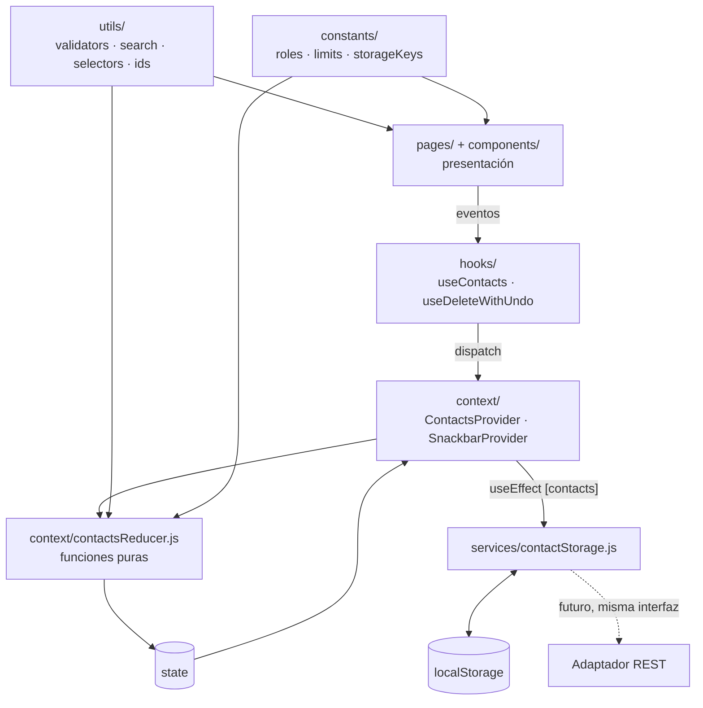
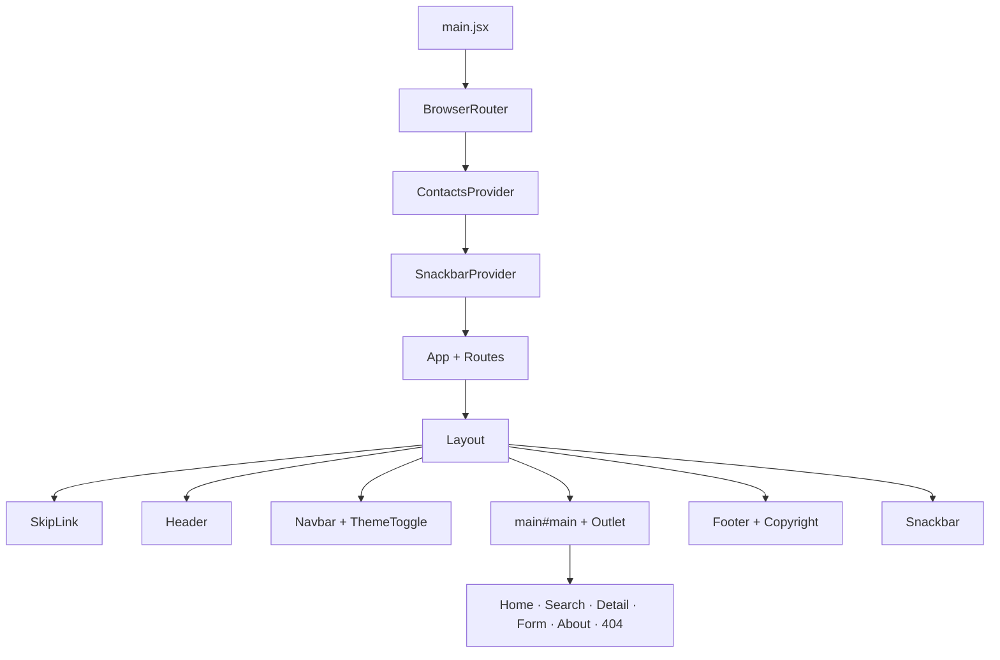
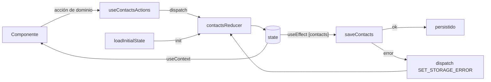
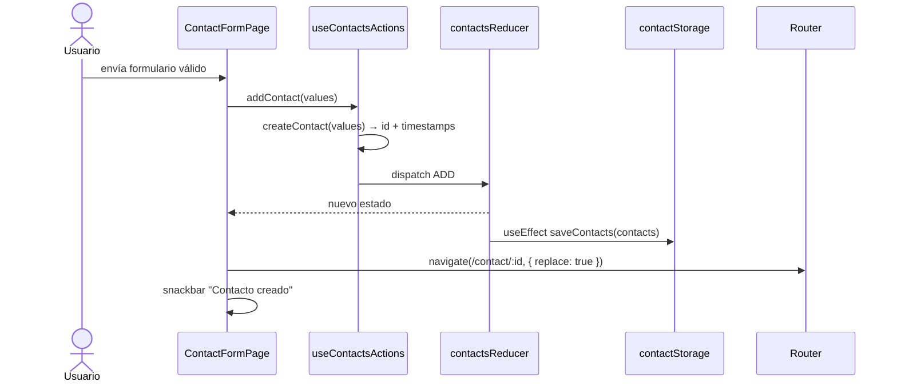
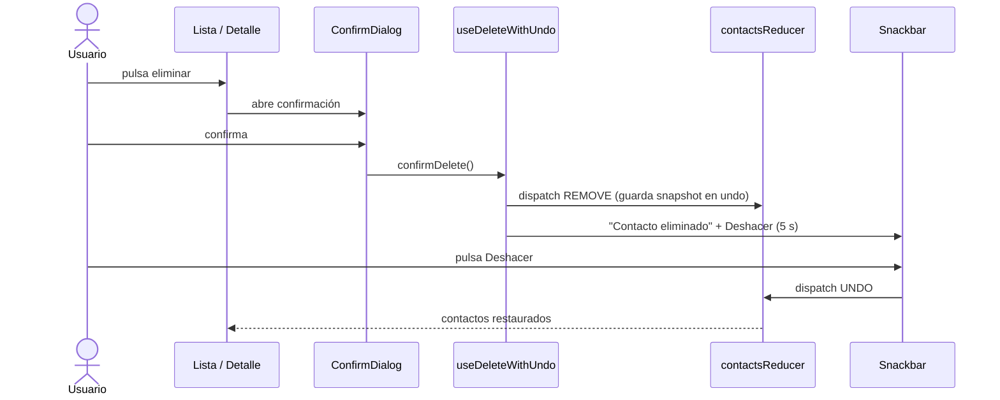
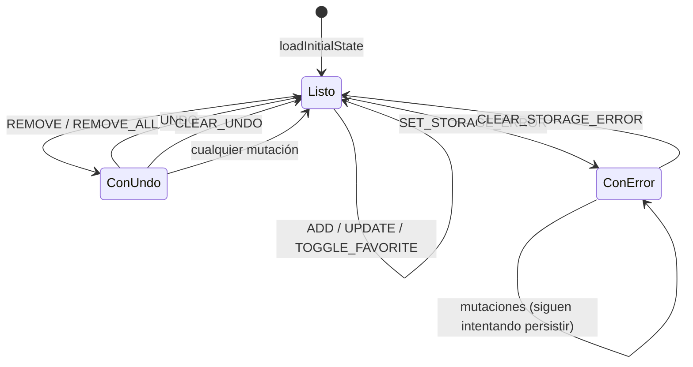
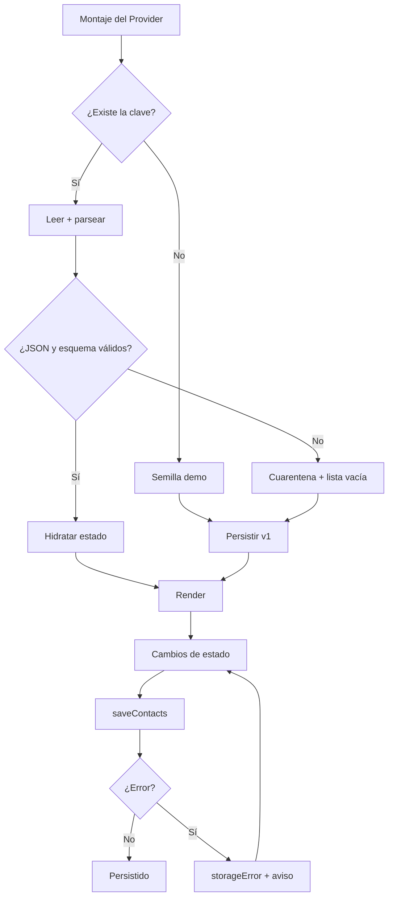
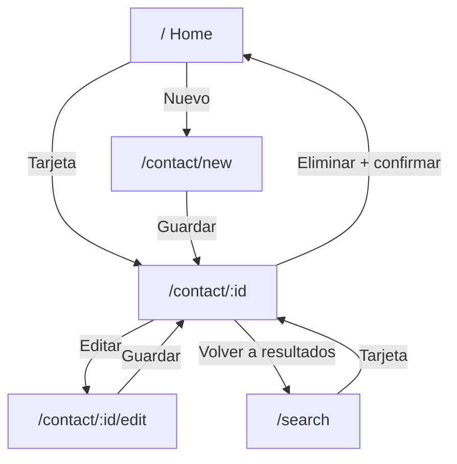

# Contact Manager — Fase 2: Diseño del sistema y arquitectura detallada

> Documento de diseño basado en las decisiones aprobadas en `prompt-3.md`.
> Fecha: 2026-11-02
> Alcance: diseño y planificación. Sin implementación, sin cambios de código, sin instalación de dependencias.

---

## 1. Decisiones aplicadas

### 1.1 Decisiones D1–D10

| ID | Decisión aprobada | Impacto en el diseño |
|---|---|---|
| **D1** | `contact.json` **no** es contrato definitivo; queda pendiente para una futura integración. | No se importa ni se usa. El modelo conserva los nombres actuales. La persistencia se aísla tras un servicio para poder sustituirlo por un adaptador REST sin tocar UI. |
| **D2** | `role` es categoría de relación; no cambiar su significado. | Se mantiene `role` con valores `Amigo`, `Trabajo`, `Familia` (+ `Otro`, pendiente de confirmar). No se crea campo de ocupación. |
| **D3** | Borrar todos con confirmación + deshacer temporal. Multi-selección queda para mejoras. | Acción `REMOVE_ALL` con snapshot de undo; sin checkboxes ni estado de selección. |
| **D4** | `company` opcional; `birthday` fuera del MVP y del formulario. | `company: string` opcional en modelo y formulario. **No existe** `birthday` en el MVP. |
| **D5** | UUID con `crypto.randomUUID()`. | `id: string` UUID v4; `createId()` con fallback para contextos sin `randomUUID`. |
| **D6** | Datos demo en la primera visita; tras borrar todos **no** se reinsertan al recargar. | La **presencia de la clave** de almacenamiento marca "inicializado". Una lista vacía se persiste como `[]`. |
| **D7** | Vitest + RTL + `user-event` + `jsdom`; sin Playwright. | Stack de pruebas definido en la sección 13. |
| **D8** | Páginas independientes `/contact/new` y `/contact/:id/edit`. | Dos rutas; un componente `ContactForm` reutilizado y `ContactFormPage` con `mode`. |
| **D9** | `isFavorite` como atributo del contacto persistido localmente. | Campo booleano dentro de cada contacto; no hay overlay separado. |
| **D10** | Mantener `/contact/:id`. | Se conservan todas las rutas actuales y se añaden las dos de formulario. |

### 1.2 Decisiones adicionales

| # | Decisión | Impacto |
|---|---|---|
| **A1** | `name` obligatorio; al menos un medio de contacto (email **o** teléfono); ambos opcionales individualmente. | Validación cruzada `contactMethod`; el formulario muestra ambos como opcionales con nota "indica al menos uno". |
| **A2** | No renombrar `name`, `phone`, `role`. | El modelo usa esos nombres. Se justifica en 1.3. |
| **A3** | Filtro de favoritos en el MVP. | Se incorpora `?fav=1` en Home y Search. El filtro por rol sigue en P1. |
| **A4** | Tests desde cada módulo. | Cada módulo M1–M8 entrega sus pruebas; M9 consolida regresión. |
| **A5** | Accesibilidad desde cada componente. | Checklist por componente y pruebas por rol/teclado desde su implementación. |
| **A6** | Stack intacto; sin dependencias de runtime. | Solo se añaden dependencias **dev** de testing. |

### 1.3 Verificación de D2 y A2

Valores encontrados en el código (10 ocurrencias):

| Valor | Ubicaciones |
|---|---|
| `Amigo` | `HomePage.jsx:12, 43`, `SearchPage.jsx:13`, `ContactDetailPage.jsx:22` |
| `Trabajo` | `HomePage.jsx:20`, `SearchPage.jsx:21`, `ContactDetailPage.jsx:30` |
| `Familia` | `HomePage.jsx:28`, `SearchPage.jsx:29`, `ContactDetailPage.jsx:38` |

**Conclusión:** `role` representa una **categoría de relación** ("Trabajo" = contacto laboral), no una ocupación ni un cargo. No existe ningún campo de profesión. Por tanto:

- Se mantiene `role` como categoría.
- No se renombra a `type` ni a `category`: sería un cambio semántico sin beneficio funcional y con migración de datos.
- Si en el futuro se necesita ocupación, se añadirá un campo **separado** `jobTitle` (opcional), sin reutilizar `role`. Fuera del MVP.
- `name` = nombre completo mostrado; `phone` = teléfono; ambos conservan su significado actual.

**Única ambigüedad:** el nombre `role` puede sugerir "cargo". Se documentará como "categoría de relación" en el modelo y en la UI ("Categoría"). Renombrarlo requeriría aprobación y migración; no se hace ahora.

---

## 2. Modelo de datos definitivo del MVP

### 2.1 Entidad `Contact`

| Campo | Tipo | Obligatorio | Valor por defecto | Reglas |
|---|---|---|---|---|
| `id` | `string` (UUID v4) | Sí | Generado | Único, inmutable, generado con `createId()`. |
| `name` | `string` | **Sí** | — | `trim()`, 1–80 caracteres. |
| `phone` | `string` | No | `""` | `trim()`, ≤ 30 caracteres; si existe, 6–15 dígitos y solo `+ ( ) - . espacio`. |
| `email` | `string` | No | `""` | `trim()` + minúsculas, ≤ 254, formato válido. |
| `role` | `string` (enum) | **Sí** | — | `Amigo` \| `Trabajo` \| `Familia` \| `Otro` (ver F2-01). |
| `company` | `string` | No | `""` | `trim()`, ≤ 80 caracteres. |
| `isFavorite` | `boolean` | Sí | `false` | Solo modificable por acción de usuario. |
| `createdAt` | `string` (ISO 8601) | Sí | `new Date().toISOString()` | Inmutable. |
| `updatedAt` | `string` (ISO 8601) | Sí | Igual que `createdAt` | Se actualiza al editar contenido. **No** al alternar favorito (ver F2-06). |

**Restricción cruzada:** `phone !== "" || email !== ""`. No se impone unicidad de email (ver F2-07).

**Campos descartados del MVP:** `birthday`, `avatar`, `jobTitle`, `notes`, `address`. No se inventan requisitos.

### 2.2 Ejemplo

```json
{
  "id": "6f1c2a9e-3b4d-4c8a-9f21-7d5e8b0a1c34",
  "name": "Ana García",
  "phone": "+1 (555) 123-4567",
  "email": "ana@email.com",
  "role": "Amigo",
  "company": "",
  "isFavorite": true,
  "createdAt": "2026-01-15T09:00:00.000Z",
  "updatedAt": "2026-01-15T09:00:00.000Z"
}
```

### 2.3 Invariantes del modelo

1. `id` no vacío y único en la colección.
2. `name.trim()` no vacío y ≤ 80.
3. `role` pertenece al enum.
4. Al menos uno de `phone` o `email` no vacío.
5. Si `email` no está vacío, cumple formato y ≤ 254.
6. Si `phone` no está vacío, cumple patrón y longitud.
7. `isFavorite` es booleano.
8. `createdAt` y `updatedAt` son fechas ISO válidas; `updatedAt >= createdAt`.
9. `company` es string (posiblemente vacío).
10. El reducer **nunca** muta objetos ni arrays existentes.

### 2.4 Datos semilla (D6)

`src/data/seedContacts.js` exporta **3 contactos** con UUID e ISO **fijos** (no generados en cada carga), para que:

- Los enlaces de demostración sean estables.
- Los tests sean deterministas.
- No se generen IDs nuevos al recargar antes de persistir.

Se reutilizan Ana García, Carlos López y María Torres con los valores actuales. `createdAt`/`updatedAt` fijos (por ejemplo, `2026-01-01T00:00:00.000Z`).

**Regla de siembra:** solo si `localStorage.getItem(KEY)` devuelve `null`. Si devuelve `[]` (lista vacía persistida), **no** se siembra.

---

## 3. Arquitectura y responsabilidades por capa

### 3.1 Diagrama de capas



### 3.2 Responsabilidades y reglas de dependencia

| Capa | Responsabilidad | Puede importar | **No** puede |
|---|---|---|---|
| `pages/` | Componer la vista, leer URL/params, disparar acciones. | components, hooks, utils, constants | `services/` ni `localStorage` |
| `components/` | Presentación, eventos hacia arriba, a11y local. | ui, utils de formato, constants | contexto global directamente (recibe props) |
| `hooks/` | Orquestar dominio y UI (`useContacts`, `useDeleteWithUndo`, `useTheme`). | context, utils, constants | JSX de página |
| `context/` | Estado, dispatch, persistencia como efecto. | reducer, services, constants | componentes de página |
| `services/` | Serializar, validar, leer/escribir almacenamiento. | constants, utils | React |
| `utils/` | Funciones puras. | constants | React, servicios, estado |
| `constants/` | Valores inmutables. | — | cualquier otra capa |

**Regla clave:** `localStorage` solo se toca en `services/contactStorage.js`. Ningún componente lo conoce.

### 3.3 Árbol de componentes



`BrowserRouter` sigue en `main.jsx`; los providers envuelven `App` para que todas las rutas compartan estado.

---

## 4. Flujo de estado con Context API y `useReducer`

### 4.1 Forma del estado

```js
export const initialState = {
  contacts: [],       // Contact[]
  undo: null,         // { contacts: Contact[], message: string } | null
  storageError: null, // { code, message } | null
};
```

No hay `status: "loading"` porque `localStorage` es síncrono. El estado queda preparado para añadir `loading`/`error` cuando exista API.

### 4.2 Provider

```jsx
// context/ContactsContext.jsx (diseño, no implementación)
const ContactsStateContext = createContext(null);
const ContactsActionsContext = createContext(null);

export function ContactsProvider({ children, initialState: testState }) {
  const [state, dispatch] = useReducer(
    contactsReducer,
    testState,
    testState ? (s) => s : loadInitialState, // seam para tests
  );

  useEffect(() => {
    const result = saveContacts(state.contacts);
    if (!result.ok) dispatch({ type: "SET_STORAGE_ERROR", error: result.error });
  }, [state.contacts]);

  const actions = useMemo(() => createActions(dispatch), []);
  // ...
}
```

**Decisiones:**

- **Dos contextos** (`state` y `actions`): las acciones son estables y no re-renderizan a quien solo las usa.
- **Lazy init** con `loadInitialState()`: lee almacenamiento una sola vez, siembra si procede.
- **Persistencia en efecto** sobre `state.contacts`: no en cada acción, para mantener el reducer puro.
- **Seam de test:** `initialState` opcional evita `localStorage` en pruebas.
- **`StrictMode`:** el efecto puede ejecutarse dos veces; `saveContacts` es idempotente (mismo JSON).
- **Sin `loading`:** si en el futuro se migra a API, se añade `status` y el efecto pasa a ser asíncrono.

### 4.3 Hooks públicos

| Hook | Devuelve | Uso |
|---|---|---|
| `useContactsState()` | `{ contacts, undo, storageError }` | Componentes que solo leen. |
| `useContactsActions()` | `{ addContact, updateContact, removeContact, removeAll, toggleFavorite, undo, clearUndo, clearStorageError }` | Componentes que solo actúan. |
| `useContacts()` | Ambos, por comodidad | Páginas. |
| `useDeleteWithUndo()` | `{ requestDelete, requestDeleteAll, confirmDelete, cancelDelete, pending }` | Lista y detalle: confirma + snackbar + undo. |

### 4.4 Flujo general



### 4.5 Flujo: crear contacto



### 4.6 Flujo: eliminar + deshacer



Si el usuario no pulsa Deshacer, el snackbar se cierra y `CLEAR_UNDO` descarta el snapshot. Si realiza otra mutación, el reducer limpia `undo` para evitar restauraciones incoherentes.

---

## 5. Acciones del reducer y transiciones de estado

### 5.1 Tabla de acciones

| Tipo | Payload | Precondición | `contacts` resultante | `undo` resultante | ¿Persiste? |
|---|---|---|---|---|---|
| `ADD` | `contact` completo | `id` único | `[...contacts, contact]` | `null` | Sí |
| `UPDATE` | `{ id, changes, updatedAt }` | `id` existe | `map` con merge (conserva `id` y `createdAt`) | `null` | Sí |
| `REMOVE` | `{ id, message }` | `id` existe | `filter(c => c.id !== id)` | `{ contacts: prev, message }` | Sí |
| `REMOVE_ALL` | `{ message }` | `contacts.length > 0` | `[]` | `{ contacts: prev, message }` | Sí |
| `TOGGLE_FAVORITE` | `{ id }` | `id` existe | `map` con `isFavorite` invertido | `null` | Sí |
| `UNDO` | — | `undo !== null` | `undo.contacts` | `null` | Sí |
| `CLEAR_UNDO` | — | — | sin cambios | `null` | No |
| `SET_STORAGE_ERROR` | `{ error: { code, message } }` | — | sin cambios | sin cambios | No |
| `CLEAR_STORAGE_ERROR` | — | — | sin cambios | sin cambios | No |

**Notas:**

- Si `id` no existe en `UPDATE`, `REMOVE` o `TOGGLE_FAVORITE`, el reducer devuelve el estado actual (sin excepción).
- `REMOVE_ALL` con lista vacía no genera `undo`.
- `UNDO` restaura la colección completa: preserva orden, favoritos y timestamps.
- Alternar favorito **no** modifica `updatedAt` (F2-06).
- Cualquier mutación (`ADD`, `UPDATE`, `REMOVE`, `REMOVE_ALL`, `TOGGLE_FAVORITE`) limpia `undo`.

### 5.2 Transiciones de estado



### 5.3 Reducer (pseudocódigo)

```js
export function contactsReducer(state, action) {
  switch (action.type) {
    case "ADD":
      return { ...state, contacts: [...state.contacts, action.contact], undo: null };

    case "UPDATE":
      return {
        ...state,
        contacts: state.contacts.map((c) =>
          c.id === action.id ? { ...c, ...action.changes, updatedAt: action.updatedAt } : c,
        ),
        undo: null,
      };

    case "REMOVE": {
      const target = state.contacts.find((c) => c.id === action.id);
      if (!target) return state;
      return {
        ...state,
        contacts: state.contacts.filter((c) => c.id !== action.id),
        undo: { contacts: state.contacts, message: action.message },
      };
    }

    case "REMOVE_ALL":
      if (state.contacts.length === 0) return state;
      return { ...state, contacts: [], undo: { contacts: state.contacts, message: action.message } };

    case "TOGGLE_FAVORITE":
      return {
        ...state,
        contacts: state.contacts.map((c) =>
          c.id === action.id ? { ...c, isFavorite: !c.isFavorite } : c,
        ),
        undo: null,
      };

    case "UNDO":
      return state.undo ? { ...state, contacts: state.undo.contacts, undo: null } : state;

    case "CLEAR_UNDO":
      return { ...state, undo: null };

    case "SET_STORAGE_ERROR":
      return { ...state, storageError: action.error };

    case "CLEAR_STORAGE_ERROR":
      return { ...state, storageError: null };

    default:
      return state;
  }
}
```

### 5.4 Action creators y pureza

El reducer **no** genera UUID ni fechas. Lo hace la capa de acciones:

```js
createContact(values, { id = createId(), now = new Date().toISOString() } = {})
updateContact(existing, values, { now = new Date().toISOString() } = {})
```

Esto permite tests deterministas sin mocks de tiempo ni de criptografía.

### 5.5 Selectores

| Selector | Entrada | Salida |
|---|---|---|
| `selectContactById(contacts, id)` | colección, id | `Contact \| undefined` |
| `selectFavoriteCount(contacts)` | colección | `number` |
| `selectFilteredContacts(contacts, filters)` | colección, `{ query, role, onlyFavorites }` | `Contact[]` |
| `selectNeighbors(contacts, id)` | colección, id | `{ index, total, previous, next }` |

Los selectores son puros y se memoizan en las páginas con `useMemo` cuando aporte valor.

---

## 6. Persistencia en `localStorage` y recuperación ante errores

### 6.1 Claves y sobre (envelope)

| Clave | Contenido | Notas |
|---|---|---|
| `contact-manager:contacts` | `{ version: 1, contacts: Contact[] }` | Clave **estable**; la versión va dentro para migrar en el mismo sitio. |
| `contact-manager:theme` | `"light"` \| `"dark"` | Nueva clave namespaced. |
| `theme` | `"light"` \| `"dark"` | Clave heredada: se lee como fallback y se migra a la nueva. |
| `contact-manager:contacts:corrupt:<ISO>` | string crudo | Cuarentena de datos ilegibles. |

**¿Por qué la versión dentro y no en la clave?** Permite migrar `v1 → v2` leyendo la misma clave, sin recorrer claves antiguas. La clave estable también simplifica el borrado y el diagnóstico.

### 6.2 Algoritmo de carga

```text
1. getItem(KEY) dentro de try/catch.
2. Si es null → primera visita:
   a. contacts = SEED_CONTACTS
   b. intentar saveContacts(contacts)
   c. devolver { contacts, storageError: null | UNAVAILABLE }
3. JSON.parse.
4. Si el resultado es un array → formato heredado v0:
   normalizar, guardar como v1.
5. Si es objeto:
   - version === 1 → validar.
   - version < 1 → migrar.
   - version > 1 → incompatible.
6. Validar sobre y contactos:
   - contactos válidos → conservar.
   - inválidos → descartar y contar.
7. Si JSON, sobre o versión son inválidos:
   a. cuarentena del string crudo (mejor esfuerzo).
   b. guardar { version: 1, contacts: [] } para marcar inicializado.
   c. devolver lista vacía + storageError.
8. Devolver { contacts, storageError }.
```

### 6.3 Algoritmo de guardado

```js
saveContacts(contacts) → { ok: true } | { ok: false, error: { code, message } }
```

- Serializa `{ version: 1, contacts }`.
- `setItem` dentro de `try/catch`.
- Nunca lanza: devuelve resultado.
- El provider despacha `SET_STORAGE_ERROR` si falla.
- No reintenta en bucle: el siguiente cambio de contactos vuelve a intentarlo.

### 6.4 Matriz de fallos y recuperación

| Situación | Detección | Comportamiento | Mensaje |
|---|---|---|---|
| Primera visita | `getItem === null` | Siembra demo y persiste. | — |
| Datos válidos | JSON + esquema OK | Hidrata. | — |
| JSON corrupto | `JSON.parse` lanza | Cuarentena + lista vacía + persistir vacío. **No** resiembra. | "Los datos guardados estaban dañados. Se guardó una copia y se inició una lista vacía." |
| Esquema inválido | `contacts` no es array / campos inválidos | Cuarentena + lista vacía. | Igual que corrupto. |
| Contactos parcialmente inválidos | Validación individual | Conserva válidos, descarta inválidos. | "Se ignoraron N contactos con datos inválidos." |
| Versión futura | `version > 1` | Cuarentena + lista vacía. No se destruye el crudo. | "Datos de una versión no compatible. Se guardó una copia." |
| Versión antigua | `version < 1` o array | Migra y guarda v1. | — |
| Cuota llena | `QuotaExceededError` | Mantiene estado en memoria; aviso persistente. | "No hay espacio para guardar los cambios." |
| Almacenamiento no disponible | `SecurityError` / acceso denegado | Modo memoria; aviso. | "Los cambios no se guardarán al recargar." |
| Lista vacía persistida | `contacts: []` | **No** siembra. | — |

**Limitación explícita:** si `localStorage` no está disponible, no se puede marcar "inicializado"; al recargar se volverá a sembrar la demo. Es inevitable sin almacenamiento y se comunica con el aviso.

### 6.5 Diagrama de persistencia



### 6.6 Migración futura a API REST

La interfaz del servicio se diseña ya con la forma que tendrá el adaptador:

```js
// services/contactStorage.js
export function loadContacts()          // → { contacts, error }
export function saveContacts(contacts)  // → { ok, error }

// futuro services/contactsApi.js
listContacts() / createContact() / updateContact() / removeContact()
```

Al migrar:

1. Se sustituye el servicio por uno asíncrono.
2. El estado añade `status: "loading" | "ready" | "error"`.
3. Las páginas muestran carga/error.
4. `isFavorite` se resuelve según D9/futuro (campo de API u overlay local).
5. `contact.json` se evalúa entonces como contrato (D1 sigue pendiente).

No se implementa nada de esto ahora.

---

## 7. Diseño de rutas y navegación

### 7.1 Tabla de rutas

| Ruta | Elemento | Datos | Comportamiento |
|---|---|---|---|
| `/` | `HomePage` | `?fav=1` opcional | Resumen, "Nuevo contacto", "Eliminar todos", filtro de favoritos, lista. |
| `/search` | `SearchPage` | `?q=&fav=1` | Búsqueda, filtro de favoritos, contador, resultados. |
| `/contact/new` | `ContactFormPage mode="create"` | — | Formulario vacío. |
| `/contact/:id` | `ContactDetailPage` | `state.from` opcional | Detalle, acciones, anterior/siguiente. |
| `/contact/:id/edit` | `ContactFormPage mode="edit"` | — | Formulario precargado; si no existe, "no encontrado". |
| `/about` | `AboutPage` | — | Sin cambios funcionales. |
| `*` | `NotFoundPage` | — | 404 con estilos corregidos. |

**Ranking de rutas:** React Router 7 prioriza el segmento estático `new` sobre `:id`; `/contact/new` nunca se interpreta como un contacto. Aun así, se declara antes por claridad.

### 7.2 Flujos de navegación



| Acción | Destino | Historial |
|---|---|---|
| Crear y guardar | `/contact/:id` | `replace: true` (evita reenviar el formulario al volver). |
| Editar y guardar | `/contact/:id` | `replace: true`. |
| Cancelar formulario | `navigate(-1)` si hay historial; si no, `/` | — |
| Eliminar desde detalle | `location.state?.from ?? "/"` | `replace: true`. |
| Eliminar desde lista/búsqueda | Se queda en la vista actual | — |
| Eliminar todos | Se queda en Home | — |
| Anterior/Siguiente | `/contact/:id` | `push` (permite volver atrás). |
| "Volver a resultados" | `location.state.from` (incluye `?q=&fav=`) o `/search` | — |

**Contexto de búsqueda:** al abrir un detalle desde Search, se pasa `state: { from: location.pathname + location.search }`. Si el usuario recarga, `state` se pierde y el enlace cae a `/search` sin filtros. Es una degradación aceptable y documentada.

### 7.3 Anterior / Siguiente

- Se calculan con `selectNeighbors(contacts, id)` sobre la **colección global** en orden de inserción.
- No se usa aritmética de IDs (corrige P-04).
- En los extremos, el botón se deshabilita.
- Si se llega desde una búsqueda filtrada, la navegación sigue siendo global para evitar estados frágiles; el enlace "Volver a resultados" conserva el contexto. **Requiere confirmación (F2-04).**

### 7.4 Título, foco y scroll

- `useDocumentTitle(title)` por página: "Contactos", "Buscar", nombre del contacto, "Nuevo contacto", etc.
- Al cambiar de ruta, se enfoca `main#main` (sin robar foco en la carga inicial).
- `useScrollToTop()` en cambios de `pathname`.
- Un `SkipLink` al inicio permite saltar a `#main`.

### 7.5 Estados no encontrados

- `/contact/:id` inexistente → tarjeta "Contacto no encontrado" con enlace a Home.
- `/contact/:id/edit` inexistente → misma tarjeta.
- Ruta desconocida → 404 con estilos corregidos.
- ID malformado → se trata como inexistente (sin `Number()`).

---

## 8. Componentes y páginas reutilizables

### 8.1 Primitivas UI (`components/ui/`)

| Componente | Props | Responsabilidad / a11y |
|---|---|---|
| `Button` | `variant`, `size`, `type`, `children` | Botón base; `type="button"` por defecto; `:focus-visible`. |
| `IconButton` | `label` (obligatorio), `icon`, `variant` | `aria-label` obligatorio; área táctil ≥ 44 px. |
| `Badge` | `children`, `tone` | Etiqueta de categoría; contraste AA. |
| `ConfirmDialog` | `open`, `title`, `description`, `confirmLabel`, `cancelLabel`, `tone`, `onConfirm`, `onCancel` | `<dialog>` nativo, `aria-labelledby`/`aria-describedby`, Esc, foco devuelto al disparador. |
| `Snackbar` | `message`, `actionLabel`, `onAction`, `duration`, `onDismiss` | `role="status"`, `aria-live="polite"`; pausa al enfocar/hover; no roba foco. |
| `EmptyState` | `title`, `description`, `action` | Estado vacío con CTA; encabezado semántico. |
| `FormField` | `id`, `label`, `error`, `hint`, `required`, `children` | Asocia label, error (`aria-describedby`), `aria-invalid`. |
| `ErrorBoundary` | `fallback` | Captura errores de render; enlace a Home. |

### 8.2 Componentes de contacto (`components/contacts/`)

| Componente | Props | Responsabilidad / a11y |
|---|---|---|
| `ContactList` | `contacts`, `onToggleFavorite`, `onRequestDelete`, `emptyState` | `<ul>`/`<li>`; delega tarjetas; estado vacío. |
| `ContactCard` | `contact`, `onToggleFavorite`, `onRequestDelete` | `<article>`; `<h3><Link>` al detalle; favorito con `aria-pressed`; borrar con `IconButton`; **sin interactivos anidados**. |
| `ContactSummary` | `total`, `favorites` | Resumen con pluralización correcta; `aria-live="polite"`. |
| `SearchBar` | `value`, `onChange`, `onClear` | `<label>` (visible u oculta), botón limpiar con nombre. |
| `ContactFilters` | `onlyFavorites`, `onChange`, `onClear` | Toggle de favoritos; en P1 se añade rol. |
| `ContactForm` | `mode`, `initialValues`, `onSubmit`, `onCancel` | Formulario controlado; validación; resumen de errores. |

### 8.3 Layout (`components/layout/`)

| Componente | Responsabilidad / a11y |
|---|---|
| `Layout` | Header, Navbar, `main#main`, Footer, Snackbar, SkipLink. **Un solo `main`.** |
| `Header` | Marca; deja de ser `<h1>` global para permitir un `h1` por página. |
| `Navbar` | `<nav aria-label="Principal">`; `NavLink` (añade `aria-current`); `ThemeToggle`. |
| `ThemeToggle` | Botón con `aria-pressed`; label dinámico; persistencia. |
| `Footer` / `Copyright` | Estilos corregidos (P-07). |
| `SkipLink` | Primer elemento enfocable; salta a `#main`. |

### 8.4 Páginas

| Página | Contenido | Acciones |
|---|---|---|
| `HomePage` | Resumen, botones "Nuevo" y "Eliminar todos", filtro de favoritos, lista. | Crear, borrar todos, favorito, borrar uno, abrir detalle. |
| `SearchPage` | Buscador, filtro de favoritos, contador, resultados. | Buscar, limpiar, favorito, borrar, abrir detalle. |
| `ContactDetailPage` | Breadcrumb, datos, favorito, acciones, anterior/siguiente. | Editar, borrar, favorito, navegar. |
| `ContactFormPage` | Formulario crear/editar. | Guardar, cancelar. |
| `AboutPage` | Información y versión. | — |
| `NotFoundPage` | 404. | Volver a Home. |

### 8.5 Checklist de accesibilidad por componente

1. Elemento interactivo real (`button`, `a`, `input`, `select`), nunca `div` con `onClick`.
2. Nombre accesible (texto visible o `aria-label`).
3. `type="button"` en botones que no envían formularios.
4. `:focus-visible` con contraste.
5. Estado comunicado con texto/ARIA, no solo color (`aria-pressed`, `aria-current`, `aria-invalid`).
6. Un `h1` por página y jerarquía sin saltos.
7. Un solo `main`; landmarks correctos.
8. `aria-live` para resultados, errores y undo.
9. Contraste ≥ 4.5:1 en texto normal.
10. `prefers-reduced-motion` respetado.
11. Área táctil ≥ 44×44 px.
12. Formularios con `label`, `autocomplete`, `inputmode` y errores asociados.

---

## 9. Formularios, validaciones, confirmaciones y deshacer

### 9.1 Campos y validación

| Campo | Control | Reglas | Mensaje |
|---|---|---|---|
| `name` | `text`, `autocomplete="name"` | Obligatorio; `trim`; 1–80 | "El nombre es obligatorio." / "Máximo 80 caracteres." |
| `email` | `email`, `autocomplete="email"`, `inputmode="email"` | Opcional; si existe, formato y ≤ 254 | "Introduce un correo válido." |
| `phone` | `tel`, `autocomplete="tel"`, `inputmode="tel"` | Opcional; si existe, 6–15 dígitos y caracteres permitidos | "Introduce un teléfono válido." |
| `role` | `select` | Obligatorio; valor del enum | "Selecciona una categoría." |
| `company` | `text`, `autocomplete="organization"` | Opcional; ≤ 80 | "Máximo 80 caracteres." |
| **Cruzado** | — | `email` o `phone` no vacío | "Indica al menos un medio de contacto: correo o teléfono." |

**Normalización al guardar:** `trim` en todos los strings; `email` a minúsculas; `phone` se conserva tal como se escribe (sin formateo automático).

**Email:** regex pragmática `/^[^\s@]+@[^\s@]+\.[^\s@]+$/`; no se promete RFC 5322 completo.

### 9.2 Comportamiento del formulario

- Estado local controlado (`values`, `errors`, `touched`).
- Validación al `blur`, al cambiar si el campo ya tenía error, y al enviar.
- Al enviar con errores: resumen `role="alert"`, foco en el primer campo inválido.
- Cada campo: `aria-invalid`, `aria-describedby` al error, `required` cuando aplica.
- No se deshabilita el botón Guardar (permite descubrir errores).
- Cancelar no guarda; si hay cambios sin guardar, se puede confirmar en P1 (no MVP).
- Tras guardar: `replace` al detalle + snackbar "Contacto creado/actualizado".

### 9.3 Modo crear vs editar

| Aspecto | Crear | Editar |
|---|---|---|
| Ruta | `/contact/new` | `/contact/:id/edit` |
| Valores iniciales | `{ name:"", email:"", phone:"", role:"", company:"" }` | Contacto existente |
| Si no existe | — | Estado "no encontrado" con enlace a Home |
| Al guardar | `addContact` + `navigate(/contact/:id, { replace: true })` | `updateContact` + `navigate(/contact/:id, { replace: true })` |
| `createdAt` | Generado | Se conserva |
| `updatedAt` | Igual a `createdAt` | Ahora |

### 9.4 Confirmaciones

| Acción | Diálogo | Texto |
|---|---|---|
| Eliminar uno | `ConfirmDialog` | "¿Eliminar a {name}? Esta acción se puede deshacer durante unos segundos." |
| Eliminar todos | `ConfirmDialog` | "¿Eliminar todos los contactos? Se pueden deshacer durante unos segundos." |

- Botón destructivo con variante `danger`.
- Cancelar devuelve el foco al disparador.
- Esc y clic en backdrop cierran sin ejecutar.
- No se usa `window.confirm`.

### 9.5 Deshacer

| Aspecto | Diseño |
|---|---|
| Alcance | Borrado individual y borrado total. |
| Snapshot | `state.undo.contacts` (colección completa previa). |
| Duración | 5 segundos (F2-08). |
| UI | `Snackbar` con acción "Deshacer", `role="status"`. |
| Cancelación | `CLEAR_UNDO` al cerrar o al realizar otra mutación. |
| Persistencia | El borrado se persiste de inmediato; el undo también persiste al restaurar. |
| Recarga | El undo se pierde (solo memoria). |
| Accesibilidad | No roba foco; pausa el temporizador al enfocar/hover. |

**Por qué snapshot completo:** el dataset es pequeño y evita lógica inversa propensa a errores (restaurar un contacto en su índice, conservar favoritos, etc.).

---

## 10. Estrategia de búsqueda y filtros

### 10.1 Normalización

```js
normalizeText(value) =
  String(value ?? "")
    .normalize("NFD")
    .replace(/\p{Diacritic}/gu, "")
    .toLowerCase()
    .trim();
```

- "María" y "maria" coinciden.
- Mayúsculas/minúsculas irrelevantes.
- Se aplica a `name`, `email`, `role` y al texto de búsqueda.

### 10.2 Coincidencia

```js
matchesQuery(contact, query):
  q = normalizeText(query)
  si q === "" → true
  si normalizeText(name/email/role).includes(q) → true
  dígitos = q.replace(/\D/g, "")
  si dígitos !== "" y phoneDigits(contact.phone).includes(dígitos) → true
  si no → false
```

**Campos cubiertos (MVP):** nombre, email, teléfono y rol. `company` **no** se busca en el MVP (F2-09); añadirlo después es una línea.

### 10.3 Filtros

| Filtro | MVP | P1 |
|---|---|---|
| Texto `q` | Sí | — |
| Solo favoritos `fav=1` | **Sí** (A3) | — |
| Rol | No (solo búsqueda textual por rol) | Sí, desplegable |
| Combinación | AND entre filtros activos | — |

### 10.4 Estado en la URL

| Param | Valores | Validación |
|---|---|---|
| `q` | texto libre | `trim`; vacío se elimina. |
| `fav` | `"1"` | Cualquier otro valor se ignora. |
| `role` | valor del enum (P1) | Valor inválido se ignora. |

- El input mantiene estado local para no perder el cursor.
- Se sincroniza con la URL con un debounce de 250 ms y `replace: true` (no llena el historial).
- Al montar y en `popstate`, se lee la URL y se actualiza el input.
- "Limpiar" borra `q` y `fav` (y `role` en P1).

### 10.5 Resultados y estados vacíos

| Situación | Mensaje | Acción |
|---|---|---|
| Sin contactos | "Aún no tienes contactos." | "Crear contacto" |
| Con filtros y 0 resultados | "No hay contactos que coincidan con tu búsqueda." | "Limpiar filtros" |
| Solo favoritos y 0 | "Todavía no tienes favoritos." | "Ver todos" |

- Contador: "3 contactos" / "1 contacto" con `aria-live="polite"`.
- El contador refleja el resultado filtrado, no el total.

---

## 11. Tema y estilos (transversal)

- **Tokens semánticos** en `styles/tokens.css`: `--color-bg`, `--color-surface`, `--color-text`, `--color-muted`, `--color-accent`, `--color-danger`, `--color-focus`, `--color-border`, `--radius-*`, `--space-*`.
- Tema en `<html data-theme="light|dark">`; se mantienen alias de las variables actuales durante la migración.
- `useTheme()`: lee `contact-manager:theme`, fallback a `theme`, y si no hay preferencia usa `matchMedia("(prefers-color-scheme: dark)")`.
- Persistencia al alternar; si el usuario no ha elegido, se escucha el cambio del sistema.
- **Sin FOUC:** script inline mínimo en `index.html` que aplica `data-theme` antes del primer render.
- `prefers-reduced-motion` para desactivar transiciones.
- Se eliminan colores hardcodeados de los módulos y se sustituyen por tokens.
- `box-sizing: border-box` global y foco visible homogéneo.

---

## 12. Estructura de carpetas definitiva

```text
src/
├── components/
│   ├── contacts/
│   │   ├── ContactCard.jsx        + ContactCard.module.css
│   │   ├── ContactFilters.jsx     + ContactFilters.module.css
│   │   ├── ContactForm.jsx        + ContactForm.module.css
│   │   ├── ContactList.jsx        + ContactList.module.css
│   │   ├── ContactSummary.jsx     + ContactSummary.module.css
│   │   └── SearchBar.jsx          + SearchBar.module.css
│   ├── layout/
│   │   ├── Layout.jsx
│   │   ├── Header.jsx             + Header.module.css
│   │   ├── Navbar.jsx             + Navbar.module.css
│   │   ├── Footer.jsx             + Footer.module.css
│   │   ├── Copyright.jsx
│   │   └── SkipLink.jsx
│   ├── ui/
│   │   ├── Badge.jsx              + Badge.module.css
│   │   ├── Button.jsx             + Button.module.css
│   │   ├── IconButton.jsx         + IconButton.module.css
│   │   ├── ConfirmDialog.jsx      + ConfirmDialog.module.css
│   │   ├── Snackbar.jsx           + Snackbar.module.css
│   │   ├── EmptyState.jsx         + EmptyState.module.css
│   │   ├── ErrorBoundary.jsx      + ErrorBoundary.module.css
│   │   └── FormField.jsx          + FormField.module.css
│   └── Breadcrumbs.jsx            + Breadcrumbs.module.css
├── context/
│   ├── ContactsContext.jsx
│   ├── contactsReducer.js
│   └── SnackbarContext.jsx
├── hooks/
│   ├── useContacts.js
│   ├── useDeleteWithUndo.js
│   ├── useTheme.js
│   ├── useDocumentTitle.js
│   └── useScrollToTop.js
├── pages/
│   ├── HomePage.jsx               + HomePage.module.css
│   ├── SearchPage.jsx             + SearchPage.module.css
│   ├── ContactDetailPage.jsx      + ContactDetailPage.module.css
│   ├── ContactFormPage.jsx        + ContactFormPage.module.css
│   ├── AboutPage.jsx              + AboutPage.module.css
│   └── NotFoundPage.jsx           + NotFoundPage.module.css
├── services/
│   └── contactStorage.js
├── data/
│   └── seedContacts.js
├── constants/
│   ├── roles.js
│   ├── limits.js
│   └── storageKeys.js
├── utils/
│   ├── ids.js
│   ├── validators.js
│   ├── search.js
│   └── selectors.js
├── styles/
│   ├── tokens.css
│   └── base.css
├── test/
│   ├── setup.js
│   ├── factories.js
│   └── renderWithProviders.jsx
├── App.jsx
├── index.css
└── main.jsx
```

**Movimientos respecto a la estructura actual:** `Layout`, `Header`, `Navbar`, `Footer` y `Copyright` pasan a `components/layout/`; `ContactList`/`ContactCard`/`Badge` se reubican en `contacts/` y `ui/`. Son movimientos mecánicos, sin cambio de comportamiento, y se harán en un commit aislado.

**Archivos que desaparecen:** `src/App.css`, `src/layout/Layout.jsx` (se mueve), `src/assets/hero.png`, `src/assets/react.svg`, `src/assets/vite.svg`, `public/icons.svg` (previa verificación). `src/index.css` se mantiene como punto de entrada de estilos y delega en `styles/`.

---

## 13. Estrategia de pruebas por módulo

### 13.1 Herramientas y configuración

| Elemento | Decisión |
|---|---|
| Runner | `vitest` |
| Entorno | `jsdom` |
| Componentes | `@testing-library/react` |
| Interacción | `@testing-library/user-event` |
| Matchers | `@testing-library/jest-dom` |
| Cobertura | `@vitest/coverage-v8` |
| E2E | No (D7) |

`vitest.config.js`:

```js
test: {
  environment: "jsdom",
  setupFiles: ["./src/test/setup.js"],
  restoreMocks: true,
  coverage: { provider: "v8", reporter: ["text", "html"] },
}
```

`src/test/setup.js`: importa `@testing-library/jest-dom/vitest`, limpia `localStorage` antes de cada test y define un mock de `matchMedia`.

`src/test/renderWithProviders.jsx`: `MemoryRouter` + `ContactsProvider initialState` + `SnackbarProvider`, con `initialEntries` configurable.

`src/test/factories.js`: `makeContact(overrides)` con IDs y fechas deterministas.

### 13.2 Pruebas por módulo

| Módulo | Archivos de test | Casos clave |
|---|---|---|
| **M1. Dominio** | `utils/validators.test.js`, `utils/ids.test.js`, `utils/search.test.js`, `utils/selectors.test.js` | Nombre vacío/largo; email inválido; teléfono inválido; regla email-o-teléfono; roles válidos; UUID formato/fallback; normalización de acentos; búsqueda por teléfono; filtros combinados; vecinos. |
| **M2. Estado** | `context/contactsReducer.test.js`, `services/contactStorage.test.js`, `context/ContactsContext.test.jsx` | Cada acción; undo/clear; mutaciones limpias; inmutabilidad; carga primera visita; lista vacía persistida; JSON corrupto; cuarentena; versión futura; cuota; `localStorage` no disponible; provider expone estado/acciones. |
| **M3. Vistas** | `pages/HomePage.test.jsx`, `pages/SearchPage.test.jsx`, `pages/ContactDetailPage.test.jsx` | Render con datos; vacío; borrar y ver reflejo; favorito; detalle; no encontrado; anterior/siguiente; cambio entre páginas sin recargar. |
| **M4. CRUD y formulario** | `pages/ContactFormPage.test.jsx`, `components/contacts/ContactForm.test.jsx`, `components/ui/ConfirmDialog.test.jsx` | Crear válido; errores por campo; error cruzado; foco en primer error; editar; cancelar; confirmar/cancelar borrado; foco devuelto; Esc. |
| **M5. Búsqueda y filtros** | `pages/SearchPage.test.jsx`, `utils/search.test.js` | URL `?q=`; acentos; teléfono; favoritos; limpiar; contador; estados vacíos; `replace` (sin historial extra). |
| **M6. Detalle y navegación** | `pages/ContactDetailPage.test.jsx`, `App.test.jsx` | Vecinos por índice; extremos deshabilitados; breadcrumb; "volver a resultados"; rutas inválidas; 404. |
| **M7. Tema** | `hooks/useTheme.test.js` | Preferencia guardada; fallback al sistema; persistencia; atributo `data-theme`; sin duplicar listeners. |
| **M8. Accesibilidad** | `components/contacts/ContactCard.test.jsx`, `components/ui/Snackbar.test.jsx`, `pages/*.test.jsx` | Abrir tarjeta con Enter; `aria-pressed`; labels; `aria-live`; foco en diálogo; un `h1`; un `main`. |
| **M9. Regresión** | `App.test.jsx`, suite completa | Flujo crear → buscar → favorito → detalle → editar → borrar → deshacer → recargar (con storage simulado). |
| **M10. Documentación** | — | Revisión manual de README/arquitectura/modelo. |

### 13.3 Cobertura

| Ámbito | Objetivo |
|---|---|
| `utils/`, `contactsReducer`, `contactStorage` | ≥ 90 % líneas/ramas. |
| `context/`, `hooks/` | ≥ 85 %. |
| Componentes y páginas | ≥ 70 %. |
| Global | ≥ 75 % líneas (no bloqueante al inicio; se fija al cerrar el MVP). |

### 13.4 Comandos

```json
"test": "vitest run",
"test:watch": "vitest",
"test:coverage": "vitest run --coverage"
```

### 13.5 Dependencias de desarrollo

| Paquete | Justificación |
|---|---|
| `vitest` | Runner nativo de Vite (aprobado). |
| `jsdom` | DOM para tests (aprobado). |
| `@testing-library/react` | Pruebas por comportamiento (aprobado). |
| `@testing-library/user-event` | Interacción realista (aprobado). |
| `@testing-library/jest-dom` | Matchers de DOM/accesibilidad (complemento directo del stack aprobado). |
| `@vitest/coverage-v8` | Cobertura (complemento directo). |
| `eslint-plugin-jsx-a11y` | Opcional, dev; a11y estática. |

Sin dependencias de runtime nuevas.

---

## 14. Contradicciones y decisiones que requieren aprobación

### 14.1 Contradicciones resueltas por tus decisiones

| Contradicción con la Fase 1 | Resolución |
|---|---|
| La Fase 1 proponía alinear nombres a `fullname`/`phonenumber`/`type`. | **Resuelta:** D1 + A2 → se mantienen `name`, `phone`, `role`. |
| La Fase 1 incluía `birthday` opcional en el modelo. | **Resuelta:** D4 → fuera del MVP y del formulario. |
| La Fase 1 dejaba el filtro de favoritos en P1. | **Resuelta:** A3 → pasa al MVP. |
| La Fase 1 sembraba demo "en la primera visita" sin detallar el borrado total. | **Resuelta:** D6 → la presencia de la clave marca inicializado; `[]` no resiembra. |
| La Fase 1 agrupaba todos los tests en M9. | **Resuelta:** A4 → tests por módulo; M9 solo consolida. |

### 14.2 Decisiones pendientes

| ID | Tema | Opciones | Recomendación |
|---|---|---|---|
| **F2-01** | Valor `Otro` en `role` | Añadirlo al enum / mantener solo los 3 actuales | Añadirlo: permite clasificar sin inventar categorías y evita texto libre. |
| **F2-02** | Datos corruptos | Sembrar demo / iniciar vacío + cuarentena | **Iniciar vacío + cuarentena**, para no resucitar datos que el usuario pudo haber borrado. |
| **F2-03** | Filtro de favoritos en Home | Estado local / `?fav=1` | URL, por coherencia con Search y enlaces compartibles. |
| **F2-04** | Anterior/Siguiente en detalle | Orden global / orden filtrado de la búsqueda | Global + "Volver a resultados" con el contexto. |
| **F2-05** | Destino al borrar desde detalle | Home / vista de origen | `location.state.from` con fallback a Home. |
| **F2-06** | `updatedAt` al alternar favorito | Actualizar / no actualizar | No actualizar: el favorito no es una edición de contenido. |
| **F2-07** | Unicidad de email | Permitir duplicados / bloquear | Permitir duplicados (familias comparten correo); no bloquear el alta. |
| **F2-08** | Límites y undo | 80/30/254/80 y 5 s | Mantener estas cifras; ajustables sin impacto arquitectónico. |
| **F2-09** | Buscar por `company` | Sí / no en MVP | No en MVP; se añade en P1. |
| **F2-10** | Filtro por rol | MVP / P1 | P1 (solo el filtro de favoritos se movió al MVP). |
| **F2-11** | Claves de tema | Mantener `theme` / namespaced + fallback | Namespaced con lectura de la clave heredada. |
| **F2-12** | Semilla con IDs fijos | Sí / generar en cada carga | Fijos, para enlaces estables y tests deterministas. |
| **F2-13** | Rol por defecto en el formulario | `Otro` preseleccionado / vacío + obligatorio | Vacío con placeholder "Selecciona una categoría" y validación. |
| **F2-14** | ¿Buscador también en Home? | Sí / no | No: Home lista y filtra favoritos; Search busca. |
| **F2-15** | `contact.json` | Usar / ignorar | Ignorar y dejar pendiente (D1); no se importa ni se modifica. |

---

## 15. Resumen de la Fase 2

| Elemento | Diseño |
|---|---|
| Modelo | 9 campos; `name` obligatorio; email o teléfono; `company` opcional; sin `birthday`; `isFavorite` local. |
| Estado | Context + `useReducer`, dos contextos (estado/acciones), reducer puro, action creators con UUID/fechas. |
| Persistencia | `localStorage` con sobre versionado, cuarentena de datos corruptos, modo memoria y avisos. |
| Siembra | Solo si la clave no existe; `[]` persistido no resiembra. |
| Rutas | Actuales + `/contact/new` y `/contact/:id/edit`; detalle con vecinos por índice. |
| Componentes | Primitivas UI, dominio de contactos y layout separados; tarjeta con enlace real. |
| Formularios | Validación por campo + cruzada; resumen de errores; foco gestionado. |
| Borrado | Confirmación nativa + snackbar con deshacer de 5 s. |
| Búsqueda | Normalizada, por nombre/email/teléfono/rol, con `?q=` y `?fav=1`. |
| Pruebas | Vitest + RTL + `user-event` + `jsdom`, por módulo, con cobertura objetivo. |
| Dependencias | Ninguna de runtime; solo dev de testing. |

---

## Cierre

Este documento no ha implicado cambios en el código del proyecto ni instalación de dependencias. El diseño está listo para revisión.

Quedo a la espera de tu aprobación de la Fase 2 y de tus respuestas a **F2-01, F2-02, F2-04 y F2-05** (las que más afectan al comportamiento); el resto puede asumirse con las recomendaciones indicadas.
