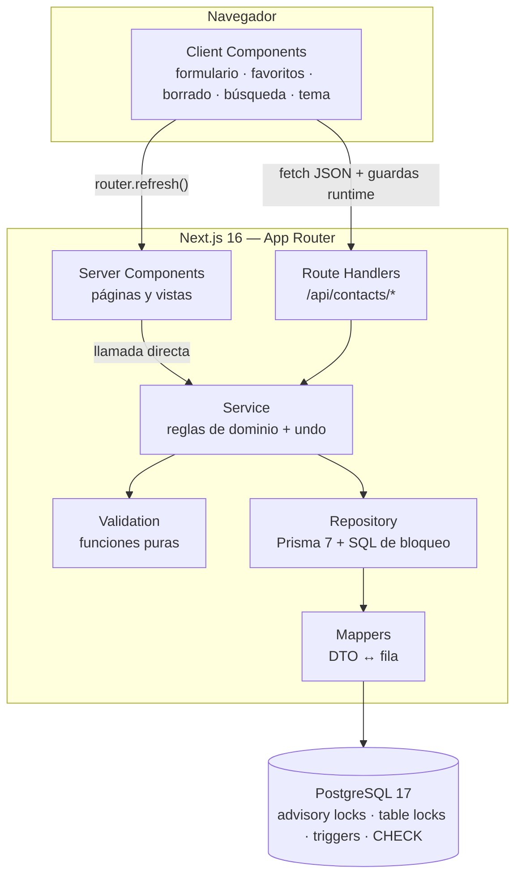

# Contact Manager — Fase 3: Arquitectura full-stack consolidada

> Documento de arquitectura basado en `prompt-3.md` … `prompt-9.md` y en las decisiones aprobadas en cada revisión.
> Fecha: 2026-11-03
> Estado: **aprobado**. Incorpora las correcciones P1–P4 (`prompt-8.md`), Q1–Q4 (`prompt-9.md`) y la sincronización con las decisiones visuales D-V1–D-V9 (`docs/direccion-visual.md`).
> Alcance: diseño. No incluye implementación, instalación de dependencias ni ejecución de migraciones (eso es M0 en adelante).

---

## 1. Resumen y alcance

La Fase 3 convierte el Contact Manager en **un único proyecto Next.js full-stack** (App Router), con TypeScript estricto, Tailwind CSS v4, Prisma 7 sobre PostgreSQL y pruebas con Vitest + Testing Library.

| Aspecto | Decisión |
|---|---|
| Runtime | Node.js 24.15.0, pnpm 12.11.2 |
| Framework | Next.js 16 (App Router, Server Components + Route Handlers) |
| Lenguaje | TypeScript 5.9.3, `strict`, `noUncheckedIndexedAccess` |
| Persistencia | PostgreSQL 17 vía Prisma 7.10.1 (`prisma-client` generator + `@prisma/adapter-pg`) |
| Estilos | Tailwind CSS v4 con tokens semánticos en variables CSS; tema oscuro por defecto y tema claro soportado; sin CSS Modules |
| Pruebas | Vitest 5 + RTL + `user-event` + `jsdom` (unitarias) y PostgreSQL real (integración) |
| Backend | Route Handlers del mismo proyecto; sin Express, NestJS ni Django |

**Fuera del MVP:** autenticación, multi-usuario, `birthday`, `avatar`, `jobTitle`, `notes`, `address`, multi-selección, filtro por rol, Playwright.

**Advertencia de despliegue:** el MVP usa un dataset único sin autenticación. Cualquier despliegue público en modo `read-write` expone lectura y escritura completas. No debe publicarse con escritura sin un modelo de autorización (`ownerId` u equivalente), que queda fuera de alcance. La demostración pública se publica en modo de solo lectura (`CONTACTS_ACCESS_MODE=read-only` + rol de base de datos de solo lectura); ver `docs/despliegue-demo.md`.

---

## 2. Decisiones aplicadas

### 2.1 D1–D10

| ID | Decisión | Consecuencia en el diseño |
|---|---|---|
| **D1** | `contact.json` no es contrato; no se importa ni se modifica | El contrato real es el DTO de la sección 8. `contact.json` permanece intacto. |
| **D2** | `role` es categoría de relación, no cargo | Enum `Role` con 4 valores; etiqueta de UI «Categoría». Sin `jobTitle`. |
| **D3** | Borrar todo con confirmación + deshacer de 5 s; sin multi-selección | `DELETE /api/contacts` + `UndoBatch`; sin checkboxes. |
| **D4** | `company` opcional en UI, `NOT NULL DEFAULT ''`; sin `birthday` | Columna `company` no nula con cadena vacía. |
| **D5** | UUID generados por el servicio con `crypto.randomUUID()` | Sin `@default(uuid())` ni `dbgenerated(gen_random_uuid())`. |
| **D6** | Seed explícito sin resiembra; marca persistente | `system_state['seed:v1']` (sección 12). |
| **D7** | Vitest + RTL + `user-event` + `jsdom`; integración con PostgreSQL real | Dos configuraciones de Vitest (sección 14). |
| **D8** | `/contact/new` y `/contact/[id]/edit` | Rutas independientes, formulario compartido. |
| **D9** | `isFavorite` persistido; no altera `updatedAt` | Garantizado por trigger (sección 6). |
| **D10** | `/contact/[id]` se mantiene | Sin cambios de URL pública respecto a Fase 2. |

Precisiones de `prompt-3.md` vigentes: `name` obligatorio y al menos un medio de contacto (`email` o `phone`); no renombrar `name`, `phone`, `role`; favoritos en el MVP; pruebas por módulo; accesibilidad desde cada componente. La precisión 6 de `prompt-3.md` (JavaScript, Vite, React Router, CSS Modules) queda **sustituida** por TypeScript, Next.js y Tailwind, según `prompt-4.md`.

### 2.2 F2-01, F2-04, F2-05

| ID | Decisión | Consecuencia |
|---|---|---|
| **F2-01** | `Otro` se añade al enum `Role` | `Amigo \| Trabajo \| Familia \| Otro`; los valores existentes no cambian. |
| **F2-04** | Anterior/Siguiente sobre los resultados filtrados | `getDetail(id, filters)` calcula `index`, `previous`, `next` sobre la lista filtrada y conserva `q` y `fav`. |
| **F2-05** | `?from=` validado; nunca redirección externa | Solo se aceptan `/` y `/search` (con filtros canónicos). Origen inválido → `/`. |

### 2.3 N-01 a N-12

| ID | Decisión |
|---|---|
| **N-01** | Seed explícito, idempotente y seguro con datos preexistentes; decisión bajo mutex + `LOCK TABLE … SHARE` |
| **N-02** | Borrado lógico + `UndoBatch` + reloj de PostgreSQL + transacciones + purga segura |
| **N-03** | Dataset único sin autenticación; no apto para despliegue público |
| **N-04** | Búsqueda en servidor con normalización de texto y de teléfono |
| **N-05** | Tailwind v4, tokens CSS semánticos, tema oscuro por defecto y tema claro soportado, sin CSS Modules |
| **N-06** | Versiones exactas + lockfile + `.nvmrc` + `packageManager` |
| **N-07** | `role` verificado como categoría de relación; enum de 4 valores |
| **N-08** | `updatedAt` no cambia con favorito, borrado ni restauración; es estrictamente creciente con cambios de contenido |
| **N-09** | Integración con PostgreSQL real, incluida concurrencia determinista |
| **N-10** | Validación propia, sin Zod |
| **N-11** | `strict` + `noUncheckedIndexedAccess` |
| **N-12** | `tsx` para seed y purga |

### 2.4 Correcciones P1–P4 (`prompt-8.md`)

| ID | Corrección | Estado |
|---|---|---|
| **P1** | El seed nunca inserta demos si la tabla tiene filas, aunque falte la marca | Cerrada |
| **P2** | PostgreSQL es la única autoridad de `createdAt` y `updatedAt` | Cerrada |
| **P3** | Normalización telefónica específica, independiente de `normalizeText()` | Cerrada |
| **P4** | Pruebas de concurrencia con dos conexiones reales y detección por `pg_blocking_pids()` | Cerrada |

### 2.5 Correcciones Q1–Q4 (`prompt-9.md`)

| ID | Corrección | Estado |
|---|---|---|
| **Q1** | Deadlock real entre `seed` y `deleteAll`; se introduce un mutex estructural | Cerrada |
| **Q2** | `updatedAt` estrictamente creciente; `GREATEST` incluye `OLD."updatedAt"` | Cerrada |
| **Q3** | Escenario independiente que demuestra `UNDO_INCONSISTENT` con rollback completo | Cerrada |
| **Q4** | Estado de versiones separado en publicado / declarado / probado | Cerrada |

---

## 3. Arquitectura general

### 3.1 Diagrama



### 3.2 Reglas de dependencia

| Capa | Puede importar | No puede importar |
|---|---|---|
| `app/**/page.tsx` (RSC) | `lib/contacts/service`, `lib/navigation`, componentes de servidor | `lib/http/client`, `lib/prisma` |
| `app/api/**/route.ts` | `lib/contacts/service`, `lib/http/responses` | componentes de UI |
| `components/**` (cliente) | `lib/http/client`, `lib/contracts`, `lib/contacts/selectors` | `lib/prisma`, `lib/contacts/repository`, `src/generated/**` |
| `lib/contacts/service` | `validation`, `repository`, `mappers`, `search`, `undo` | `next/*`, `react` |
| `lib/contacts/repository` | `lib/prisma`, Prisma Client generado | `next/*`, `react`, componentes |
| `lib/contacts/{validation,search,selectors}` | solo TypeScript estándar | Prisma, React, `next/*` |

Reglas adicionales:

- **Un solo proyecto.** Las páginas leen la base llamando al servicio directamente; **no** hay HTTP interno.
- Las páginas que leen la base declaran `export const dynamic = "force-dynamic"` para evitar prerenderizado estático en `next build`.
- En Next 16, `params` y `searchParams` son `Promise`: `const { id } = await params`.
- `lib/prisma.ts`, `repository.ts` y `src/generated/**` son **solo servidor**; ESLint lo impone con `no-restricted-imports` por zona.
- PostgreSQL es la autoridad de la ventana de undo y de los timestamps. Node nunca decide caducidades ni versiones temporales.
- La UI no mantiene un store global: el estado vive en la URL (`q`, `fav`, `from`), en el servidor y en estado local del componente.

### 3.3 Flujo de una lectura

```text
Request → RSC (force-dynamic) → service.list(filters)
        → repo.findMany(...) → mappers → ContactListResult
        → render en servidor
```

La purga oportunista (`maybePurge`) se ejecuta antes de la consulta, con *throttle* de 1 min por proceso y `pg_try_advisory_xact_lock`.

### 3.4 Flujo de una escritura

```text
Client Component → apiRequest<T>(path, guard, init)
                 → Route Handler → readJson → validación
                 → service.* → transacción (mutex y bloqueos)
                 → mappers → ApiSuccess<T>
                 → router.refresh()
```

`apiRequest<T>` **exige** una guarda runtime; nunca usa `as T`. Si la respuesta no cumple el contrato, lanza `ApiContractError` (error de programación, no de usuario).

---

## 4. Estructura de carpetas

```text
contact-manager/
├── prisma/
│   ├── schema.prisma
│   ├── migrations/
│   │   ├── 0001_init/migration.sql
│   │   ├── 0002_undo_integrity/migration.sql
│   │   └── 0003_contact_timestamps/migration.sql
│   ├── seed.ts
│   └── purge.ts
├── prisma.config.ts
├── docker-compose.yaml
├── docker/init/01-test-db.sql
├── public/
├── src/
│   ├── app/
│   │   ├── layout.tsx
│   │   ├── page.tsx
│   │   ├── globals.css
│   │   ├── error.tsx
│   │   ├── global-error.tsx
│   │   ├── not-found.tsx
│   │   ├── loading.tsx
│   │   ├── about/page.tsx
│   │   ├── search/page.tsx
│   │   ├── contact/
│   │   │   ├── new/page.tsx
│   │   │   └── [id]/
│   │   │       ├── page.tsx
│   │   │       └── edit/page.tsx
│   │   └── api/
│   │       ├── health/route.ts
│   │       └── contacts/
│   │           ├── route.ts
│   │           ├── restore/route.ts
│   │           └── [id]/
│   │               ├── route.ts
│   │               └── favorite/route.ts
│   ├── components/
│   │   ├── ui/
│   │   ├── layout/
│   │   ├── contacts/views/
│   │   └── providers/
│   ├── lib/
│   │   ├── prisma.ts
│   │   ├── container.ts
│   │   ├── env.ts
│   │   ├── contacts/
│   │   │   ├── constants.ts
│   │   │   ├── types.ts
│   │   │   ├── ids.ts
│   │   │   ├── validation.ts
│   │   │   ├── search.ts
│   │   │   ├── selectors.ts
│   │   │   ├── mappers.ts
│   │   │   ├── repository.ts
│   │   │   ├── service.ts
│   │   │   └── undo.ts
│   │   ├── navigation/
│   │   │   ├── context.ts
│   │   │   └── hrefs.ts
│   │   ├── contracts/guards.ts
│   │   └── http/
│   │       ├── types.ts
│   │       ├── errors.ts
│   │       ├── responses.ts
│   │       ├── readJson.ts
│   │       └── client.ts
│   ├── hooks/
│   ├── generated/prisma/          # generado; en .gitignore
│   └── test/
│       ├── setup.ts
│       ├── factories.ts
│       ├── render.tsx
│       └── mocks/
├── tests/
│   └── integration/
│       ├── globalSetup.ts
│       ├── helpers/
│       │   ├── db.ts
│       │   └── concurrency.ts
│       ├── migrations.int.test.ts
│       ├── contacts.int.test.ts
│       ├── search.int.test.ts
│       ├── timestamps.int.test.ts
│       ├── undo.int.test.ts
│       ├── undo-inconsistent.int.test.ts
│       ├── concurrency.int.test.ts
│       ├── purge.int.test.ts
│       └── seed.int.test.ts
├── .env.example
├── .nvmrc
├── tsconfig.json
├── next.config.ts
├── postcss.config.mjs
├── eslint.config.mjs
├── vitest.config.ts
├── pnpm-lock.yaml
├── package.json
└── README.md
```

**Nota de migración:** el proyecto actual usa Vite y tiene `src/pages/*.jsx`. Esa carpeta **debe eliminarse o migrarse** en M0, porque Next la interpreta como Pages Router y colisiona con `src/app`.

---

## 5. Modelo de datos

### 5.1 Esquema Prisma

```prisma
generator client {
  provider = "prisma-client"
  output   = "../src/generated/prisma"
}

datasource db {
  provider = "postgresql"
}

enum Role {
  Amigo
  Trabajo
  Familia
  Otro
}

enum UndoScope {
  ONE
  ALL
}

model Contact {
  id             String     @id @db.Uuid
  name           String     @db.VarChar(80)
  phone          String     @default("") @db.VarChar(30)
  email          String     @default("") @db.VarChar(254)
  role           Role
  company        String     @default("") @db.VarChar(80)
  isFavorite     Boolean    @default(false)
  createdAt      DateTime   @default(now()) @db.Timestamptz(3)
  updatedAt      DateTime   @default(now()) @db.Timestamptz(3)
  deletedAt      DateTime?  @db.Timestamptz(3)
  deletedBatchId String?    @db.Uuid
  deletedBatch   UndoBatch? @relation(fields: [deletedBatchId], references: [id], onDelete: Cascade)

  @@index([deletedAt])
  @@index([deletedBatchId])
  @@index([createdAt])
  @@index([isFavorite])
  @@map("contacts")
}

model UndoBatch {
  id           String     @id @db.Uuid
  scope        UndoScope
  contactCount Int
  createdAt    DateTime   @default(now()) @db.Timestamptz(3)
  expiresAt    DateTime   @db.Timestamptz(3)
  restoredAt   DateTime?  @db.Timestamptz(3)
  contacts     Contact[]

  @@index([expiresAt])
  @@index([restoredAt])
  @@map("undo_batches")
}

model SystemState {
  key       String   @id @db.VarChar(64)
  value     String   @db.VarChar(1024)
  updatedAt DateTime @default(now()) @db.Timestamptz(3)

  @@map("system_state")
}
```

Notas:

- `id` **no** tiene `@default(uuid())`: lo genera el servicio con `crypto.randomUUID()` (D5).
- `createdAt`/`updatedAt` usan `@default(now())`, que Prisma traduce a `DEFAULT CURRENT_TIMESTAMP` **en la base**.
- **No** se usa `@updatedAt`: está implementado en la capa de Prisma con el reloj de la aplicación. La autoridad es PostgreSQL (sección 6).
- `deletedBatch` con `onDelete: Cascade` permite que la purga elimine contactos borrados al borrar el lote, sin dejar huérfanos.

### 5.2 Migración `0002_undo_integrity`

```sql
ALTER TABLE "contacts"
  ADD CONSTRAINT "contacts_deleted_pair_check"
  CHECK (("deletedAt" IS NULL) = ("deletedBatchId" IS NULL));

ALTER TABLE "undo_batches"
  ADD CONSTRAINT "undo_batches_count_check"
  CHECK ("contactCount" > 0);

ALTER TABLE "undo_batches"
  ADD CONSTRAINT "undo_batches_window_check"
  CHECK ("expiresAt" > "createdAt");
```

### 5.3 Migración `0003_contact_timestamps`

```sql
ALTER TABLE "contacts"
  ADD CONSTRAINT "contacts_timestamps_check"
  CHECK ("updatedAt" >= "createdAt");

CREATE OR REPLACE FUNCTION "contacts_before_update"()
RETURNS trigger
LANGUAGE plpgsql
AS $$
BEGIN
  -- createdAt es inmutable
  NEW."createdAt" := OLD."createdAt";

  IF NEW."name"    IS DISTINCT FROM OLD."name"
  OR NEW."phone"   IS DISTINCT FROM OLD."phone"
  OR NEW."email"   IS DISTINCT FROM OLD."email"
  OR NEW."role"    IS DISTINCT FROM OLD."role"
  OR NEW."company" IS DISTINCT FROM OLD."company"
  THEN
    -- Estrictamente creciente: nunca retrocede, ni con el reloj del servidor atrasado.
    NEW."updatedAt" := GREATEST(
      clock_timestamp(),
      OLD."updatedAt" + interval '1 millisecond'
    );
  ELSE
    -- Favorito, borrado lógico, restauración, cambios sin efecto real: intacto.
    NEW."updatedAt" := OLD."updatedAt";
  END IF;

  RETURN NEW;
END;
$$;

DROP TRIGGER IF EXISTS "contacts_before_update" ON "contacts";

CREATE TRIGGER "contacts_before_update"
BEFORE UPDATE ON "contacts"
FOR EACH ROW
EXECUTE FUNCTION "contacts_before_update"();
```

### 5.4 Restricción de medio de contacto (migración `0004_contactable_check`)

```sql
ALTER TABLE "contacts"
  ADD CONSTRAINT "contacts_contactable_check"
  CHECK ("email" <> '' OR "phone" <> '');
```

Refleja la regla de validación «al menos un medio de contacto». Se aplica también en el servicio para devolver `VALIDATION_ERROR` con mensaje de campo en lugar de un error de base. Aprobada en M3 como defensa en profundidad y aplicada en la migración `0004_contactable_check`, sin modificar `0001`–`0003`.

### 5.5 Invariantes

1. Visible ⇔ `deletedAt IS NULL`.
2. Borrado ⇔ `deletedAt IS NOT NULL` **y** `deletedBatchId IS NOT NULL` (CHECK de par).
3. Restaurable ⇔ `restoredAt IS NULL` **y** `expiresAt > clock_timestamp()`.
4. `updatedAt >= createdAt` siempre (CHECK).
5. Todo-o-nada por lote: no existe restauración parcial.
6. `contactCount` de un lote coincide con los contactos vinculados mientras no se restaure.
7. Un contacto nunca pertenece a dos lotes.
8. La purga solo elimina lotes completos; nunca contactos sueltos.

---

## 6. Timestamps: PostgreSQL como única autoridad (P2 + Q2)

### 6.1 Decisión

| Campo | Origen | Mutabilidad |
|---|---|---|
| `createdAt` | `DEFAULT CURRENT_TIMESTAMP(3)` en el `INSERT` | Inmutable: el trigger lo fuerza a `OLD."createdAt"` |
| `updatedAt` | `DEFAULT CURRENT_TIMESTAMP(3)` en el `INSERT` | Trigger `BEFORE UPDATE`; estrictamente creciente solo con cambios de contenido |

Ningún reloj de aplicación participa. Prisma no envía `updatedAt` en los `UPDATE` porque el modelo no tiene `@updatedAt`.

### 6.2 Por qué el trigger anterior era insuficiente

La expresión previa era `GREATEST(clock_timestamp(), OLD."createdAt")`.

| Escenario | `OLD.updatedAt` | `clock_timestamp()` | Resultado | ¿Monótono? |
|---|---|---|---|---|
| Normal | 10:00:00.100 | 10:00:01.500 | 10:00:01.500 | Sí |
| Dos ediciones en el mismo ms | 10:00:00.100 | 10:00:00.100 | 10:00:00.100 | No avanza |
| Reloj retrocede 200 ms | 10:00:00.300 | 10:00:00.100 | 10:00:00.100 | **Retrocede** |

El `CHECK` seguía cumpliéndose, pero `updatedAt` podía disminuir: ordenamientos por «modificado recientemente» incorrectos, clientes que no detectan cambios y pruebas intermitentes.

### 6.3 Decisión: estrictamente creciente

```sql
NEW."updatedAt" := GREATEST(
  clock_timestamp(),
  OLD."updatedAt" + interval '1 millisecond'
);
```

Justificación:

1. **`OLD."updatedAt"` entra en la expresión**: convierte «no retroceder respecto de `createdAt`» en «no retroceder respecto de sí mismo».
2. **`+ 1 ms`**: `GREATEST` solo garantiza `>=`; el incremento garantiza `>` cuando gana ese término.
3. **`OLD."createdAt"` se elimina**: el CHECK garantiza `OLD.updatedAt >= OLD.createdAt`, luego `OLD.updatedAt + 1 ms > OLD.createdAt`. Mantenerlo sería código muerto; la dependencia queda documentada junto al CHECK.
4. **Precisión `timestamptz(3)`: es la del contrato**. La API serializa con `Date.toISOString()` (milisegundos). Un paso de 1 µs sobre `timestamptz(6)` sería invisible en el JSON: dos ediciones distintas producirían respuestas idénticas. Por eso el paso es 1 ms.
5. **Sesgo acotado**: si `n` ediciones de contenido caen en el mismo milisegundo, el sesgo máximo es `n−1` ms, siempre hacia delante.
6. **`GREATEST` nunca devuelve `NULL`**: `OLD.updatedAt` es `NOT NULL`.

### 6.4 Comportamiento por operación

| Operación | SQL que emite Prisma | Efecto en `updatedAt` |
|---|---|---|
| `create` | `INSERT` sin timestamps | `DEFAULT CURRENT_TIMESTAMP(3)`; `createdAt = updatedAt` |
| Editar contenido | `UPDATE … SET "name" = $1` | Trigger: `clock_timestamp()` o `OLD + 1 ms` |
| Alternar favorito | `UPDATE … SET "isFavorite" = $1` | Intacto (`ELSE`) |
| `deleteOne` / `deleteAll` | `UPDATE … SET "deletedAt" = clock_timestamp(), "deletedBatchId" = $1` | Intacto |
| Restaurar | `UPDATE … SET "deletedAt" = NULL, "deletedBatchId" = NULL` | Intacto |
| `UPDATE` con los mismos valores | — | Intacto (`IS DISTINCT FROM` = falso) |
| `UPDATE` manual de `createdAt` o `updatedAt` | — | Sobrescrito por el trigger |

Prisma devuelve el valor final porque PostgreSQL aplica los triggers `BEFORE` antes de `RETURNING`.

### 6.5 Alternativas descartadas

| Alternativa | Motivo |
|---|---|
| `GREATEST(clock_timestamp(), OLD."updatedAt")` sin incremento | No estricto: dos ediciones en el mismo ms dejan el mismo valor |
| Contador `bigint` monótono en lugar de `timestamptz` | Rompe el tipo del contrato; complejidad desproporcionada |
| `timestamptz(6)` + 1 µs | El paso es invisible tras `toISOString()` |
| Secuencia de PostgreSQL por fila | Estado extra; `updatedAt` deja de ser un instante real |
| `now()` / `transaction_timestamp()` | Constante dentro de la transacción; no representa el momento de la edición |

---

## 7. Concurrencia y orden de bloqueos (C1–C6 + Q1)

### 7.1 El deadlock `seed` ↔ `deleteAll`

`SHARE` es compatible con `SHARE`, pero **incompatible con `ROW EXCLUSIVE`** (el modo que necesitan `INSERT`, `UPDATE` y `DELETE`). Mantener `SHARE` no exime de pedir `ROW EXCLUSIVE`: PostgreSQL concede el modo más fuerte por separado y comprueba conflictos contra los demás backends.

| Paso | T1 (`seed`) | T2 (`deleteAll`) | Estado |
|---|---|---|---|
| 1 | `BEGIN` | | |
| 2 | `LOCK TABLE "contacts" IN SHARE MODE` | | T1 tiene `SHARE` |
| 3 | | `BEGIN` | |
| 4 | | `LOCK TABLE "contacts" IN SHARE MODE` | T2 tiene `SHARE` (compatible) |
| 5 | `INSERT INTO "contacts" …` | | T1 pide `ROW EXCLUSIVE` → espera por el `SHARE` de T2 |
| 6 | | `SELECT … FOR UPDATE` (toma `ROW SHARE`, compatible) → `UPDATE "contacts" …` | T2 pide `ROW EXCLUSIVE` → espera por el `SHARE` de T1 |
| 7 | espera | espera | **ciclo** → `40P01` tras `deadlock_timeout` |

Agravantes: en el paso 6, T2 ya mantiene bloqueos de fila mientras espera el bloqueo de tabla (ventana más amplia); el detector aborta a uno de los dos, y `deleteAll` como víctima produce un 500 tras una confirmación de usuario.

### 7.2 Mecanismo: mutex estructural

```ts
// src/lib/contacts/constants.ts
/**
 * Clave arbitraria pero estable del mutex estructural de escritura.
 * Debe ser idéntica en todos los procesos y despliegues sobre la misma base.
 * Cabe en int4, por lo que no requiere castear a bigint.
 */
export const WRITE_MUTEX_KEY = 482019001;
```

```sql
SELECT pg_advisory_xact_lock(482019001);
```

Propiedades:

1. Se libera automáticamente en `COMMIT`/`ROLLBACK`: no hay fugas por excepciones ni timeouts.
2. Se adquiere **antes** de cualquier bloqueo de tabla: el segundo proceso espera sin tener nada tomado.
3. No participa del *lock upgrade*: quien espera el mutex no tiene `SHARE`, así que no puede entrar en el ciclo.
4. Es observable en pruebas: `pg_locks` distingue `locktype = 'advisory'` y `NOT granted`.
5. Es independiente del modo de tabla: cubre cualquier futuro escritor multi-tabla sin cambiar la fuerza de los bloqueos.

### 7.3 Regla de orden de bloqueos

> **R1.** Toda transacción que escriba en **más de una tabla** toma `pg_advisory_xact_lock(WRITE_MUTEX_KEY)` como **primera sentencia** después de `BEGIN` (y de `SET LOCAL`).
>
> **R2.** Solo `seed` y `deleteAll` toman además `LOCK TABLE "contacts" IN SHARE MODE`, **después** del mutex.
>
> **R3.** Ninguna otra operación toma bloqueos de tabla distintos de `ACCESS SHARE` (lecturas) o `ROW EXCLUSIVE` (escritura de una sola tabla).
>
> **R4.** `purge` usa `pg_try_advisory_xact_lock`; si no lo obtiene, omite la pasada.

Bajo R1, como máximo **un escritor multi-tabla** está dentro de la sección crítica a la vez. Eso hace irrelevante el orden interno entre `undo_batches` y `contacts`, y elimina el análisis caso por caso.

| Operación | Tablas que escribe | Orden interno | Mutex |
|---|---|---|---|
| `create` | `contacts` | — | No (una tabla) |
| `update` / `favorite` | `contacts` | — | No (una tabla) |
| `deleteOne` | `undo_batches` → `contacts` | Lote primero (FK) | Sí |
| `deleteAll` | `contacts` → `undo_batches` | Lote al final (necesita el conteo) | Sí |
| `restore` | `undo_batches` → `contacts` | Lote primero (claim) | Sí |
| `purge` | `undo_batches` → `contacts` (cascada) | `DELETE` | Sí (`try`) |
| `seed` | `contacts` + `system_state` | Marca + datos | Sí |

`deleteAll` (contacts→lotes) y `restore` (lotes→contacts) tienen orden invertido. Antes era un riesgo latente; con el mutex dejan de coexistir. Esa es la razón para incluir también `deleteOne`, `restore` y `purge`: la regla pasa de «demostrar que no hay ciclo en diez pares» a «solo hay uno dentro».

### 7.4 Por qué no otras alternativas

| Alternativa | Veredicto |
|---|---|
| `LOCK TABLE … IN SHARE ROW EXCLUSIVE MODE` (autoconflictivo) | **Funciona** y elimina el deadlock. Descartada porque acopla la exclusión mutua a un modo de bloqueo de tabla, no serializa antes de tomarlo y no permite la variante `try` de `purge`. Plan B documentado. |
| `LOCK TABLE … IN EXCLUSIVE MODE` | Más fuerte sin beneficio; sigue sin serializar antes del bloqueo de tabla. |
| `SERIALIZABLE` + reintentos ante `40001` | Vuelve a hacer de los reintentos el mecanismo principal. Descartado en C1. |
| Mutex en proceso (una `Promise`) | No sirve: Next.js puede atender en varios workers/procesos. |
| Fila centinela con `SELECT … FOR UPDATE` | Equivalente con más piezas y riesgo de bloqueos huérfanos si se olvida cerrar. |

### 7.5 Protección frente a escritores ordinarios

El mutex **no** sustituye a `SHARE`. Son mecanismos distintos:

- **Mutex**: excluye a los otros escritores multi-tabla (estructurales).
- **`SHARE`**: excluye `INSERT`/`UPDATE`/`DELETE` de una sola tabla mientras `seed` cuenta o `deleteAll` fija el conjunto de ids.

Sin `SHARE`, un `INSERT` podría colarse entre el `count(*)` y la inserción de demos, o entre el `SELECT … FOR UPDATE` y el `UPDATE`, dejando un contacto activo tras «borrar todo». No hay ciclo con un escritor ordinario: este toma `ROW EXCLUSIVE`, **no asciende** a ningún modo superior y no toma una segunda tabla.

### 7.6 Aislamiento por operación

| Operación | Mutex | Bloqueo de tabla | Bloqueos de fila | Aislamiento |
|---|---|---|---|---|
| `create` | — | — | — | READ COMMITTED |
| `update` / `favorite` | — | — | `updateMany WHERE id AND deletedAt IS NULL` + `findUnique` | READ COMMITTED |
| `deleteOne` | Sí | — | `UPDATE … WHERE id AND deletedAt IS NULL` | READ COMMITTED |
| `deleteAll` | Sí | `SHARE` | `SELECT … FOR UPDATE` | READ COMMITTED |
| `restore` | Sí | — | Claim condicional del lote | READ COMMITTED |
| `purge` | Sí (`try`) | — | `DELETE` condicionado | READ COMMITTED |
| `seed` | Sí | `SHARE` | — | READ COMMITTED |

`SERIALIZABLE` no se usa. Los reintentos ante `40001`/`40P01` quedan como red de seguridad, no como mecanismo principal.

### 7.7 SQL de las operaciones estructurales

**`deleteAll`**

```sql
BEGIN;                                                  -- READ COMMITTED
SET LOCAL lock_timeout = '3s';

SELECT pg_advisory_xact_lock(482019001);                -- 1. mutex estructural
LOCK TABLE "contacts" IN SHARE MODE;                    -- 2. congelar escritores

SELECT "id" FROM "contacts"                             -- 3. bloquear filas
 WHERE "deletedAt" IS NULL
 ORDER BY "id"
 FOR UPDATE;

-- n = filas devueltas; si n = 0 → COMMIT sin lote

INSERT INTO "undo_batches" ("id","scope","contactCount","createdAt","expiresAt")
VALUES ($1::uuid, 'ALL', $2, clock_timestamp(), clock_timestamp() + interval '5 seconds');

UPDATE "contacts"
   SET "deletedAt" = clock_timestamp(),
       "deletedBatchId" = $1::uuid
 WHERE "id" = ANY($3::uuid[])
   AND "deletedAt" IS NULL;

-- si filas afectadas <> n → ROLLBACK → 409 CONFLICT
COMMIT;
```

**`deleteOne`** (lote primero por la clave foránea)

```sql
BEGIN;
SET LOCAL lock_timeout = '3s';
SELECT pg_advisory_xact_lock(482019001);

INSERT INTO "undo_batches" ("id","scope","contactCount","createdAt","expiresAt")
VALUES ($1::uuid, 'ONE', 1, clock_timestamp(), clock_timestamp() + interval '5 seconds');

UPDATE "contacts"
   SET "deletedAt" = clock_timestamp(), "deletedBatchId" = $1::uuid
 WHERE "id" = $2::uuid AND "deletedAt" IS NULL;

-- 0 filas → ROLLBACK → 404 NOT_FOUND (el lote no se crea)
COMMIT;
```

**`restore`**

```sql
BEGIN;
SET LOCAL lock_timeout = '3s';
SELECT pg_advisory_xact_lock(482019001);

UPDATE "undo_batches"
   SET "restoredAt" = clock_timestamp()
 WHERE "id" = $1::uuid
   AND "restoredAt" IS NULL
   AND "expiresAt" > clock_timestamp()
RETURNING "contactCount";
-- 0 filas → clasificar: 404 UNDO_NOT_FOUND / already_restored / 410 UNDO_EXPIRED

UPDATE "contacts"
   SET "deletedAt" = NULL, "deletedBatchId" = NULL
 WHERE "deletedBatchId" = $1::uuid AND "deletedAt" IS NOT NULL;

-- si filas <> contactCount → excepción → ROLLBACK → 409 UNDO_INCONSISTENT
COMMIT;
```

**`purge`**

```sql
BEGIN;
SET LOCAL lock_timeout = '1s';

SELECT pg_try_advisory_xact_lock(482019001) AS acquired;
-- acquired = false → ROLLBACK y salir (no es error)

DELETE FROM "undo_batches"
 WHERE ("restoredAt" IS NULL     AND "expiresAt"  < clock_timestamp() - interval '10 minutes')
    OR ("restoredAt" IS NOT NULL AND "restoredAt" < clock_timestamp() - interval '24 hours');
COMMIT;
```

La purga se apoya en la re-evaluación de la condición por parte de PostgreSQL (`EvalPlanQual`): si el lote es reclamado mientras el `DELETE` espera su bloqueo, al liberarse se re-evalúa `restoredAt IS NULL` sobre la versión nueva y la fila se descarta.

---

## 8. Contratos de API

### 8.1 Endpoints

| Método | Ruta | Entrada | Respuesta |
|---|---|---|---|
| `GET` | `/api/contacts?q=&fav=1` | — | `200 ApiSuccess<ContactListResult>` |
| `POST` | `/api/contacts` | `ContactInput` | `201` + `Location` + `ApiSuccess<Contact>` |
| `GET` | `/api/contacts/:id` | — | `200 ApiSuccess<Contact>` |
| `PUT` | `/api/contacts/:id` | `ContactInput` | `200 ApiSuccess<Contact>` |
| `PATCH` | `/api/contacts/:id` | `ContactPatch` | `200 ApiSuccess<Contact>` |
| `PATCH` | `/api/contacts/:id/favorite` | `{ isFavorite: boolean }` | `200 ApiSuccess<Contact>` |
| `DELETE` | `/api/contacts/:id` | — | `200 ApiSuccess<UndoResult>` |
| `DELETE` | `/api/contacts` | — | `200 ApiSuccess<UndoResult>` |
| `POST` | `/api/contacts/restore` | `{ batchId: string }` | `200 ApiSuccess<RestoreResult>` |
| `GET` | `/api/health` | — | `200` (sin base de datos) |

Métodos no declarados → `405 METHOD_NOT_ALLOWED` con cabecera `Allow`.

### 8.2 Tipos

```ts
export interface ApiSuccess<T> { data: T }

export interface ApiFailure {
  error: {
    code: ApiErrorCode;
    message: string;
    fields?: FieldErrors;
  };
}

export type ApiResponse<T> = ApiSuccess<T> | ApiFailure;

export interface ContactFilters {
  q: string;
  onlyFavorites: boolean;
}

/**
 * Contrato exacto de `data` en GET /api/contacts.
 * No existe `meta`: los contadores viajan aquí (semántica en §10.3).
 */
export interface ContactListResult {
  contacts: Contact[];
  /** Contactos devueltos: cumplen `q` y `onlyFavorites`. Siempre `contacts.length`. */
  total: number;
  /** Favoritos que cumplen `q`, ignorando `onlyFavorites`. */
  favorites: number;
  filters: ContactFilters;
}

export type UndoResult =
  | { count: 0; batchId: null; expiresAt: null }
  | { count: number; batchId: string; expiresAt: string };

export interface RestoreResult {
  restored: number;
  status: "restored" | "already_restored";
}

export interface ContactInput {
  name: string;
  phone: string;
  email: string;
  role: Role;
  company: string;
  isFavorite: boolean;
}

export type ContactPatch = Partial<Omit<ContactInput, "isFavorite">>;
```

`ContactListResult` es **exactamente** el `data` de la respuesta: no hay envoltorio `meta` ni contadores en otra ubicación.

### 8.3 Códigos de error

```ts
export type ApiErrorCode =
  | "INVALID_JSON"
  | "INVALID_ID"
  | "VALIDATION_ERROR"
  | "NOT_FOUND"
  | "CONFLICT"
  | "UNDO_NOT_FOUND"
  | "UNDO_EXPIRED"
  | "UNDO_INCONSISTENT"
  | "READ_ONLY"
  | "METHOD_NOT_ALLOWED"
  | "DB_UNAVAILABLE"
  | "INTERNAL_ERROR";
```

| Código | HTTP | Causa |
|---|---|---|
| `INVALID_JSON` | 400 | Cuerpo no es JSON válido |
| `INVALID_ID` | 400 | `id` o `batchId` no es UUID (ver identificadores, abajo) |
| `VALIDATION_ERROR` | 422 | Campos inválidos; se devuelve `fields` |
| `NOT_FOUND` | 404 | Contacto inexistente o ya borrado |
| `CONFLICT` | 409 | Estado incompatible (p. ej. `lock_timeout` 55P03: «operación en curso, reintenta») |
| `UNDO_NOT_FOUND` | 404 | Lote inexistente |
| `UNDO_EXPIRED` | 410 | Lote fuera de la ventana de 5 s |
| `UNDO_INCONSISTENT` | 409 | `contactCount` no coincide con los contactos vinculados |
| `READ_ONLY` | 403 | Escritura en un despliegue de solo lectura (demo): `POST`, `PUT`, `PATCH`, `DELETE` y restauración |
| `METHOD_NOT_ALLOWED` | 405 | Método no soportado |
| `DB_UNAVAILABLE` | 503 | Conexión a PostgreSQL no disponible |
| `INTERNAL_ERROR` | 500 | Fallo no clasificado |

Mapeo de PostgreSQL: `55P03` (lock timeout) → `409 CONFLICT`; `40001`/`40P01` → reintento interno y, agotado, `409 CONFLICT`; errores de conexión → `503 DB_UNAVAILABLE`; `25006` (transacción de solo lectura) y `42501` (sin privilegios) → `403 READ_ONLY`; `23514` de `contacts_contactable_check` → `422 VALIDATION_ERROR` con `fields.contactMethod`.

Solo lectura: el modo lo fija el servidor con `CONTACTS_ACCESS_MODE` (`read-only` | `read-write`; sin valor, `read-only` en producción), nunca la petición. El servicio rechaza toda escritura con `READ_ONLY` antes de validar el id o el cuerpo, y en ese modo las lecturas no ejecutan la purga oportunista. Detalle y rol de base de datos de solo lectura en `docs/despliegue-demo.md`.

Identificadores: todo `id` o `batchId` recibido del exterior (ruta o cuerpo) pasa por `normalizeId()` de `lib/contacts/ids.ts` antes de usarse.

- Solo acepta la forma canónica `8-4-4-4-12` en hexadecimal, sin restricción de versión ni de variante; admite mayúsculas.
- Si es válido, lo devuelve en minúsculas, como los `uuid` que devuelve PostgreSQL. Las consultas y las comparaciones de cadenas (por ejemplo, Anterior/Siguiente) usan siempre ese valor normalizado.
- Si no es válido (texto vacío, espacios, llaves `{…}`, sin guiones, otro tipo), devuelve `null` y la API responde `400 INVALID_ID`.

### 8.4 Cliente HTTP con guardas runtime

```ts
export class ApiContractError extends Error {}
export class ApiClientError extends Error {
  constructor(
    readonly code: ApiErrorCode,
    readonly status: number,
    message: string,
    readonly fields?: FieldErrors,
  ) { super(message); }
}

export async function apiRequest<T>(
  path: string,
  guard: (value: unknown) => value is T,
  init?: RequestInit,
): Promise<T>;
```

Reglas:

- Sin `as T`: la única forma de obtener `T` es una guarda que lo demuestre.
- Respuesta no conforme → `ApiContractError` (error de programación, no de usuario).
- `error.code` conocido → `ApiClientError`; desconocido → `INTERNAL_ERROR`.
- Sin Zod, sin axios, sin SWR.

---

## 9. Validación de entrada

### 9.1 Reglas

| Campo | Regla |
|---|---|
| `name` | `trim()`, 1–80 caracteres, obligatorio |
| `phone` | `trim()`, ≤ 30; si no está vacío: 6–15 dígitos y solo `+ ( ) - . espacio` |
| `email` | `trim()` + minúsculas, ≤ 254, formato básico `local@dominio.tld` |
| `role` | Uno de `Amigo`, `Trabajo`, `Familia`, `Otro` |
| `company` | `trim()`, ≤ 80, opcional → `""` |
| `isFavorite` | Booleano |
| Cruzada | `phone !== "" \|\| email !== ""` |

### 9.2 Salida

```ts
export type FieldErrors = Partial<Record<
  "name" | "phone" | "email" | "role" | "company" | "isFavorite" | "contactMethod",
  string
>>;

export type ValidationResult<T> =
  | { ok: true; value: T }
  | { ok: false; fieldErrors: FieldErrors };
```

- `isFavorite` es una clave válida de `FieldErrors`: la usan `validateContactInput` (POST/PUT, donde `isFavorite` es obligatorio y booleano) y `validateFavoriteInput` (`PATCH /favorite`). No existen claves genéricas como `form`.
- Si el cuerpo no es un objeto, la validación devuelve `{ ok: false, fieldErrors: {} }`. La API responde `422 VALIDATION_ERROR` con un mensaje general y **sin** `fields` (nunca `fields: {}`).
- `PATCH` valida solo los campos presentes. El servicio combina el parche con el contacto existente y valida el resultado completo con `validateContactInput`, incluida la regla cruzada `phone` o `email`; así un `PATCH` no puede dejar un contacto sin medio de contacto.
- `VALIDATION_ERROR` devuelve `fields` y el formulario los muestra junto a cada campo (`aria-describedby`, `aria-invalid`).
- La validación es puramente funcional, sin dependencias, y se reutiliza en cliente (feedback inmediato) y servidor (autoridad).
- El servidor **no confía** en la validación del cliente: siempre revalida.

---

## 10. Búsqueda y filtros (N-04 + P3)

### 10.1 Normalización de texto

```ts
export function normalizeText(value: string): string {
  return value
    .normalize("NFD")
    .replace(/\p{Diacritic}/gu, "")
    .toLowerCase()
    .trim();
}
```

Se aplica a `name`, `email` y `role`.

### 10.2 Normalización de teléfono

```ts
const PHONE_QUERY_MIN_DIGITS = 3;
const PHONE_STORED_MIN_DIGITS = 6;
const HAS_LETTER = /\p{L}/u;

/** Solo dígitos; elimina el prefijo internacional 00. El '+' desaparece como no dígito. */
export function normalizePhoneDigits(value: string): string {
  const digits = value.replace(/\D+/g, "");
  return digits.startsWith("00") ? digits.slice(2) : digits;
}

/** La rama telefónica solo se activa si la consulta no contiene letras. */
export function isPhoneQuery(query: string): boolean {
  return query.trim() !== "" && !HAS_LETTER.test(query);
}

export function phoneMatches(storedPhone: string, queryDigits: string): boolean {
  if (queryDigits.length < PHONE_QUERY_MIN_DIGITS) return false;

  const stored = normalizePhoneDigits(storedPhone);
  if (stored.length === 0) return false;

  if (stored.includes(queryDigits)) return true;

  return stored.length >= PHONE_STORED_MIN_DIGITS && queryDigits.includes(stored);
}
```

Reglas:

1. Se comparan solo dígitos: espacios, guiones, paréntesis, puntos y `+` se descartan.
2. El prefijo `00` se elimina en ambos lados.
3. Coincide si el número almacenado **contiene** la consulta, o si la consulta **contiene** el número almacenado y este tiene al menos 6 dígitos.
4. La consulta necesita al menos 3 dígitos para activar la rama telefónica.
5. Si la consulta contiene letras, la rama telefónica **no** se aplica.
6. `company` no se busca en el MVP.
7. El teléfono se **almacena tal como lo escribe el usuario** (solo `trim`); la normalización es exclusiva de la búsqueda.

### 10.3 Selección

```ts
export function selectFilteredContacts(
  contacts: readonly Contact[],
  filters: ContactFilters,
): Contact[] {
  const q = normalizeText(filters.q);
  const qDigits = normalizePhoneDigits(filters.q);
  const phoneQuery = isPhoneQuery(filters.q);

  return contacts.filter((contact) => {
    if (filters.onlyFavorites && !contact.isFavorite) return false;
    if (q === "") return true;

    return (
      normalizeText(contact.name).includes(q) ||
      normalizeText(contact.email).includes(q) ||
      normalizeText(contact.role).includes(q) ||
      (phoneQuery && phoneMatches(contact.phone, qDigits))
    );
  });
}
```

Los contadores de `ContactListResult` se calculan con la **misma** función de filtrado:

- `total` = número de contactos devueltos, que cumplen `q` **y** `onlyFavorites`.
- `favorites` = favoritos que cumplen `q`, **ignorando** `onlyFavorites`.

```ts
const matching = selectFilteredContacts(contacts, { q, onlyFavorites: false });
const favorites = matching.filter((contact) => contact.isFavorite);
const returned = onlyFavorites ? favorites : matching;
// total = returned.length; favorites = favorites.length
```

Ejemplo: si `q` encuentra 3 contactos y 2 son favoritos, sin el filtro de favoritos `total = 3` y `favorites = 2`; con `onlyFavorites` activo, `total = 2` y `favorites = 2`.

### 10.4 Casos de referencia

| Teléfono almacenado | Consulta | Resultado | Motivo |
|---|---|---|---|
| `+51 987-654-321` | `987654321` | Sí | `51987654321` contiene `987654321` |
| `+51 987-654-321` | `+51 987 654 321` | Sí | Mismos dígitos |
| `+51 987-654-321` | `0051 987 654 321` | Sí | Se elimina `00` |
| `987654321` | `+51 987654321` | Sí | La consulta contiene el almacenado (9 ≥ 6) |
| `+1 (555) 123-4567` | `5551234567` | Sí | Subcadena de dígitos |
| `+1 (555) 123-4567` | `987` | No | No aparece |
| `+1 (555) 123-4567` | `9876543210` | No | Ni contiene ni está contenido |
| `+1 (555) 123-4567` | `Ana` | No | Rama telefónica desactivada por letras |
| `+1 (555) 123-4567` | `555` | Sí | 3 dígitos, subcadena |

### 10.5 Estado en la URL

| Parámetro | Valores | Comportamiento |
|---|---|---|
| `q` | Texto | `trim`; vacío se omite |
| `fav` | `1` | Solo favoritos; cualquier otro valor se ignora |
| `from` | `/` o `/search` (con `q` y `fav`) | Valida y reconstruye `returnTo` canónicamente; inválido → `/`; nunca externo |

---

## 11. Borrado, restauración y purga (N-02)

### 11.1 Ventana y retención

| Parámetro | Valor | Autoridad |
|---|---|---|
| Ventana de undo | 5 s | PostgreSQL (`expiresAt`) |
| Margen antes de purgar lotes sin restaurar | 10 min | PostgreSQL |
| Retención de lotes restaurados | 24 h | PostgreSQL |

La expiración se decide **siempre** en el servidor con `clock_timestamp()`. La UI puede mostrar una cuenta atrás, pero nunca decide si una restauración es válida.

### 11.2 Flujo de borrado

1. El usuario confirma.
2. `DELETE /api/contacts/:id` o `DELETE /api/contacts`.
3. El servicio abre la transacción, toma el mutex, aplica `SHARE` y bloqueos de fila, crea el lote y marca los contactos.
4. La UI muestra «Contacto(s) eliminado(s) · Deshacer» durante 5 s.
5. `POST /api/contacts/restore` con el `batchId`.
6. Si el lote expiró → `410 UNDO_EXPIRED`; la UI informa y retira la acción.

### 11.3 Clasificación del claim fallido

| Estado del lote | Respuesta |
|---|---|
| No existe | `404 UNDO_NOT_FOUND` |
| `restoredAt IS NOT NULL` | `200 { restored: 0, status: "already_restored" }` |
| `restoredAt IS NULL` y `expiresAt <= now` | `410 UNDO_EXPIRED` |

La clasificación se hace **después** del claim fallido, en la misma transacción, con un `SELECT` por `id`.

### 11.4 Inconsistencia (`UNDO_INCONSISTENT`)

```ts
const claimed = await tx.$queryRaw<{ contactCount: number }[]>`
  UPDATE "undo_batches" SET "restoredAt" = clock_timestamp()
   WHERE "id" = ${batchId}::uuid
     AND "restoredAt" IS NULL
     AND "expiresAt" > clock_timestamp()
  RETURNING "contactCount"
`;
if (claimed.length === 0) return classifyMissingBatch(tx, batchId);

const expected = claimed[0]!.contactCount;

const restored = await tx.$executeRaw`
  UPDATE "contacts" SET "deletedAt" = NULL, "deletedBatchId" = NULL
   WHERE "deletedBatchId" = ${batchId}::uuid AND "deletedAt" IS NOT NULL
`;

if (restored !== expected) {
  throw new UndoInconsistentError({ batchId, expected, actual: restored });
}
```

Al lanzarse dentro de `$transaction`, revierte **también el `restoredAt`**: la restauración es todo-o-nada y nunca deja un estado mixto.

### 11.5 Purga

- *Lazy* al listar/leer, con *throttle* de 1 min por proceso y `pg_try_advisory_xact_lock`.
- Manual o por cron: `pnpm db:purge` (`prisma/purge.ts` con `tsx`).
- Nunca toca contactos activos ni lotes restaurados dentro de la retención.

---

## 12. Seed e inicialización (N-01 + P1 + Q1)

### 12.1 Regla

| Estado de la base | Marca `seed:v1` | Acción |
|---|---|---|
| Sin filas en `contacts` | Ausente | Insertar 3 demos + marca `applied` |
| **Con filas en `contacts`** | Ausente | **No insertar demos**. Registrar `skipped_existing_data` |
| Cualquiera | Presente | Nada (`already_seeded`) |
| Tras `db:reset` | Desaparece con el esquema | `applied` |

«Con filas» incluye **filas borradas lógicamente**: si el usuario borró todo pero la purga aún no corrió, la base sigue considerándose con datos. Es la opción conservadora.

### 12.2 Algoritmo

```ts
const SEED_KEY = "seed:v1";

export type SeedOutcome =
  | { status: "applied"; contacts: number }
  | { status: "skipped_existing_data"; existing: number }
  | { status: "already_seeded" };

export async function seed(
  prisma: PrismaClient,
  hooks?: SeedHooks,
): Promise<SeedOutcome> {
  return prisma.$transaction(
    async (tx) => {
      const pid = hooks?.onStart
        ? (await tx.$queryRaw<{ pid: number }[]>`SELECT pg_backend_pid() AS pid`)[0]!.pid
        : undefined;

      await hooks?.onStart?.({ tx, pid: pid! });

      await tx.$executeRawUnsafe(`SET LOCAL lock_timeout = '3s'`);
      await tx.$executeRaw`SELECT pg_advisory_xact_lock(${WRITE_MUTEX_KEY})`;

      await hooks?.afterMutex?.({ tx, pid: pid! });

      await tx.$executeRawUnsafe(`LOCK TABLE "contacts" IN SHARE MODE`);

      await hooks?.afterLock?.({ tx, pid: pid! });

      const [{ existing }] = await tx.$queryRaw<{ existing: bigint }[]>`
        SELECT count(*) AS existing FROM "contacts"
      `;
      const hasData = existing > 0n;

      const claimed = await tx.$queryRaw<{ key: string }[]>`
        INSERT INTO "system_state" ("key", "value", "updatedAt")
        VALUES (
          ${SEED_KEY},
          json_build_object(
            'status',   ${hasData ? "skipped_existing_data" : "applied"}::text,
            'existing', ${Number(existing)}::int
          )::text,
          clock_timestamp()
        )
        ON CONFLICT ("key") DO NOTHING
        RETURNING "key"
      `;

      if (claimed.length === 0) {
        return { status: "already_seeded" };
      }

      if (hasData) {
        return { status: "skipped_existing_data", existing: Number(existing) };
      }

      await tx.contact.createMany({
        data: DEMO_CONTACTS,
        skipDuplicates: true,
      });

      return { status: "applied", contacts: DEMO_CONTACTS.length };
    },
    { maxWait: 15_000, timeout: 15_000 },
  );
}
```

### 12.3 Propiedades

- **Marca y datos en una sola transacción**: si falla la inserción, se revierte la marca y un reintento reevalúa desde cero.
- **Mutex primero**: serializa con `deleteAll`, `deleteOne`, `restore` y `purge`.
- **`SHARE` después**: congela a los escritores ordinarios durante la decisión.
- **`ON CONFLICT DO NOTHING`**: dos seeds concurrentes se serializan; uno reclama la marca y el otro obtiene 0 filas.
- **`db:reset`**: `"db:reset": "prisma migrate reset --force && prisma db seed"`. `migrate reset --force` elimina el esquema completo, incluida `system_state`. Es la **única** vía de reinicialización intencional y es destructiva por diseño.

### 12.4 Casos concurrentes

| Situación | Resultado |
|---|---|
| `INSERT` confirma antes de que el seed tome `SHARE` | El seed lo ve; `count > 0`; `skipped_existing_data` |
| `INSERT` en curso al pedir el seed `SHARE` | El seed espera; si confirma, omite; si revierte, siembra |
| `INSERT` empieza tras el `SHARE` | Espera; el seed decide sobre una tabla estable |
| `deleteAll` y `seed` a la vez | El mutex los serializa; sin deadlock |
| Dos seeds | Uno `applied`, otro `already_seeded` |

---

## 13. Interfaz: rutas, componentes y tema

### 13.1 Rutas

| Ruta | Tipo | Contenido |
|---|---|---|
| `/` | RSC | Lista de contactos, búsqueda, filtro de favoritos, acciones |
| `/search` | RSC | Búsqueda con `q` y `fav` en la URL |
| `/contact/new` | RSC + Client | Formulario de creación |
| `/contact/[id]` | RSC | Detalle con categoría, favorito, anterior/siguiente |
| `/contact/[id]/edit` | RSC + Client | Formulario de edición |
| `/about` | RSC | Información del proyecto |
| `not-found` / `error` / `global-error` / `loading` | RSC | Estados de la aplicación |

### 13.2 Componentes principales

| Componente | Tipo | Responsabilidad |
|---|---|---|
| `ContactList` | RSC | Render de la lista; sin estado propio |
| `ContactCard` | RSC | Resumen + enlaces |
| `FavoriteButton` | Client | `PATCH /favorite`; `aria-pressed`; actualización optimista con reversión |
| `DeleteButton` | Client | `DELETE` + `router.refresh()` |
| `UndoToast` | Client | Ventana de 5 s, `POST /restore`, estados de error |
| `DeleteAllDialog` | Client | Confirmación accesible (`role="dialog"`, foco atrapado, `Esc`) |
| `ContactForm` | Client | Crear/editar; validación propia; sin RHF |
| `SearchField` | Client | Actualiza `q` en la URL; *debounce* ligero |
| `FavoritesToggle` | Client | `fav=1` en la URL |
| `PrevNextNav` | RSC | Enlaces calculados sobre la lista filtrada, conservando `q`/`fav`/`from` |
| `ThemeToggle` | Client | Alterna entre tema claro y oscuro; persiste en `localStorage`; sin opción «sistema» |

El header (`SiteHeader`) y el footer (`SiteFooter`) son Server Components. La ruta activa de la navegación se resuelve en un Client Component pequeño (`SiteNav`) mediante `usePathname` y `aria-current="page"`; el layout raíz y el header no se convierten en Client Components (D-V4).

### 13.3 Tema y estilos (N-05)

- Tailwind CSS v4 con `@import "tailwindcss";` en `globals.css`.
- Tokens semánticos como variables CSS: `--color-bg`, `--color-surface`, `--color-text`, `--color-muted`, `--color-border`, `--color-accent`, `--color-danger`, `--color-focus`.
- **Tema oscuro por defecto** e identidad principal; el **tema claro también está soportado** en el MVP. Ambos temas comparten el mismo conjunto de tokens semánticos y se validan por separado.
- El tema se selecciona con una clase en `<html>`: `dark` (predeterminado) o `light`. El tema oscuro se define en `:root` y el claro en `html.light`.
- **No se usa `prefers-color-scheme` para elegir el tema.** Se reserva para `prefers-reduced-motion` y otras preferencias del sistema.
- Persistencia en `localStorage` con la clave `contact-manager-theme`; **sin cookies**. Si no existe una preferencia almacenada, se usa el tema oscuro.
- Un script bloqueante en `<head>` aplica la clase antes del primer pintado para evitar el destello del tema incorrecto; `<html>` usa `suppressHydrationWarning` para la diferencia esperada entre servidor y cliente.
- `ThemeToggle` (M6) solo ofrece claro y oscuro; no existe un modo «sistema».
- Sin CSS Modules, sin librerías de UI, sin `styled-components`.
- Foco visible siempre; contraste mínimo AA en ambos temas.

### 13.4 Accesibilidad

- Cada campo con `<label>` asociado; errores con `aria-describedby` y `aria-invalid`.
- Diálogos con `role="dialog"`, `aria-modal`, foco inicial, trampa de foco, cierre con `Esc`.
- Botones de icono con `aria-label`.
- `aria-live="polite"` para el resultado de borrar/deshacer.
- Navegación completa por teclado; sin dependencia del ratón.

---

## 14. Estrategia de pruebas (D7 + N-09 + P4)

### 14.1 Suites

| Suite | Entorno | Base de datos | Objetivo |
|---|---|---|---|
| Unitaria | `jsdom` | Mocks | Dominio, validación, guardas, selectores, componentes |
| Integración | `node` | PostgreSQL real | Migraciones, CRUD, timestamps, undo, inconsistencia, concurrencia, purga, seed |

### 14.2 Comandos

```json
{
  "scripts": {
    "dev": "next dev",
    "build": "prisma generate && next build",
    "start": "next start",
    "lint": "eslint .",
    "typecheck": "tsc --noEmit",
    "test": "vitest run",
    "test:unit": "vitest run --project unit",
    "test:integration": "vitest run --project integration",
    "test:coverage": "vitest run --coverage",
    "db:generate": "prisma generate",
    "db:migrate": "prisma migrate dev",
    "db:deploy": "prisma migrate deploy",
    "db:seed": "tsx prisma/seed.ts",
    "db:purge": "tsx prisma/purge.ts",
    "db:reset": "prisma migrate reset --force && prisma db seed"
  }
}
```

Prisma 7 ya no ejecuta `generate` ni el seed automáticamente en `migrate dev`/`reset`; por eso `db:reset` los encadena explícitamente.

### 14.3 Arnés de concurrencia

Dos conexiones reales, coordinación explícita, detección por PostgreSQL y timeouts con fallo:

```ts
// tests/integration/helpers/concurrency.ts
import { Client } from "pg";

export interface TestConnection {
  client: Client;
  pid: number;
  query<T>(sql: string, params?: unknown[]): Promise<T[]>;
  close(): Promise<void>;
}

export async function openTestConnection(name: string): Promise<TestConnection> {
  const client = new Client({
    connectionString: process.env.TEST_DATABASE_URL,
    application_name: `int:${name}`,
  });
  await client.connect();
  await client.query(`SET statement_timeout = '10s'`);
  await client.query(`SET lock_timeout = '10s'`);
  const { rows } = await client.query<{ pid: number }>(`SELECT pg_backend_pid() AS pid`);
  return {
    client,
    pid: rows[0]!.pid,
    async query<T>(sql: string, params: unknown[] = []) {
      const result = await client.query(sql, params);
      return result.rows as T[];
    },
    close: () => client.end(),
  };
}

export function deferred<T = void>() {
  let resolve!: (value: T) => void;
  const promise = new Promise<T>((r) => { resolve = r; });
  return { promise, resolve };
}

export async function waitUntilBlockedBy(
  observer: TestConnection,
  blockedPid: number,
  blockerPid: number,
  timeoutMs = 5000,
): Promise<void> {
  const deadline = Date.now() + timeoutMs;
  while (Date.now() < deadline) {
    const rows = await observer.query<{ blocked: boolean }>(
      `SELECT $1::int = ANY(pg_blocking_pids($2::int)) AS blocked`,
      [blockerPid, blockedPid],
    );
    if (rows[0]?.blocked) return;
    await new Promise((r) => setTimeout(r, 10));
  }
  throw new Error(`Timeout: el backend ${blockedPid} no quedó bloqueado por ${blockerPid}`);
}

export async function waitUntilBlockedOnAdvisoryLock(
  observer: TestConnection,
  pid: number,
  timeoutMs = 5000,
): Promise<void> {
  const deadline = Date.now() + timeoutMs;
  while (Date.now() < deadline) {
    const rows = await observer.query<{ ok: boolean }>(
      `SELECT EXISTS (
         SELECT 1 FROM pg_locks
          WHERE locktype = 'advisory' AND NOT granted AND pid = $1
       ) AS ok`,
      [pid],
    );
    if (rows[0]?.ok) return;
    await new Promise((r) => setTimeout(r, 10));
  }
  throw new Error(`Timeout: el backend ${pid} no quedó esperando el mutex`);
}

export async function waitForDbCondition(
  observer: TestConnection,
  sql: string,
  params: unknown[] = [],
  timeoutMs = 5000,
): Promise<void> {
  const deadline = Date.now() + timeoutMs;
  while (Date.now() < deadline) {
    const rows = await observer.query<{ ok: boolean }>(sql, params);
    if (rows[0]?.ok) return;
    await new Promise((r) => setTimeout(r, 10));
  }
  throw new Error("Timeout esperando la condición de base de datos");
}
```

Principios:

1. Dos conexiones reales: una mantiene el bloqueo, otra espera.
2. Coordinación por hooks que señalan «he llegado aquí».
3. Detección del bloqueo por PostgreSQL (`pg_blocking_pids`, `pg_locks`), no por tiempo.
4. Timeout de 5 s con fallo explícito; nunca continuación «por si acaso».
5. Sin `sleep` como sincronización: solo *polling* de condiciones de base.
6. Una conexión por rol, cerrada en `finally`; `afterEach` ejecuta `TRUNCATE contacts, undo_batches, system_state RESTART IDENTITY CASCADE` con `lock_timeout = '5s'`.

### 14.4 Hooks de transacción

```ts
export interface WriteMutexHook {
  /** Tras adquirir el mutex y antes de cualquier bloqueo de tabla. */
  afterMutex?: (ctx: { tx: Prisma.TransactionClient; pid: number }) => Promise<void>;
}

export interface UndoTransactionHooks extends WriteMutexHook {
  onStart?: (ctx: { tx: Prisma.TransactionClient; pid: number }) => Promise<void>;
  afterDeleteAllSnapshot?: (ctx: {
    tx: Prisma.TransactionClient;
    pid: number;
    batchId: string;
    ids: readonly string[];
  }) => Promise<void>;
  afterRestoreClaim?: (ctx: {
    tx: Prisma.TransactionClient;
    pid: number;
    batchId: string;
    contactCount: number;
  }) => Promise<void>;
}

export interface SeedHooks extends WriteMutexHook {
  onStart?: (ctx: { tx: Prisma.TransactionClient; pid: number }) => Promise<void>;
  afterLock?: (ctx: { tx: Prisma.TransactionClient; pid: number }) => Promise<void>;
}
```

En producción se pasan `undefined`: **no se ejecuta ninguna consulta extra** (el `SELECT pg_backend_pid()` solo ocurre si `onStart` existe).

### 14.5 Casos obligatorios

| Área | Casos |
|---|---|
| Migraciones | `migrate deploy` limpio; CHECKs y trigger presentes |
| CRUD | Crear/leer/actualizar/borrar; email duplicado permitido |
| Favorito | Cambia `isFavorite`; `updatedAt` intacto |
| Timestamps | T1–T11 |
| Borrado lógico | Par `deletedAt`/`deletedBatchId`; invisible en listados |
| Restauración | Dentro de 5 s; conserva id, orden, favorito y timestamps |
| Expiración | `410`; no restaura |
| Inconsistencia | C5 + C5-bis |
| Purga | Lote expirado → contactos y lote eliminados; activos y restaurados intactos |
| Concurrencia | C1–C4 + restauración/purga concurrentes |
| Invariantes | Ningún activo con lote; ningún borrado sin lote; `updatedAt >= createdAt` |
| Seed | S1–S7 + C1, C2 |
| Búsqueda | Acentos, mayúsculas, teléfono con separadores y prefijos |

### 14.6 Timestamps (T1–T11)

| ID | Prueba | Verificación |
|---|---|---|
| T1 | Crear | `createdAt = updatedAt` |
| T2 | Editar `name` | `updatedAt > createdAt` y `updatedAt > updatedAt_previo` |
| T3 | Alternar favorito | `updatedAt` idéntico |
| T4 | `deleteAll` | `updatedAt` intacto en los 3 |
| T5 | Restaurar | `updatedAt` intacto |
| T6 | `UPDATE` con los mismos valores | `updatedAt` intacto |
| T7 | `UPDATE` manual de `createdAt` | Revierte; no cambia |
| T8 | Invariante global | `count(*) WHERE updatedAt < createdAt` = 0 |
| T9 | Reloj atrasado (determinista) | Con `updatedAt` 1 h en el futuro, una edición produce exactamente `futuro + 1 ms` |
| T10 | Dos ediciones en el mismo ms | `updatedAt₂ = updatedAt₁ + 1 ms` |
| T11 | Secuencia de 50 ediciones | Estrictamente creciente en cada paso |

**Preparación de T9/T10 (solo pruebas):** no se puede mover el reloj del servidor, así que se simula «reloj por detrás» colocando el valor almacenado por delante.

```ts
// tests/integration/helpers/db.ts — solo entorno de pruebas
export async function withTriggersDisabled<T>(
  conn: TestConnection,
  fn: () => Promise<T>,
): Promise<T> {
  await conn.query(`SET session_replication_role = replica`); // requiere superusuario
  try {
    return await fn();
  } finally {
    await conn.query(`SET session_replication_role = origin`);
  }
}
```

```ts
const future = await conn.query<{ t: string }>(
  `SELECT (clock_timestamp() + interval '1 hour') AS t`);

await withTriggersDisabled(conn, () =>
  conn.query(
    `UPDATE "contacts" SET "updatedAt" = $1::timestamptz WHERE "id" = $2::uuid`,
    [future[0]!.t, id],
  ));

await conn.query(
  `UPDATE "contacts" SET "name" = 'Nombre nuevo' WHERE "id" = $1::uuid`, [id]);

const [{ updatedAt }] = await conn.query(
  `SELECT "updatedAt" FROM "contacts" WHERE "id" = $1::uuid`, [id]);

// exacto: ms
expect(new Date(updatedAt!).getTime())
  .toBe(new Date(future[0]!.t).getTime() + 1);
```

No se añade nada al código de producción: el trigger es el mismo y la prueba demuestra la rama `GREATEST` que el reloj real nunca ejercitaría. `session_replication_role` requiere superusuario (el usuario de pruebas en `docker-compose.yaml` lo es); la alternativa equivalente es `ALTER TABLE "contacts" DISABLE TRIGGER "contacts_before_update"` (requiere ser propietario).

### 14.7 Concurrencia (C1–C4)

#### C1 — `deleteAll` primero, `seed` después

```text
1. seed() → applied (A, B, C).
2. deleteAll con hooks:
     onStart      → pidDelete
     afterMutex   → mutexTaken.resolve(); await hold.promise;   // aún sin bloqueo de tabla
3. await pidDelete; await mutexTaken.
4. seed() en un segundo PrismaClient con hooks: onStart → pidSeed.
5. await pidSeed; await waitUntilBlockedOnAdvisoryLock(observer, pidSeed).
6. hold.resolve(); await deleteAll → { count: 3, batchId }.
7. await seed().
```

Aserciones: sin `40P01` ni `55P03`; `seed` devuelve `{ status: "skipped_existing_data", existing: 3 }`; `count(*)` = 3 (sin demos); los 3 borrados con el mismo `deletedBatchId`; un lote con `contactCount = 3`; `system_state['seed:v1']` con `"status":"skipped_existing_data"`.

#### C2 — `seed` primero, `deleteAll` después

```text
1. Base vacía, sin marca.
2. seed() con afterMutex → hold; onStart → pidSeed.
3. deleteAll con onStart → pidDelete.
4. await waitUntilBlockedOnAdvisoryLock(observer, pidDelete).
5. hold.resolve(); await seed → applied (3 demos).
6. await deleteAll → { count: 3, batchId }.
```

Aserciones: sin `40P01`; `count(*)` = 3 (sin duplicados); un lote con `contactCount = 3`; ningún lote vacío.

#### C3 — Estrés acotado

10 iteraciones de `Promise.all([seed(), deleteAll()])` sobre base vacía: cero errores `40P01`/`55P03`, `count(*) = 3` en cada iteración, como máximo un lote por iteración. Complementaria, no determinista.

#### C4 — `deleteAll` frente a escritor ordinario

Un `INSERT` concurrente se bloquea en `SHARE` (no en el mutex) y se completa al confirmar `deleteAll`; el contacto nuevo queda activo y fuera del lote.

### 14.8 Restauración y purga

| Escenario | Quién mantiene el bloqueo | Resultado esperado |
|---|---|---|
| Restauración vs purga | Restauración (claim del lote) | La purga afecta a 0 filas; el lote conserva `restoredAt`; el contacto queda activo |
| Dos restauraciones | La primera | `restored: 1` y `already_restored`; `restoredAt` no se sobrescribe |
| Purga sin concurrencia | — | Lote expirado hace 20 min → eliminado; restaurar después → 404; activos intactos |
| Re-evaluación SQL pura | `UPDATE` del lote | `DELETE` bloqueado → 0 filas al liberarse; `EvalPlanQual` demostrado |

### 14.9 Seed (S1–S7)

| ID | Escenario | Resultado esperado |
|---|---|---|
| S1 | Base vacía sin marca | `applied`, 3 contactos, marca `applied` |
| S2 | Base con datos sin marca | `skipped_existing_data`, `existing = 2`; sin demos; marca registrada |
| S3 | Seed repetido | `applied` y luego `already_seeded`; 3 contactos |
| S4 | Borrar todo, purgar y sembrar | `already_seeded`; 0 contactos |
| S5 | Dos seeds concurrentes | Una `applied`, una `already_seeded`; exactamente 3 |
| S6 | Creación concurrente durante la inicialización | `skipped_existing_data`; sin demos; el contacto real intacto |
| S7 | Reinicio intencional (`TRUNCATE` del esquema) | `applied`, 3 contactos |

### 14.10 Inconsistencia (C5)

```text
1. Base limpia. Crear A, B, C.
2. deleteAll → lote L con contactCount = 3, expiresAt = ahora + 5 s.
3. UPDATE undo_batches SET contactCount = 5 WHERE id = L;   // inconsistencia inyectada
4. POST /api/contacts/restore { batchId: L } → 409 UNDO_INCONSISTENT
```

Aserciones: `UNDO_INCONSISTENT`; `restoredAt` sigue `NULL`; los 3 contactos siguen borrados; **ningún** contacto activo; el lote existe; no hubo restauración parcial.

Cierre: reparar `contactCount = 3`, reintentar → `200 { restored: 3, status: "restored" }`, los 3 activos con su id, orden, favorito y timestamps originales. Demuestra que el rollback deja el lote reparable.

**Inyección solo en pruebas:** `UPDATE` directo, permitido por el `CHECK (contactCount > 0)`. No se añade ningún hook, flag ni rama de producción. Variante inversa: `contactCount = 2` con 3 vinculados.

**C5-bis (integridad pura, sin servicio):**

```sql
BEGIN;
  UPDATE "undo_batches" SET "restoredAt" = clock_timestamp()
   WHERE "id" = $L AND "restoredAt" IS NULL AND "expiresAt" > clock_timestamp()
  RETURNING "contactCount";                                   -- 5
  UPDATE "contacts" SET "deletedAt" = NULL, "deletedBatchId" = NULL
   WHERE "deletedBatchId" = $L AND "deletedAt" IS NOT NULL;   -- 3
ROLLBACK;
-- restoredAt IS NULL y los 3 contactos siguen borrados
```

### 14.11 Cobertura

| Ámbito | Objetivo |
|---|---|
| Dominio (validación, búsqueda, selectores) | ≥ 90 % |
| Servicio y handlers | ≥ 85 % |
| Componentes | ≥ 70 % |
| Global | ≥ 75 % |

CI: PostgreSQL 17, `pnpm install --frozen-lockfile`, `db:generate`, `lint`, `typecheck`, `test:unit`, `test:integration`, `build`.

---

## 15. Dependencias y versiones (N-06 + Q4)

### 15.1 Tres niveles de verificación

1. **Publicada**: la versión existe en el registro (consultado el 2026-11-03 con `npm view`).
2. **Requisito declarado**: los rangos de `peerDependencies`/`engines` de la propia versión.
3. **Compatibilidad probada**: `pnpm install` + `prisma generate` + `build` + suites en verde. **No ejecutado todavía.**

Ninguna combinación se considera «funcionando» hasta completar el nivel 3 en M0.

### 15.2 Matriz

| Paquete | Versión | Publicada | Requisito declarado | Probada en conjunto |
|---|---|---|---|---|
| Node | 24.15.0 | — | `jsdom 30` exige `^24.15.0` (borde exacto) | Pendiente (M0) |
| pnpm | 12.11.2 | Sí | — | Pendiente (M0) |
| `next` | 16.4.5 | Sí | node ≥20.9.0; react ^19 | Pendiente (M0) |
| `react` / `react-dom` | 19.3.1 | Sí | — | Pendiente (M0) |
| `typescript` | 5.9.3 | Sí | `typescript-eslint` <6.1.0 | Pendiente (M0) |
| `prisma` / `@prisma/client` | 7.10.1 | Sí | node ≥24 (rama 24); TS ≥5.4 | Pendiente (M0) |
| `@prisma/adapter-pg` | 7.10.1 | Sí | — | Pendiente (M0) |
| `pg` / `@types/pg` | 8.23.1 | Sí | node ≥16 | Pendiente (M0) |
| `tailwindcss` / `@tailwindcss/postcss` | 4.3.4 | Sí | sin peers | Pendiente (M0) |
| `postcss` | 8.5.32 | Sí | — | Pendiente (M0) |
| `vitest` / `@vitest/coverage-v8` | 5.1.0 | Sí | vite ^6.4 ‖ ^7 ‖ ^8; node ^22.12 ‖ ^24 ‖ ≥26 | Pendiente (M0) |
| `vite` | 8.3.5 | Sí | node ≥22.12 | Pendiente (M0) |
| `@vitejs/plugin-react` | 6.2.1 | Sí | vite ^8 | Pendiente (M0) |
| `jsdom` | 30.1.3 | Sí | node ^24.15.0 | Pendiente (M0) |
| `@testing-library/react` | 16.3.3 | Sí | react ^19; dom ^10 | Pendiente (M0) |
| `@testing-library/dom` | 10.4.2 | Sí | — | Pendiente (M0) |
| `@testing-library/user-event` | 14.6.8 | Sí | — | Pendiente (M0) |
| `@testing-library/jest-dom` | 7.0.1 | Sí | — | Pendiente (M0) |
| `eslint` | 9.39.5 | Sí | plugins de `eslint-config-next` ⇒ ^9 | Pendiente (M0) |
| `eslint-config-next` | 16.4.5 | Sí | eslint ≥9; TS ≥3.3.1 | Pendiente (M0) |
| `typescript-eslint` | 8.72.1 | Sí | eslint ^8.57 ‖ ^9 ‖ ^10; TS <6.1.0 | Pendiente (M0) |
| `prettier` | 3.9.10 | Sí | — | Pendiente (M0) |
| `tsx` | 4.23.15 | Sí | — | Pendiente (M0) |
| `dotenv` | 18.0.9 | Sí | — | Pendiente (M0) |
| `@types/node` | 24.19.2 | Sí | `vitest` pide ^22 ‖ ≥24 | Pendiente (M0) |
| `@types/react` / `@types/react-dom` | 19.3.0 | Sí | RTL ^19 | Pendiente (M0) |

### 15.3 Hallazgos que condicionan la elección

| Hallazgo | Consecuencia |
|---|---|
| `eslint-plugin-jsx-a11y@6.10` y `eslint-plugin-import@2.32` declaran `eslint … ^9` | **ESLint 9.39.5**, no 10.x |
| `typescript-eslint@8.72.1` declara `typescript <6.1.0` | TypeScript 5.9.3 es válido; TS 6.x no |
| `vitest@5.1.0` declara `vite ^6.4 ‖ ^7 ‖ ^8` | Vite 8.3.5 coherente con `@vitejs/plugin-react@6.2.1` (`vite ^8`) |
| `jsdom@30.1.3` declara `node ^24.15.0` | `.nvmrc` y `engines` deben fijar `>=24.15.0` |
| `prisma@latest` apunta a `8.0.0-rc.30` | Instalación explícita de `7.10.1` |
| `@prisma/client@latest` es `7.10.1` | Coherente con el pin de `prisma` |

Sin Zod, React Hook Form, Zustand, SWR, axios ni librerías de UI.

### 15.4 Configuración relevante

```ts
// prisma.config.ts
import "dotenv/config";
import { defineConfig } from "prisma/config";

export default defineConfig({
  schema: "prisma/schema.prisma",
  migrations: { path: "prisma/migrations" },
  datasource: {
    // No usar env("DATABASE_URL"): `prisma generate` debe funcionar sin la variable.
    url: process.env.DATABASE_URL ?? "",
  },
});
```

- `next.config.ts` sin configuración experimental.
- `postcss.config.mjs` con `@tailwindcss/postcss`.
- `tsconfig.json` con `strict`, `noUncheckedIndexedAccess`, alias `@/*`.
- `.nvmrc` = `24.15.0`; `package.json` con `"packageManager": "pnpm@12.11.2"`.
- `src/generated/**` en `.gitignore` y regenerado en `build`.

---

## 16. Riesgos y mitigaciones

| Riesgo | Mitigación |
|---|---|
| Sin autenticación | Documentado; no desplegar públicamente; `ownerId` antes |
| Mutex estructural retenido por una transacción larga | `lock_timeout = '3s'`; el mutex solo cubre escrituras de milisegundos; `purge` usa `try` |
| Nuevo escritor multi-tabla sin el mutex | Regla R1 documentada en `constants.ts`; C1–C3 como red |
| `SHARE` bloquea escrituras unos milisegundos | Aceptable en el MVP; `lock_timeout` de 3 s |
| Sesgo de `+1 ms` en ráfagas | Acotado a `n−1` ms por milisegundo, solo hacia delante |
| Trigger no modelado por Prisma | Migración SQL + T1–T11 |
| Dist-tag `prisma@latest` = 8.0.0-rc | Instalación explícita de `7.10.1` |
| `jsdom` con Node 24.14.x | `.nvmrc` y `engines` fijan `>=24.15.0` |
| `next build` consultando la base | `force-dynamic` + `prisma.config.ts` sin `env()` |
| Purga accidental | Condiciones + cascada + CHECK + desvinculación + pruebas |
| Búsqueda en aplicación | Suficiente; `unaccent`/`pg_trgm` quedan para P1 |
| Sin Playwright | Unitarias + integración real + checklist manual |
| Matriz de versiones no probada | Se declara como pendiente hasta M0; no se afirma compatibilidad práctica |

---

## 17. Plan de implementación

| Módulo | Alcance | Criterio de cierre |
|---|---|---|
| **M0** | Next.js 16 + TS + Tailwind v4 + Prisma 7 + Vitest; retirar Vite y `src/pages` | `install`, `generate`, `build`, `lint`, `typecheck` y una prueba de humo en verde |
| **M1** | Esquema Prisma, migraciones `0001`–`0003`, trigger y CHECKs | `migrate deploy` limpio sobre base vacía; T8 en verde |
| **M2** | `types`, `validation`, `search`, `selectors`, `ids`, `mappers` | Unitarias de dominio ≥ 90 % |
| **M3** | `repository` + `service`: CRUD, favorito, undo, purga | Integración de CRUD, undo y purga |
| **M4** | Route Handlers + `apiRequest<T>` + guardas | Contratos y códigos de error verificados |
| **M5** | RSC: Home, Search, Detalle, Anterior/Siguiente | Navegación filtrada y `?from=` |
| **M6** | Cliente: formularios, favorito, borrado, undo, tema claro/oscuro | Pruebas de componentes con `user-event` |
| **M7** | Seed, accesibilidad, estados vacíos/error | S1–S7, C1–C2 y checklist a11y |
| **M8** | CI, cobertura, README, `.env.example` | Pipeline completo en verde |

Cada módulo entrega sus pruebas (A4) y su checklist de accesibilidad (A5).

---

## 18. Tabla final de decisiones

### Cerradas

| ID | Decisión | Estado |
|---|---|---|
| D1–D10 | Producto, modelo, rutas, seed, favoritos, pruebas | Cerradas |
| F2-01 / F2-04 / F2-05 | `Otro`, navegación filtrada, `?from=` | Cerradas |
| N-01 | Seed idempotente y seguro con datos previos | Cerrada |
| N-02 | Soft delete + undo + reloj de PostgreSQL | Cerrada |
| N-03 | Sin auth; no apto para público | Cerrada |
| N-04 | Búsqueda en servidor (texto + teléfono) | Cerrada |
| N-05 | Tailwind v4, tokens, tema oscuro por defecto y claro soportado | Cerrada |
| N-06 | Versiones fijadas + lockfile + `.nvmrc` | Cerrada (alcance definido) |
| N-07 | `role` = categoría de relación | Cerrada |
| N-08 | `updatedAt` no cambia con favorito/borrado/restauración; crece con contenido | Cerrada |
| N-09 | Integración real con concurrencia determinista | Cerrada |
| N-10 / N-11 / N-12 | Sin Zod, `strict` + `noUncheckedIndexedAccess`, `tsx` | Cerradas |
| P1 | Seed en base existente sin marca | Cerrada |
| P2 | Autoridad temporal de timestamps | Cerrada |
| P3 | Normalización telefónica | Cerrada |
| P4 | Pruebas deterministas de concurrencia | Cerrada |
| **Q1** | Deadlock `seed` ↔ `deleteAll` | Cerrada (mutex + C1–C3) |
| **Q2** | Monotonicidad de `updatedAt` | Cerrada (trigger + T9–T11) |
| **Q3** | Prueba de `UNDO_INCONSISTENT` | Cerrada (C5 + C5-bis) |
| **Q4** | Estado de verificación de versiones | Cerrada (tres niveles) |

### Pendientes

| ID | Pendiente | Cuándo | Cómo se cierra |
|---|---|---|---|
| V-1 | Compatibilidad práctica de la matriz de versiones | M0 | `pnpm install --frozen-lockfile` + `build` + suites en verde |
| V-2 | `prisma generate` con `prisma-client` y `prisma.config.ts` | M0 | Ejecución real |
| V-3 | `next build` con Tailwind v4 y `postcss.config.mjs` | M0 | Ejecución real |
| V-4 | Vitest 5 + Vite 8 + `jsdom` + RTL | M0 | Primera prueba en verde |
| V-5 | Flat config de ESLint con `eslint-config-next` 16 | M0 | `pnpm lint` sin errores |
| V-6 | Migraciones + trigger + `pg` sobre PostgreSQL 17 | M0/M1 | `migrate deploy` + integración |
| V-7 | Checklist manual de accesibilidad y teclado | M7 | Revisión guiada |
| V-8 | Modelo de autorización (`ownerId`) | Fuera del MVP | Fase posterior |

---

## 19. Cierre

La Fase 3 queda consolidada con:

- Un único proyecto Next.js full-stack con TypeScript estricto y Tailwind v4.
- PostgreSQL como autoridad de timestamps, ventana de undo y orden de bloqueos.
- Un mutex estructural que serializa todas las escrituras multi-tabla y elimina el deadlock `seed` ↔ `deleteAll`.
- Un trigger monotónico que garantiza `updatedAt` estrictamente creciente sin depender del reloj de Node.
- Borrado lógico con restauración todo-o-nada, detección explícita de inconsistencia y purga segura.
- Un seed idempotente que nunca introduce datos de demostración en una base con información.
- Pruebas unitarias y de integración con concurrencia determinista basada en el estado real de PostgreSQL.
- Un estado de versiones declarado con honestidad: publicado y declarado no es lo mismo que probado.

**Siguiente paso autorizado pendiente:** iniciar M0 (no ejecutado todavía).
